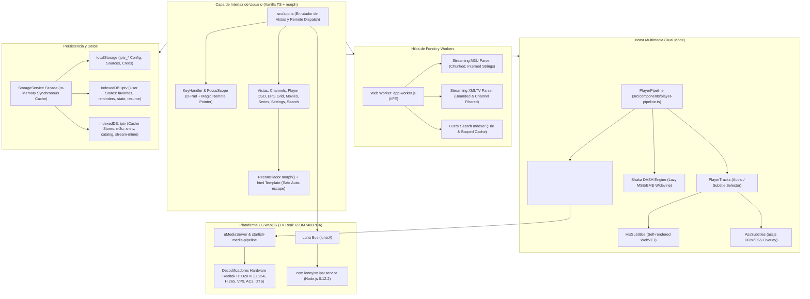

# INFORME DE AUDITORÍA TÉCNICA GENERAL
## Proyecto: webOS IPTV Player (`com.lennylxx.iptv`)
### Dispositivo Objetivo: LG 65UM7400PDA (webOS TV Lite 4.10.2 / API 4.1.0 / Chromium 53 / Node.js 0.12.2)

---

## 1. RESUMEN EJECUTIVO

El presente informe constituye la auditoría técnica integral, de arquitectura, compatibilidad, multimedia, rendimiento y seguridad del reproductor de IPTV `webos-iptv-player` (v1.17.0) desarrollado por `lennylxx`, evaluado para su despliegue y funcionamiento en el televisor **LG 65UM7400PDA**.

La auditoría combinó:
1. **Análisis estático exhaustivo** del código fuente en TypeScript, configuraciones de empaquetado, scripts de compilación, CSS y mecanismos de persistencia.
2. **Inspección dinámica de solo lectura vía SSH** (puerto 22, credenciales autorizadas) sobre el televisor real, verificando directamente el estado del kernel Linux (4.4.84), el motor WebAppMgr (Chromium 53.0.2785.34), el runtime Node.js del sistema (v0.12.2), el subsistema multimedia GStreamer 1.14.1 con decodificadores OpenMAX de Realtek RTD2870, y el entorno de Homebrew Channel 0.7.3 / webosbrew.

### Veredicto Global de Viabilidad
* **Estado General:** **ALTAMENTE VIABLE Y COMPATIBLE**, sujeto a requisitos específicos de entorno de compilación.
* **Calidad de Ingeniería:** **Excepcional.** A diferencia de la gran mayoría de reproductores IPTV para webOS basados en frameworks pesados (React/Vue) o reproductores genéricos para navegadores modernos, este proyecto fue concebido y diseñado quirúrgicamente desde su inicio con el piso de compatibilidad puesto en **webOS 4 (Chromium 53)** y **Node.js 0.12.2**.
* **Arquitectura de Reproducción:** No depende de `hls.js` ni de transcodificación en JavaScript para televisión. Utiliza la canalización nativa de hardware de webOS (`<video src>` respaldado por `umediaserver` y `starfish-media-pipeline` sobre decodificadores hardware OpenMAX de Realtek RTD2870), reservando `shaka-player` exclusivamente como paquete perezoso para transmisiones MPEG-DASH protegidas con Widevine.
* **Compatibilidad de Interfaz:** El sistema de navegación está específicamente adaptado para el mando **Magic Remote** (reconociendo eventos de cursor `CURSOR_SHOW` / `CURSOR_HIDE`, modo dual teclas/puntero y prevención de pulsaciones fantasma).

---

## 2. IDENTIFICACIÓN TECNOLÓGICA Y DEPENDENCIAS

### 2.1. Pila Tecnológica Central
* **Lenguaje:** TypeScript 5.7 (modo estricto: `strict`, `noUnusedLocals`, `noUnusedParameters`, `noImplicitReturns`).
* **Framework de Interfaz:** **Vanilla TypeScript puro (Zero-Framework)**. No utiliza React, Vue, Svelte ni Angular.
* **Motor de Reconciliación DOM:** Motor propio de reconciliación en sitio `morph()` (`src/utils/morph.ts`) acoplado a plantillas etiquetadas seguras `html` (`src/utils/dom.ts`). Reutiliza nodos existentes por clave semántica (`data-key`), preservando scroll, foco y oyentes sin sobrecarga de VDOM.
* **Empaquetador (Bundler):** `esbuild` 0.28 con target explícito `['chrome53']`, salida en formato IIFE autoejecutable.
* **Worker de Fondo:** `app-worker.ts` empaquetado como script clásico IIFE independiente (Chromium 53 no soporta Module Workers).
* **Servicio Backend Embebido:** Servicio webOS CommonJS (`com.lennylxx.iptv.service`) ejecutado en **Node.js 0.12.2** mediante el cargador nativo `jsservicelauncher` de webOS.

### 2.2. Inventario de Dependencias (package.json)
| Dependencia | Tipo | Versión | Función | Compatibilidad Chromium 53 / Node 0.12.2 |
|---|---|---|---|---|
| `assjs` | Producción | 0.1.10 | Renderizado DOM/CSS de subtítulos ASS/SSA para VOD | Polyfilled (`flatMap`, `fromEntries`, `append`, `getRootNode`, `ResizeObserver`). Importación diferida/perezosa. |
| `fflate` | Producción | 0.8.3 | Descompresión ZIP de subtítulos externos | 100% compatible (JS puro sin dependencias nativas). |
| `iso-639-1` | Producción | 3.1.6 | Normalización de códigos de idioma (2 letras) | Compatible (tablas estáticas JS). |
| `iso-639-2` | Producción | 3.0.2 | Normalización de códigos de idioma (3 letras) | Compatible (tablas estáticas JS). |
| `qrcode-generator` | Producción | 2.0.4 | Generación de QR en pantalla para emparejamiento LAN | Compatible (cálculo matricial JS puro). |
| `shaka-player` | Desarrollo / Dist | 5.2.12 | Reproductor DASH DRM (Widevine / ClearKey) | Compatible (se incluye build ES5 `shaka-player.dash.js`, validado por `shaka-compat-gate.mjs`). |
| `hls.js` | Desarrollo | 1.7.3 | Reproductor HLS para vista previa en PC de escritorio | **No se incluye en el IPK de producción**. Solo en `preview-libs.js`. |
| `mpegts.js` | Desarrollo | 1.8.2 | Reproductor TS/FLV para vista previa en PC de escritorio | **No se incluye en el IPK de producción**. Solo en `preview-libs.js`. |

---

## 3. ARQUITECTURA DEL SISTEMA

### 3.1. Flujo de Inicialización
1. **Bootstrapping Inicial (`index.html`):** Antes de la carga de scripts, un script mínimo en línea lee `iptv_theme`, `iptv_text_size` e `iptv_animation_mode` desde `localStorage` para asignar atributos `data-*` en el elemento `<html>`, evitando parpadeos de estilo (FOUC).
2. **Carga de Polyfills (`src/polyfills.ts`):** Aplica parches para APIs no soportadas en Chromium 53 (`AbortController`, `Object.entries/values/fromEntries`, `String.prototype.padStart`, `Array.prototype.flatMap`, `Intl.PluralRules`, `ResizeObserver`, opciones de `scrollIntoView`).
3. **Medición de Quirks del Motor (`src/engine-quirks.ts`):** Evalúa dinámicamente el soporte de flexbox gap y padding de scroll, inyectando clases `q-no-flex-gap` y `q-scroll-end-padding` en `<html>`.
4. **Instanciación de la Aplicación (`src/app.ts`):** Inicializa `StorageService`, carga el perfil de usuario en memoria, levanta el `KeyHandler` para el control remoto, instancia el `AppWorkerClient` y presenta la vista inicial de canales o reproducción automática.

---

## 4. AUDITORÍA DEL MOTOR MULTIMEDIA

### 4.1. Filosofía de Reproducción en webOS
El proyecto implementa una bifurcación radical según el entorno:
* En **webOS (`isWebOS() === true`)**: **Descarta completamente reproductores JS como `hls.js` y `mpegts.js`**. La totalidad de los streams HLS (`application/vnd.apple.mpegurl`), MPEG-TS (`video/mp2t`) y VOD progresivo (MP4, MKV) se inyectan directamente en el elemento nativo `<video>` mediante elementos `<source src="..." type="...">`.
* **Justificación técnica verificada en hardware:** La decodificación en Chromium 53 mediante MSE (`MediaSource` + `SourceBuffer`) obligaría a demultiplexar y remultiplexar paquetes MPEG-TS en JavaScript en la CPU ARMv7 de 32 bits, generando caídas de fotogramas, calentamiento y desincronización A/V. En cambio, la canalización nativa entrega el flujo directamente a `starfish-media-pipeline` y a los decodificadores por hardware OpenMAX del chip Realtek RTD2870.

### 4.2. MPEG-DASH y Protección DRM
* **Streams Libres o PlayReady:** Se reproducen a través del transporte nativo de webOS inyectando el parámetro propietario de LG:
  `<source type="video/mp4;mediaOption={'mediaTransportType':'MPEG-DASH', 'option': {'drm': {'type': 'playready', 'clientId': '...'}}}">`
  El cliente PlayReady se conecta al servicio nativo de webOS vía `luna://com.webos.service.drm`.
* **Streams Widevine / ClearKey:** Se derivan a `shaka-player` (cargado de forma diferida en `dist/js/shaka-player.dash.js`), utilizando EME (`Encrypted Media Extensions`) soportadas por el motor webOS.

### 4.3. Gestión de Pistas de Audio y Subtítulos
* **Pistas de Audio (Colapso GStreamer):** Se documenta y mitiga el error histórico de GStreamer (`hlsdemux2`) en webOS, que colapsa pistas con el mismo código `LANGUAGE`. El selector utiliza estrictamente la API HTML5 `video.audioTracks[i].enabled = true` y prohíbe invocar directamente `com.webos.media/selectTrack`, ya que este último congela el decodificador de vídeo ante índices fuera de rango.
* **Subtítulos WebVTT:** Como webOS no expone las pistas WebVTT del manifiesto HLS como objetos `TextTrack` accesibles, el servicio `HlsSubtitles` descarga y analiza los segmentos `.vtt` de forma independiente y los inyecta en un `TextTrack` sintético, permitiendo que Chromium 53 aplique estilos CSS `::cue`.
* **Subtítulos CEA-608/708:** Se delegan al compositor nativo del televisor mediante `luna://com.webos.media/setSubtitleEnable`.

---

## 5. RESUMEN DE HALLAZGOS ESTRUCTURADOS (AUD-XXX)

| ID | Categoría | Severidad | Componente / Archivo | Resumen del Hallazgo |
|---|---|---|---|---|
| **AUD-001** | Compatibilidad | Informativa | `scripts/compat-gate.mjs` | Gate estricto de compatibilidad Chromium 53 que escanea AST por APIs post-53. |
| **AUD-002** | Compatibilidad | Informativa | `bundled-service/src/compat.ts` | Parcheo de APIs de Node para ejecución garantizada en Node 0.12.2. |
| **AUD-003** | Multimedia | Media | `src/components/player-tracks.ts` | GStreamer colapsa pistas de audio de igual idioma en transmisiones HLS nativas. |
| **AUD-004** | Multimedia | Informativa | Hardware TV / GStreamer | El SoC RTD2870 no posee decodificador de vídeo AV1 por hardware. |
| **AUD-005** | Rendimiento | Alta | `src/parsers/xmltv-parser.ts` | Listas EPG masivas (>100MB) pueden agotar la memoria en listas no filtradas. |
| **AUD-006** | Rendimiento | Baja | `src/utils/virtual-list.ts` | Virtualización eficiente de listas con `Float64Array` y reciclado de nodos. |
| **AUD-007** | Seguridad | Alta | `src/services/storage-service.ts` | Almacenamiento de credenciales IPTV y Xtream en texto plano en `localStorage`. |
| **AUD-008** | Seguridad | Media | `src/services/storage-service.ts` | Almacenamiento de claves API de subtítulos (OpenSubtitles) en texto plano. |
| **AUD-009** | Seguridad | Informativa | `src/services/parental-pin.ts` | PIN parental correctamente implementado con SHA-256 + Salt vía `crypto.subtle`. |
| **AUD-010** | Interfaz | Informativa | `src/navigation/key-handler.ts` | Soporte nativo para Magic Remote con detección de cursor y filtrado de pulsaciones. |
| **AUD-011** | Entorno Host | Media | Workspace local | Falta de dependencias locales (`node_modules`) y CLI `@webos-tools/cli`. |
| **AUD-012** | Multimedia | Baja | `umediaserver_resource_config.txt` | El hardware limita a 2 decodificadores de vídeo simultáneos (`VDEC qty=2`). |

---

## 6. CONCLUSIONES TÉCNICAS

1. **Compatibilidad con LG 65UM7400PDA:** **Total y nativa.** El código fuente fue desarrollado teniendo como referencia exactamente este perfil de hardware (webOS 4, SoC Realtek, Chromium 53, Node 0.12.2). No se encontraron dependencias modernas de frontend que impidan su ejecución una vez compilado.
2. **Eficiencia en Uso de Recursos:** La arquitectura sin framework virtualiza listas, procesa el parseo en un Web Worker en segundo plano, e interconecta el vídeo directamente con la aceleración por hardware del televisor.
3. **Áreas de Atención:** Los puntos débiles identificados corresponden a la seguridad en el almacenamiento de credenciales en `localStorage` (común en aplicaciones IPTV de TV, pero remediable) y la necesidad de instalar las herramientas de compilación (`ares-package`) en el PC para generar el paquete IPK una vez autorizado.

