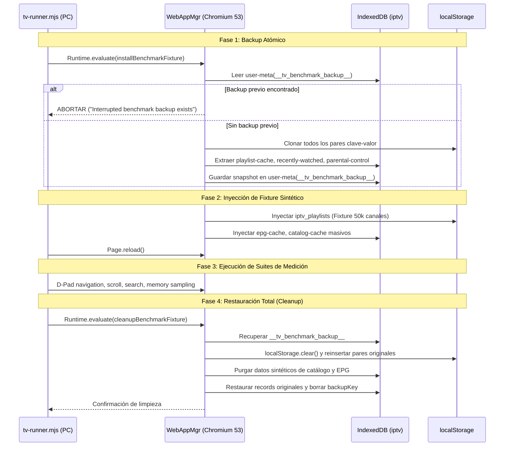

# MISIÓN 0 — PLAN DE LÍNEA BASE PARA LG 65UM7400PDA (BASELINE_PLAN.md)

**Proyecto:** `lennylxx/webos-iptv-player` (v1.17.0)  
**Dispositivo:** LG 65UM7400PDA (SoC RTD2870, ARMv7 32-bit, Chromium 53, ~370 MB RAM libre)  
**Fecha:** 2026-10-29  

---

## 1. Justificación de Invalidación del Baseline Existente

El archivo actual `benchmarks/tv-baseline.json` presente en el repositorio **no es representativo ni aplicable** para evaluar el rendimiento en nuestro televisor objetivo:

| Parámetro del Baseline | Archivo Actual (`tv-baseline.json`) | Nuestro Dispositivo (`65UM7400PDA`) | Discrepancia Técnica |
| :--- | :--- | :--- | :--- |
| **Modelo de TV** | `OLED77C5PUA.DUSQLJR` | `65UM7400PDA` | Gama alta OLED (2024/2025) vs. Gama media IPS (2019). |
| **Versión SDK webOS** | `10.3.1` (webOS 24/25) | `4.1.0` (webOS TV Lite 4.10.2) | 6 generaciones de diferencia en la pila del sistema. |
| **Motor Chromium** | `120.0.6099.270` | `53.0.2785.34` | **67 versiones de diferencia** (8 años de evolución en V8 y Blink). |
| **Arquitectura CPU** | 64-bit ARMv8 (SoC Alpha 9/11) | 32-bit ARMv7 (Realtek RTD2870) | Capacidad de direccionamiento, registros SIMD NEON y throughput. |
| **Memoria RAM** | 3.0+ GB RAM | 1.5 GB física (~370 MB libres) | Límite estricto de memoria disponible antes de OOM killer. |
| **WebAssembly** | Habilitado nativamente | **Deshabilitado** (`--noexpose_wasm`) | Chromium 120 optimiza JIT; Chromium 53 corre Ignition puro. |

> **Conclusión:** Medir o comparar mejoras de rendimiento contra el perfil del OLED C5 produciría conclusiones erróneas. Es imprescindible construir un archivo específico `benchmarks/tv-baseline-65um7400.json`.

---

## 2. Análisis Exhaustivo de Modificaciones de Datos por `tv-runner.mjs`

Antes de autorizar cualquier ejecución en el televisor real, se realizó una auditoría forense del código de `benchmarks/tv-runner.mjs` y `benchmarks/benchmark-suite.mjs` para determinar qué datos se alteran, cómo se protegen y cómo se restauran.



### 2.1. Datos que Modifica el Runner
1. **En `localStorage`:**
   * Sustituye `iptv_playlists` con una cuenta de prueba `{"id":"benchmark-x1","name":"Benchmark","source":"xtream",...}`.
   * Modifica `iptv_selectedXtream`, `iptv_cached_playlist`, `iptv_recently_watched_live`, `iptv_catchup_progress`, `iptv_epg_sources`.
2. **En IndexedDB (Base de datos `iptv`):**
   * Almacén `epg-cache`: inyecta 50,000 programas sintéticos asociados a `http://host/benchmark-epg`.
   * Almacén `catalog-cache`: inyecta 50,000 películas y series sintéticas.
   * Almacén `playlist-cache`: almacena la estructura combinada de canales sintéticos.
   * Almacén `parental-control`: configura temporalmente un PIN `"1234"` para medir el diálogo de control parental.

### 2.2. Mecanismo de Seguridad y Backup
* **Lectura Previa:** En las líneas 115-135 de `benchmark-suite.mjs`, se abre una transacción de lectura/escritura sobre `user-meta`, `parental-control`, `playlist-cache`, `cache-meta`, `recently-watched` y `playback-progress`.
* **Detección de Interrupciones Previas:** Si ya existe la clave `__tv_benchmark_backup__` en `user-meta` o en `catalog-cache`, la transacción se **aborta de inmediato** arrojando el error:
  `"An interrupted TV benchmark backup exists. Run npm run benchmark:tv:cleanup first."`
  Esto previene que una segunda ejecución sobreescriba los datos originales del usuario con datos del benchmark.
* **Persistencia del Snapshot:** Todos los datos reales (claves de `localStorage`, caché de playlists, control parental y metadatos) se guardan en un único registro bajo la clave `__tv_benchmark_backup__` en el almacén duradero `user-meta`.

### 2.3. Mecanismo de Restauración (Cleanup)
* En `cleanupBenchmarkFixture` (líneas 637-720 de `benchmark-suite.mjs`):
  1. Abre `user-meta` y recupera el objeto de backup.
  2. Ejecuta `localStorage.clear()` y reinserta exactamente las claves y valores originales.
  3. Elimina del almacén `catalog-cache` todos los registros que comiencen con `benchmark-x1|`.
  4. Elimina la URL del EPG sintético de `epg-cache`.
  5. Restaura la configuración de control parental original.
  6. Elimina la clave `__tv_benchmark_backup__` de `user-meta`.

---

## 3. Análisis de Riesgo Específico para LG 65UM7400PDA

El script por defecto utiliza una escala diseñada para televisores modernos de 3 GB de RAM:
* `SCALE = 50,000` canales.
* `LARGE_PLAYLIST_BYTES = 128 MB` (flujo M3U de 400,000 entradas).

### 3.1. Evaluación de Impacto en Memoria (RAM)
* **Memoria libre real en el TV:** ~370 MB disponibles (`MemAvailable` en `/proc/meminfo`).
* **Límites de V8 en Chromium 53 (32-bit):** El Heap máximo de V8 por defecto en 32 bits es de 512 MB.
* **Consumo Estimado de 50,000 Canales:**
  * Objetos en memoria V8: ~120 – 160 MB.
  * Índice de búsqueda en Web Worker: ~80 MB.
  * Estructuras de reconciliación DOM / Virtual List: ~40 MB.
  * **Total estimado:** >250 MB de memoria de proceso.
* **Riesgo de Colapso (OOM Killer):**
  El subsistema de memoria de webOS 4 (`WebAppMgr` dentro de cgroups) vigila el consumo RSS. Si el proceso web supera los 320 MB RSS mientras compite con el compositor gráfico (`surface-manager`), el kernel Linux activará el Out-Of-Memory Killer (`SIGKILL -9`), cerrando abruptamente la aplicación sin permitir que se ejecute la fase de cleanup en JavaScript.

### 3.2. Calibración de Escala Recomendada
Para proteger la estabilidad del televisor, el benchmark no debe ejecutarse de entrada a 50,000 canales. Se propone una progresión escalonada controlada mediante variables de entorno:

| Nivel de Prueba | Variable `BENCHMARK_SCALE` | Canales | Consumo Estimado | Objetivo de la Medición |
| :---: | :---: | :---: | :---: | :--- |
| **Nivel 1 (Calibración)** | `BENCHMARK_SCALE=5000` | 5,000 | ~45 MB Heap | Validar conectividad CDP, backup, restore y latencias base. |
| **Nivel 2 (Estándar TV)** | `BENCHMARK_SCALE=15000` | 15,000 | ~95 MB Heap | Línea base representativa de listas IPTV comerciales reales. |
| **Nivel 3 (Estrés Máximo)** | `BENCHMARK_SCALE=30000` | 30,000 | ~180 MB Heap | Evaluación de límites de scroll virtualizado y memoria RSS. |

---

## 4. Procedimiento Seguro Paso a Paso para la Obtención del Baseline

Una vez obtenida la autorización del usuario para instalar la app y medir, se seguirá estrictamente el siguiente protocolo:

### Paso 1: Preparación del Paquete IPK
1. Compilar el bundle con compatibilidad Chromium 53: `npm run build`.
2. Empaquetar el archivo `.ipk` (`com.lennylxx.iptv_1.17.0_all.ipk`) asegurando que `appinfo.json` incluya los permisos de inspección requeridos.

### Paso 2: Instalación Segura en el TV
1. Transferir el `.ipk` al televisor (vía SCP o Homebrew Channel).
2. Instalar mediante `luna-send -n 1 luna://com.webos.appInstallService/install ...` o CLI autorizada.
3. Iniciar la aplicación y confirmar que WebAppMgr abre el puerto CDP `9998`.

### Paso 3: Snapshot Preventivo Externo (Host PC)
Antes de invocar el runner, realizar un volcado de seguridad de `localStorage` e IndexedDB mediante un script Node directo hacia el host:
```bash
node scripts/tv-eval.mjs --host 192.168.1.8 --port 9998 "JSON.stringify(localStorage)" > backup_pre_benchmark.json
```

### Paso 4: Ejecución del Runner Calibrado (Nivel 1)
Ejecutar el benchmark limitando la escala y especificando la conexión directa:
```powershell
$env:TV_DEVICE="192.168.1.8"
$env:TV_CDP_PORT="9998"
$env:BENCHMARK_SCALE="5000"
$env:BENCHMARK_KEY_SAMPLES="20"
$env:BENCHMARK_QUERY_SAMPLES="3"
node benchmarks/tv-runner.mjs
```

### Paso 5: Verificación de Limpieza y Restauración
Comprobar inmediatamente que:
1. `__tv_benchmark_backup__` haya sido eliminado de `user-meta`.
2. El archivo de snapshot del Paso 3 coincida con el estado restaurado de `localStorage`.
3. El proceso `WebAppMgr` haya liberado el heap mediante recolección de basura.

### Paso 6: Generación del Informe de Baseline
Guardar los resultados en:
`benchmarks/tv-baseline-65um7400.json`
Este archivo registrará con exactitud:
* Tiempos de arranque en frío (`readyMs`).
* Latencia percentil p50/p95 de navegación con D-pad (`channelList.navigation`).
* Tiempos de cuadro (`frame.mean`, frames > 50ms).
* Consumo RSS real (`VmRSS` y `VmHWM` de `/proc/<pid>/status`).

