# MISIÓN 0 — REGISTRO DE BLOQUEOS Y LIMITACIONES (KNOWN_BLOCKERS.md)

**Proyecto:** `lennylxx/webos-iptv-player` (v1.17.0)  
**Dispositivo Objetivo:** LG 65UM7400PDA (192.168.1.8)  
**Host:** Windows 11 Pro / Node.js v24.18.0 / npm 11.16.0  
**Fecha:** 2026-10-29  

---

## 1. Inventario Consolidado de Bloqueos

Se ha categorizado cada limitación técnica identificada durante la Misión 0, detallando su impacto operativo, severidad y la vía de resolución o mitigación correspondiente.

```mermaid
graph TD
    subgraph HostBlockers["Bloqueos en Host (Windows 11)"]
        B1["B-01: Falta webOS CLI (ares-*)"]
        B2["B-02: tv.sh depende de Bash y expect"]
        B3["B-03: service:smoke bloqueado en win32"]
        B4["B-04: Binarios Playwright ausentes"]
        B5["B-05: 4 fallos en vitest por CRLF/POSIX"]
    end

    subgraph TVBlockers["Bloqueos en TV (LG 65UM7400PDA)"]
        B6["B-06: com.lennylxx.iptv no instalada"]
        B7["B-07: Memoria libre limitada (~370 MB)"]
        B8["B-08: WASM deshabilitado en Chromium 53"]
        B9["B-09: Límite de decodificadores (VDEC=2)"]
        B10["B-10: Carencia de decodificador AV1"]
    end

    B1 -.->|Mitigación| M1["Usar flags directas --host y --port en scripts"]
    B2 -.->|Mitigación| M2["Ejecutar comandos SSH vía PuTTY plink"]
    B3 -.->|Mitigación| M3["Validar servicio directamente en Node 0.12 del TV"]
    B4 -.->|Mitigación| M4["Ejecutar npx playwright install chromium tras autorización"]
    B6 -.->|Mitigación| M5["Fase siguiente: Empaquetar e instalar IPK"]
    B7 -.->|Mitigación| M6["Calibrar benchmark a 5k/15k canales"]
```

---

## 2. Bloqueos en el Host de Desarrollo (PC Local)

### Bloqueo B-01: Ausencia de `ares-cli` (`@webos-tools/cli`)
* **Severidad:** Media (Afecta ergonomía de scripts, no bloquea compilación).
* **Evidencia:** `ares-setup-device -F -j` falla con `El término 'ares-setup-device' no se reconoce...`.
* **Impacto:** Los módulos `scripts/cdp-client.mjs` y `benchmarks/tv-runner.mjs` no pueden autodescubrir la IP del TV si no se pasan variables de entorno explícitas.
* **Mitigación Verificada:** Pasar explícitamente `--host 192.168.1.8 --port 9998` en las llamadas a utilidades Node, o definir `$env:TV_DEVICE="192.168.1.8"`.
* **Acción Definitiva Recomendada:** Instalar `@webos-tools/cli` globalmente en el host: `npm install -g @webos-tools/cli`.

### Bloqueo B-02: Dependencia de Bash y `expect` en `scripts/tv.sh`
* **Severidad:** Media.
* **Evidencia:** `scripts/tv.sh` invoca `expect scripts/tv-ssh.exp`. En Windows CMD/PowerShell, `expect` no está instalado.
* **Impacto:** Comandos como `./scripts/tv.sh run` o `./scripts/tv.sh push` no funcionan de forma nativa en PowerShell.
* **Mitigación Verificada:**
  * Para comandos CDP (`logs`, `eval`, `perf`, `diag`): Invocar directamente `node scripts/tv-*.mjs --host 192.168.1.8`.
  * Para comandos de inspección en el TV: Invocar `plink.exe -P 22 -pw <redacted> root@192.168.1.8 "<comando>"`.

### Bloqueo B-03: Incompatibilidad de `npm run service:smoke` con Plataforma `win32`
* **Severidad:** Baja (Afecta solo a la prueba sintética de humo del microservicio).
* **Evidencia:**
  1. `service:build` invoca `rm -rf build/bundled-service` (`rm` no existe en CMD).
  2. `scripts/run-service-smoke.mjs` lanza excepción: `Service runtime smoke is unavailable for win32/x64`. Solo dispone de binarios descargables para `darwin-arm64` y `linux-x64`.
* **Impacto:** No se puede ejecutar el smoke test del servicio Node 0.12.2 localmente en Windows.
* **Mitigación Verificada:**
  * El tipado estricto TS de `bundled-service` pasó al 100% (`npm run service:typecheck` exit code `0`).
  * El televisor LG cuenta con `/usr/bin/node v0.12.2` nativo en ARMv7 donde el servicio puede ser verificado in situ.

### Bloqueo B-04: Binarios de Navegador Playwright Ausentes
* **Severidad:** Media (Bloquea E2E y benchmark de escritorio en PC).
* **Evidencia:** Error `browserType.launch: Executable doesn't exist at C:\Users\amaur\AppData\Local\ms-playwright\chromium_headless_shell-1243\...`.
* **Impacto:** `npm run test:e2e` y `npm run benchmark` no pueden lanzar instancias headless.
* **Mitigación / Solución:** Requiere ejecutar `npx playwright install chromium` una vez autorizado por el usuario.

### Bloqueo B-05: 4 Pruebas Unitarias Fallidas en `npm test` por Portabilidad Windows/POSIX
* **Severidad:** Baja (El 100% del código de la aplicación en `src/` pasó; 3,402 pruebas superadas).
* **Evidencia:**
  * `css-transforms.test.mjs`: Fallo por saltos de línea CRLF (`\r\n`) en Windows frente a LF en test.
  * `eslint-focus-rules.test.mjs`: `SUPPRESSION.exec()` falla por trailing `\r` al final de la línea.
  * `tv-diag.test.mjs`: Hardcoded `/bin/sh` no existe en Windows.
  * `tv-input.test.mjs`: Permiso POSIX octal `0o600` no soportado en NTFS (devuelve `438` = `0o666`).
* **Mitigación:** Ejecutar Git con `core.autocrlf false` o ejecutar las pruebas en WSL2/Linux.

---

## 3. Bloqueos en el Televisor Objetivo (LG 65UM7400PDA)

### Bloqueo B-06: Aplicación `com.lennylxx.iptv` no Instalada en el TV
* **Severidad:** Alta (Impide ejecutar la medición de baseline en el TV de inmediato).
* **Evidencia:** En `/media/developer/apps/usr/palm/applications/` solo está presente `org.webosbrew.hbchannel`. El puerto CDP `9998` no tiene expuesta ninguna instancia de la app.
* **Impacto:** `benchmarks/tv-runner.mjs` no puede conectarse ni ejecutar mediciones en el dispositivo.
* **Mitigación / Próximo Paso:** Concluir la Misión 0 documentando el estado actual, empaquetar el IPK y solicitar autorización explícita para la instalación y primera ejecución en la Misión 1.

### Bloqueo B-07: Ventana Estricta de Memoria RAM (~370 MB Disponibles)
* **Severidad:** Alta para Benchmarks no Calibrados.
* **Evidencia:** `/proc/meminfo` reporta `MemAvailable: 370,120 kB`. Límite de hardware 1.5 GB total compartido con GPU/VPU.
* **Impacto:** Ejecutar el benchmark por defecto (`BENCHMARK_SCALE=50000` canales + stream de 128 MB) provocaría la terminación inmediata del proceso por el kernel Linux (`Out of memory: Kill process WebAppMgr`).
* **Mitigación:** Calibrar `BENCHMARK_SCALE=5000` para la primera medición de línea base y escalar gradualmente a 15,000 canales.

### Bloqueo B-08: WebAssembly (WASM) Físicamente Deshabilitado en el TV
* **Severidad:** Arquitectónica.
* **Evidencia:** `/proc/<pid>/cmdline` de `WebAppMgr` contiene `--noexpose_wasm`.
* **Impacto:** Ningún componente de la aplicación ni dependencias externas pueden utilizar WebAssembly. Toda la lógica de indexación, deserialización y reproducción debe operar en JavaScript puro compatible con Chromium 53.

### Bloqueo B-09: Límite de Recursos de Decodificación de Hardware (`VDEC qty = 2`)
* **Severidad:** Multimedia.
* **Evidencia:** `/etc/umediaserver/umediaserver_resource_config.txt` restringe la concurrencia a 2 pipelines simultáneos.
* **Impacto:** No es posible implementar pre-buffering agresivo de canales de fondo ni vistas multiview simultáneas de más de 2 señales sin agotar los decodificadores OpenMAX del SoC.

### Bloqueo B-10: Carencia de Decodificador de Hardware para AV1
* **Severidad:** Multimedia.
* **Evidencia:** Inspección de bibliotecas `/usr/lib/libomx*.so`. Soporte exclusivo para AVC/H.264, HEVC/H.265, VP9 y MPEG-2.
* **Impacto:** Cualquier canal IPTV o VOD codificado en formato AV1 no podrá reproducirse en este televisor (la decodificación por software en CPU colapsaría los núcleos ARM Cortex-A53).

---

## 4. Estado de Preparación para la Siguiente Fase

| Requisito | Estado | Observación |
| :--- | :---: | :--- |
| **Copia de trabajo aislada** | **LISTA** | Rama `baseline/mission-0` activa y limpia. |
| **Dependencias instaladas** | **LISTA** | `npm ci` reproducible verificado. |
| **Compilación verificada** | **LISTA** | `npm run build` exitoso con gate Chromium 53. |
| **Diagnóstico de TV documentado** | **LISTO** | Vías directas CDP e inspección SSH mapeadas. |
| **Plan de Baseline definido** | **LISTO** | Fixture calibrado a 5k canales para evitar OOM. |
| **Autorización de instalación** | **PENDIENTE** | Esperando instrucciones del usuario para avanzar. |

