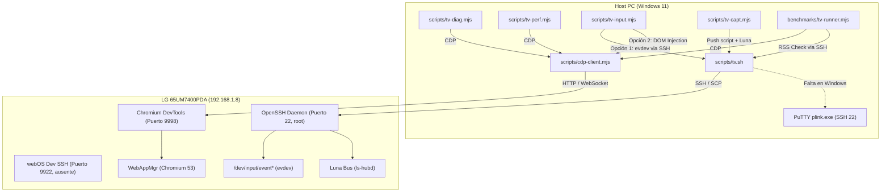

# MISIÓN 0 — INFRAESTRUCTURA DE DIAGNÓSTICO DEL TV (TV_DEBUG_INFRASTRUCTURE.md)

**Proyecto:** `lennylxx/webos-iptv-player` (v1.17.0)  
**Dispositivo Objetivo:** LG 65UM7400PDA (IP: 192.168.1.8)  
**Fecha:** 2026-10-29  

---

## 1. Arquitectura del Sistema de Diagnóstico del Proyecto

El repositorio cuenta con una sofisticada suite de diagnóstico, perfilado y automatización ubicada en `scripts/` y `benchmarks/`. A continuación se detalla la función de cada herramienta, sus dependencias y su mecanismo de transporte:



### 1.1. Inspección Componente por Componente

#### `scripts/tv.sh` (Despachador Maestro)
* **Función:** Script en Bash que actúa como interfaz unificada de línea de comandos para interactuar con el TV.
* **Comandos Soportados:** `run`, `push`, `pull`, `shell`, `reboot`, `logs`, `eval`, `perf`, `diag`, `capt`, `input`.
* **Mecanismo de Despacho:**
  * Para `logs`, `eval`, `perf`, `diag`, `capt`, `input`: transfiere la ejecución inmediatamente a los scripts Node correspondientes (`tv-logs.mjs`, `tv-eval.mjs`, etc.).
  * Para operaciones SSH (`run`, `push`, `pull`, `shell`, `reboot`): extrae los datos de conexión llamando a `ares-setup-device -F -j` y orquesta scripts en lenguaje `expect` (`scripts/tv-ssh.exp`, `scripts/tv-scp.exp`).
* **Bloqueo en Windows:** Depende de sintaxis POSIX Bash y de utilidades ausentes nativamente en Windows (`ares-setup-device`, `expect`, rutas de control socket `/tmp/webos-tv-%C`).

#### `scripts/cdp-client.mjs` (Controlador Central de CDP)
* **Función:** Biblioteca cliente para interactuar con el Chrome DevTools Protocol de WebAppMgr.
* **Descubrimiento de Objetivos (`resolveCdpTarget`):** Consulta el endpoint HTTP `http://<host>:<port>/json/list` para obtener la lista de páginas inspeccionables y su `webSocketDebuggerUrl`.
* **Resolución de IP (`resolveConfiguredDeviceIp`):**
  * Intenta ejecutar `ares-setup-device -F -j`. Si falla, arroja el error: `TV device configuration failed: cannot resolve device IP from ares-setup-device`.
* **Capacidad Directa:** Si se le pasa explícitamente el parámetro `--host <ip>` y `--port <port>` (o `url`), **no invoca `ares-setup-device`**, permitiendo conexión directa sobre TCP.

#### `scripts/tv-diag.mjs` (Generador de Informes de Diagnóstico)
* **Función:** Captura un informe integral en arranque en frío: logs de consola, eventos de red, contadores de rendimiento, información de hardware y sondeo de red nativo.
* **Redacción de Seguridad:** Implementa `DiagnosticRedactor` para eliminar credenciales, tokens y nombres reales de canales.
* **Opciones de Conexión:** Acepta `--host` y `--port` (por defecto `9998`), permitiendo conectarse directamente al televisor sin necesidad de `ares-inspect`.

#### `scripts/tv-perf.mjs` (Monitor de Rendimiento Headless)
* **Función:** Monitorea métricas en tiempo real: tamaño del Heap de V8, nodos DOM en memoria, frames renderizados, recolecciones de basura (`HeapProfiler.collectGarbage`) y perfiles de CPU.
* **Conectividad:** Acepta `--host 192.168.1.8 --port 9998 --app com.lennylxx.iptv`.

#### `scripts/tv-capt.mjs` (Captura de Pantalla y Video)
* **Función:** Captura la imagen del framebuffer o graba secuencias de video de la interfaz del televisor.
* **Mecanismo:** Copia un script temporal `tv-capt-remote.js` al TV mediante `tv.sh push` y lo ejecuta con `/usr/bin/node` en el televisor. Este script interactúa localmente con el servicio del bus Luna `com.webos.service.capture`.
* **Requisito en TV:** Acceso de escritura temporal en `/tmp` del televisor y disponibilidad del servicio de captura del sistema.

#### `scripts/tv-input.mjs` (Emulador de Control Remoto / D-Pad)
* **Función:** Inyecta pulsaciones de teclas del Magic Remote (Up, Down, Left, Right, OK, Back, Colores, etc.) y desplazamientos de rueda.
* **Dos Modos de Operación:**
  1. **Backend `evdev` (por defecto):** Escribe eventos directamente en `/dev/input/event*` usando la utilidad remota vía SSH. Simula el hardware real del Magic Remote a nivel de kernel.
  2. **Backend `--cdp`:** Inyecta eventos DOM sintéticos (`Input.dispatchKeyEvent`) a través del protocolo CDP sin requerir permisos de escritura en `/dev/input`.
* **Soporte Wake-on-LAN:** Envía Magic Packets para encendido remoto.

#### `benchmarks/tv-runner.mjs` (Orquestador del Benchmark de TV)
* **Función:** Conecta vía CDP con la aplicación instalada en el TV, inyecta el fixture en memoria, mide latencias de navegación D-pad, scroll virtualizado, búsqueda y renderizado de guía EPG, y restaura el estado original.
* **Mecanismo de Métricas:**
  * Latencias de JS y tiempos de renderizado: medidos internamente en Chromium vía `performance.now()` y `requestAnimationFrame`.
  * Memoria del proceso del TV: mide el consumo real de RSS (`VmRSS` y `VmHWM` de `/proc/<pid>/status`) ejecutando un comando shell en el TV vía `tv.sh run`.

---

## 2. Diferenciación Rigurosa de Canales de Acceso al Televisor

Es fundamental distinguir la naturaleza, privilegios y propósito de cada canal de comunicación con el televisor LG:

| Canal / Servicio | Puerto | Autenticación / Privilegios | Propósito Técnico | Estado en el TV Objetivo |
| :--- | :---: | :--- | :--- | :--- |
| **SSH Administrativo** | `22` | Usuario `root` (contraseña) | Acceso completo al sistema operativo Linux, depuración de bajo nivel, lectura de `/proc`, inspección de procesos. | **ACTIVO y FUNCIONAL** (Autorizado exclusivamente en modo solo lectura). |
| **webOS DevMode SSH** | `9922` | Usuario `prisoner` / claves SSH | Canal estándar del SDK oficial de webOS cuando se activa la app Developer Mode de LG. | **NO ACTIVO** (El TV utiliza Homebrew Channel / root directo en puerto 22). |
| **ADB (Android Debug Bridge)** | — | No aplica | Protocolo de depuración exclusivo del ecosistema Android / Android TV. | **INEXISTENTE** en webOS (webOS es Linux embebido con arquitectura OpenEmbedded/Yocto, no Android). |
| **DevTools / CDP** | `9998` | Sin autenticación (Red local) | Chrome DevTools Protocol expuesto por `WebAppMgr`. Permite inspección DOM, consola JS, perfiles de CPU/Heap y ejecución de JavaScript. | **SOPORTADO por WebAppMgr**. Se expone dinámicamente cuando una aplicación web está en ejecución. |
| **`ares-inspect`** | Dinámico | Vía puente SSH o navegador | Utilidad de la CLI de LG que abre un túnel o interfaz web hacia el puerto CDP de la app. | Requiere instalación de `@webos-tools/cli` en el PC. |
| **Bus Luna (`ls-hubd`)** | IPC local | Bus de mensajes interno (`luna://`) | Mecanismo de comunicación inter-procesos para controlar hardware de TV (sintonizador, entradas, pantalla, red, audio). | Accesible desde línea de comandos local (`luna-send`) o desde JS (`window.PalmServiceBridge`). |

---

## 3. Matriz de Dependencias Faltantes y Brechas de Integración

### 3.1. En el Host de Desarrollo (PC con Windows 11)
1. **Falta el paquete `@webos-tools/cli`:**
   * *Síntoma:* Comandos `ares-package`, `ares-install`, `ares-setup-device`, `ares-inspect` no reconocidos.
   * *Impacto:* `scripts/tv.sh` y las funciones automáticas de `cdp-client.mjs` que dependen de `ares-setup-device` fallan de inmediato.
2. **Ausencia de intérprete `expect`:**
   * *Síntoma:* `scripts/tv-ssh.exp` no puede ejecutarse directamente desde PowerShell o CMD.
   * *Impacto:* `tv.sh run` y `tv.sh push` no funcionan bajo el entorno nativo de Windows.
3. **Binarios de Chromium de Playwright ausentes:**
   * *Impacto:* Bloquea la suite local de `test:e2e` y el benchmark local de PC.

### 3.2. En el Televisor (LG 65UM7400PDA)
1. **Aplicación `com.lennylxx.iptv` no presente en ejecución:**
   * *Síntoma:* Una consulta HTTP GET a `http://192.168.1.8:9998/json/list` responde vacío o rechaza la conexión si no hay ninguna app web abierta con flag de depuración.
   * *Condición:* Para que el puerto `9998` exponga el `webSocketDebuggerUrl` de `com.lennylxx.iptv`, el paquete `.ipk` debe estar empaquetado, instalado en el TV y la aplicación debe estar activa en primer plano.

---

## 4. Estrategia Operativa para Superar las Limitaciones de Windows

Para utilizar las capacidades de diagnóstico sin alterar el código original ni violar las restricciones:

1. **Puente CDP Directo por IP:**
   * Los scripts `tv-diag.mjs` y `tv-perf.mjs` admiten `--host 192.168.1.8 --port 9998`. Esto **evita completamente** la invocación de `ares-setup-device`.
2. **Emulación de SSH vía PuTTY `plink`:**
   * En lugar de invocar `tv.sh run`, cualquier lectura de bajo nivel (por ejemplo, muestreo de `VmRSS` en `/proc/<pid>/status`) puede realizarse desde el host mediante:
     ```powershell
     & "C:\Program Files\PuTTY\plink.exe" -P 22 -pw <credencial> root@192.168.1.8 "<comando>"
     ```
3. **Inyección de Entrada vía CDP en lugar de evdev:**
   * El runner de benchmarks y emulador de control remoto puede operar con `--cdp`, desacoplándose de la necesidad de invocar scripts SSH remotos para enviar eventos a `/dev/input`.

