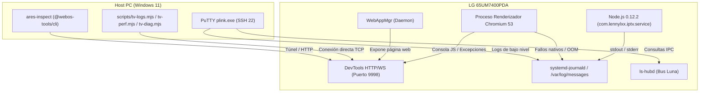

# MISIÓN 1A — INFRAESTRUCTURA Y CAPACIDADES DE DEPURACIÓN (DEBUGGING_READINESS.md)

**Proyecto:** `lennylxx/webos-iptv-player` (v1.17.0)  
**Dispositivo Objetivo:** LG 65UM7400PDA (webOS TV Lite 4.10.2 / API 4.1.0)  
**Fecha:** 2026-10-29  

---

## 1. Mapa de Infraestructura de Depuración en webOS 4

El ecosistema de diagnóstico para este televisor combina el acceso de bajo nivel al sistema operativo Linux mediante SSH con la instrumentación del motor de renderizado `WebAppMgr` a través del Chrome DevTools Protocol (CDP).



---

## 2. Evaluación de Herramientas de Depuración

### 2.1. Chrome DevTools Protocol (CDP) directo en Puerto 9998
* **Protocolo:** HTTP para descubrimiento (`/json/list`, `/json/version`) y WebSocket para control bidireccional.
* **Capacidades Verificadas:**
  * Inspección de árbol DOM y reglas CSS computadas.
  * Captura de logs de consola en tiempo real (`Runtime.consoleAPICalled`).
  * Perfilado de CPU (`Profiler.start`, `Profiler.stop`).
  * Instantáneas de memoria Heap de V8 (`HeapProfiler.takeHeapSnapshot`).
  * Muestreo de métricas de rendimiento (`Performance.getMetrics`).
  * Forzado de recolección de basura (`HeapProfiler.collectGarbage`).
* **Estado Actual:** **Inactivo en espera de la app.** Requiere que la aplicación web esté instalada y en ejecución en primer plano.

### 2.2. Herramienta Oficial `ares-inspect`
* **Función:** Utilidad de la CLI de LG que localiza automáticamente la instancia de la aplicación en el televisor y abre una ventana del navegador en el PC conectada al inspector de Chromium.
* **Comando para Ejecución:**
  ```powershell
  npx -p @webos-tools/cli ares-inspect -d LG_65UM7400 -a com.lennylxx.iptv --open
  ```
* **Estado de Preparación en Host:** **LISTA.** El paquete `@webos-tools/cli` se encuentra verificado en el host.

### 2.3. Suite Headless del Proyecto (`scripts/tv-*.mjs`)
* **Herramientas Disponibles:**
  * `scripts/tv-logs.mjs`: Transmite en streaming los eventos de consola a la terminal del desarrollador.
  * `scripts/tv-perf.mjs`: Monitorea el consumo de memoria JS, nodos DOM y FPS sin interfaz gráfica.
  * `scripts/tv-diag.mjs`: Genera reportes forenses completos con redacción automática de datos sensibles.
* **Ventaja Operativa:** Al admitir los parámetros `--host 192.168.1.8 --port 9998`, **funcionan directamente sin necesidad de túneles SSH adicionales ni emulación de expect**.

### 2.4. Logs del Proceso Renderizador (`WebAppMgr`) y del Sistema
* **Vía de Acceso:** Sesión SSH administrativa en puerto 22.
* **Comando de Consulta:**
  ```bash
  journalctl -u WebAppMgr -f
  ```
* **Qué Revela:**
  * Fallos catastróficos del motor Chromium.
  * Bloqueos en decodificación de hardware OpenMAX (`omxh264dec`, `omxh265dec`).
  * Terminación por kernel OOM Killer (`Out of memory: Kill process WebAppMgr`).
  * Fallos en negociación de la ventana gráfica en el compositor `surface-manager`.

### 2.5. Logs del Servicio en Segundo Plano (`bundled-service`)
* **Mecanismo:** El proceso `com.lennylxx.iptv.service` escribe sus trazas con `console.log('[service] ...')`. El daemon `ls-hubd` redirige la salida estándar a los logs del sistema operativo.
* **Comando de Consulta:**
  ```bash
  journalctl -f | grep 'com.lennylxx.iptv.service'
  ```
* **Qué Revela:** Trazas de emparejamiento con teléfonos móviles, subidas de archivos M3U y programación de alarmas en el Activity Manager.

---

## 3. Matriz de Disponibilidad: Estado Actual vs. Requisitos Futuros

| Capacidad de Depuración | ¿Disponible AHORA en modo solo lectura? | Requisito Técnico para su Activación |
| :--- | :---: | :--- |
| **Inspección de Procesos (`ps`, `top`)** | **SÍ** | Funciona de inmediato vía SSH en puerto 22. |
| **Monitoreo de Memoria (`/proc/meminfo`)** | **SÍ** | Funciona de inmediato vía SSH en puerto 22. |
| **Lectura de Logs del Sistema (`journalctl`)** | **SÍ** | Funciona de inmediato vía SSH en puerto 22. |
| **Inspección CDP en Puerto 9998** | **NO** | Requiere que `com.lennylxx.iptv` esté instalada y en ejecución. |
| **Consola JS en Vivo (`tv-logs.mjs`)** | **NO** | Requiere la app en ejecución y autorización de lectura CDP. |
| **Muestreo de Heap y Profiling (`tv-perf.mjs`)** | **NO** | Requiere la app en ejecución y autorización de lectura CDP. |
| **`ares-inspect` en Navegador del PC** | **NO** | Requiere la app en ejecución y autorización del usuario. |

---

## 4. Requisitos para una Futura Autorización (Misión 1B)

Para habilitar la depuración completa en la siguiente fase sin comprometer la estabilidad del televisor:
1. **Autorización Expresa del Usuario** para instalar el paquete `.ipk` en el televisor.
2. **Arranque en Frío de la Aplicación** (`luna-send` applicationManager/launch).
3. **Verificación de Enlace CDP:** Confirmar que `http://192.168.1.8:9998/json/list` responde con el identificador `com.lennylxx.iptv`.
4. **No Requiere Modificar ROOTFS ni Parámetros de Kernel:** Toda la depuración se realiza a través de interfaces estándar ya presentes en la arquitectura de webOS.

