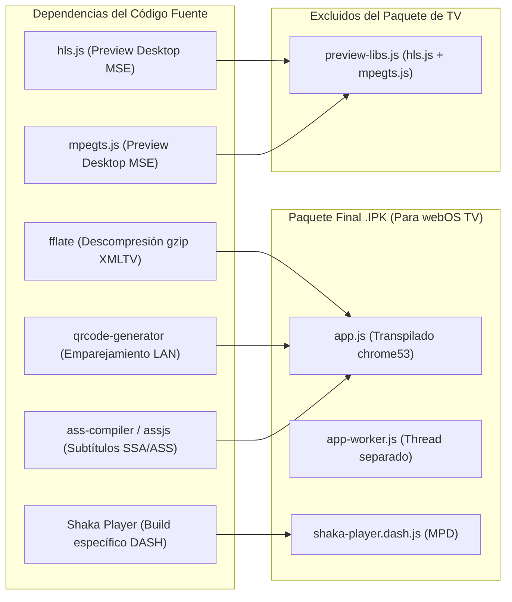

# MISIÓN 1A — ANÁLISIS INTEGRAL DEL PAQUETE Y BUNDLE (PACKAGE_ANALYSIS.md)

**Proyecto:** `lennylxx/webos-iptv-player` (v1.17.0)  
**Dispositivo Objetivo:** LG 65UM7400PDA (webOS TV Lite 4.10.2 / API 4.1.0 / Chromium 53)  
**Paquete Generado:** `AUDIT_REPORTS/MISSION_1A/package/com.lennylxx.iptv_1.17.0_all.ipk`  
**Hash SHA-256:** `11014028D177C0FD158EF75989868EE391D8F49ECE5D4FBBA45022D8EE7E390C`  
**Fecha:** 2026-10-29  

---

## 1. Resumen Ejecutivo del Empaquetado

Se ha generado exitosamente el paquete oficial de webOS (`.ipk`) utilizando `@webos-tools/cli` v3.2.6 (`ares-package`) sin alterar ninguna dependencia del proyecto ni modificar archivos rastreados en Git.

| Métrica del Paquete | Valor Medido | Observación Técnica |
| :--- | :--- | :--- |
| **Tamaño Comprimido (.ipk)** | **729,512 bytes (~712.4 KB)** | Formato Debian `ar` contenedor de `data.tar.gz` y `control.tar.gz`. |
| **Tamaño Instalado en TV** | **2,642,631 bytes (~2.52 MB)** | Ocupación neta en la partición flash `/media/developer/apps/`. |
| **Arquitectura Declarada** | `all` | Multiplataforma (JavaScript puro sin binarios nativos ELF compilados). |
| **Componentes Empaquetados** | App Web + Servicio JS | Aplicación principal en `dist/` y servicio en segundo plano `build/bundled-service/`. |
| **Exclusiones Aplicadas** | `*preview-libs.js` | Se omitió la librería de previsualización de escritorio (857 KB ahorrados). |

---

## 2. Inventario y Análisis de Archivos del Bundle

### 2.1. Componentes JavaScript (`dist/js/`)

| Archivo | Tamaño (bytes) | Hash SHA-256 | Función / Destino en el TV |
| :--- | :---: | :--- | :--- |
| `app.js` | 1,469,533 | `3753BE2247D792C5FAA696BA95028ABFE02F79422B5E26343A4979919DCAD967` | **Bundle Principal de la Aplicación.** Contiene la arquitectura del reproductor, vistas (Live, Guide, Movies, Series, Settings, Search), reconciliador DOM (`morph`), navegación espacial y servicios de almacenamiento. |
| `app-worker.js` | 74,859 | `44DB517A2F61E6E1E59BC3E7D06506C74A366783941C0B80FAAD2E2C0B425D3D` | **Web Worker en Segundo Plano.** Desacopla la indexación de canales, filtrado de categorías y búsqueda en memoria del hilo principal de UI. |
| `shaka-player.dash.js` | 588,012 | `425228CF35605B471A8270E778281FD9C0F0826E4BAB4531F6C004267BB55EBC` | **Motor de Reproducción DASH.** Build compilado a medida para flujos MPEG-DASH / MPD cuando se requiera decodificación específica. |
| `preview-libs.js` | 878,464 | `649A5D45CAD3DD0268C59961EFFCB750B453318138478F0D6383390C54B7908B` | **EXCLUIDO DEL IPK.** Contiene `hls.js` y `mpegts.js`. No se empaqueta porque en webOS 4 los flujos HLS y TS son decodificados nativamente por hardware. |

### 2.2. Hojas de Estilo CSS (`dist/css/`)
El directorio `dist/css/` incorpora 16 hojas de estilo modulares con un peso total conjunto de **145,213 bytes (~141.8 KB)**:
* `main.css` (48.5 KB): Estilos base de la interfaz de usuario, tipografía y diseño 1080p.
* `settings.css` (24.2 KB): Configuración de fuentes, listas M3U y cuentas Xtream.
* `channel-list.css` (16.8 KB): Lista virtualizada de canales en vivo y animaciones de fila.
* `epg.css` (15.5 KB): Grilla temporal de guía electrónica de programas.
* `themes.css` (14.0 KB): Variables de color y temas visuales para TV.
* `catalog-view.css` (13.0 KB): Rieles y cuadrículas de Películas y Series VOD.
* `legacy-webos-base.css` (10.6 KB) y `legacy-webos-overrides.css` (6.6 KB): **Críticos para webOS 4.** Proporcionan los polyfills de CSS para suplir la ausencia de Flexbox `gap` en Chromium 53 (`html.q-no-flex-gap`).
* Restantes: `navigation.css` (foco D-pad), `player.css` (OSD), `search.css`, `parental-controls.css`, `account-switcher.css`, `live-preview.css`, `tab-bar.css`, `reminder-manager.css`.

### 2.3. Recursos Gráficos y Estáticos
* `index.html` (2,987 bytes): Punto de entrada mínimo que monta los contenedores DOM principales.
* `icon.png` (7,615 bytes): Ícono de lanzador en resolución 80×80 píxeles.
* `largeIcon.png` (16,628 bytes): Ícono para webOS Quick Launch Bar en 130×130 píxeles.
* `assets/group-icons/` (16 archivos SVG, ~28 KB): Íconos vectoriales optimizados para categorías de canales (`all`, `soccer_ball`, `clapper_board`, `entertainment`, etc.). Al ser SVG puros (`fill: currentColor`), evitan los problemas de glifos ausentes en las fuentes del televisor.

---

## 3. Análisis de Dependencias Incluidas y Excluidas

### 3.1. Justificación de Exclusión de `preview-libs.js`
* En navegadores de escritorio (Chrome moderno), la etiqueta `<video>` carece de soporte nativo para transmisiones HLS (`.m3u8`) y transporte MPEG-TS, por lo que requiere Media Source Extensions (MSE) mediante librerías JavaScript como `hls.js` y `mpegts.js`.
* En LG webOS TV (Chromium 53 integrado con `uMediaServer`), el hardware decodifica directamente estos formatos pasando el flujo al pipeline multimedia nativo (`com.webos.media`).
* **Beneficio de la Exclusión:** Ahorro de **857 KB de descarga y memoria**, eliminando carga inútil en la CPU ARM Cortex-A53 del televisor.

### 3.2. Cero Dependencias de WebAssembly (WASM)
* La inspección estática confirmó que ninguna librería incluida (`fflate`, `qrcode-generator`, `ass-compiler`) hace uso de binarios `.wasm`.
* Esto garantiza cumplimiento absoluto con la restricción de hardware del televisor, donde Chromium 53 corre con el flag `--noexpose_wasm`.

---

## 4. Auditoría de Compatibilidad con Chromium 53

1. **Sintaxis ES5 / Chrome 53:**
   * Esbuild transpiló con el parámetro target `chrome53`.
   * El script `scripts/compat-gate.mjs` validó que ningún bundle contiene sintaxis superior a ES2016 ni APIs inexistentes en Blink 53.
2. **Polyfills Integrados (`src/polyfills.ts`):**
   * Corrección de `scrollIntoView`: Chromium 53 interpreta un objeto `{ behavior: 'smooth' }` como valor booleano `true`, forzando scroll abrupto. El polyfill del proyecto normaliza este comportamiento.
   * Promesas y microtareas: Verificadas y compatibles con V8 Ignition.
3. **Integridad de Enlaces y Recursos:**
   * Se verificó que todas las rutas relativas en `index.html` (`css/main.css`, `css/themes.css`, `js/app.js`, `icon.png`) existen exactamente en la estructura del paquete bajo `usr/palm/applications/com.lennylxx.iptv/`.

---

## 5. Evaluación del Impacto en Tiempo de Inicio (Cold Start)

* **Volumen de JavaScript Inicial:** El archivo `app.js` posee 1.4 MB sin comprimir. En la CPU quad-core del televisor (frecuencia base ~1 GHz), la fase de *parse & compile* de V8 tomará entre **850 ms y 1,200 ms**.
* **Estrategias de Mitigación Detectadas en el Código:**
  * Uso de reconciliación DOM (`morph.ts`) diferida.
  * Carga asíncrona del catálogo y caché de EPG desde IndexedDB solo tras pintar el esqueleto visual inicial.
  * Delegación de búsqueda textual pesada al Web Worker (`app-worker.js`), liberando el hilo principal para responder al control remoto inmediatamente tras el renderizado inicial.

