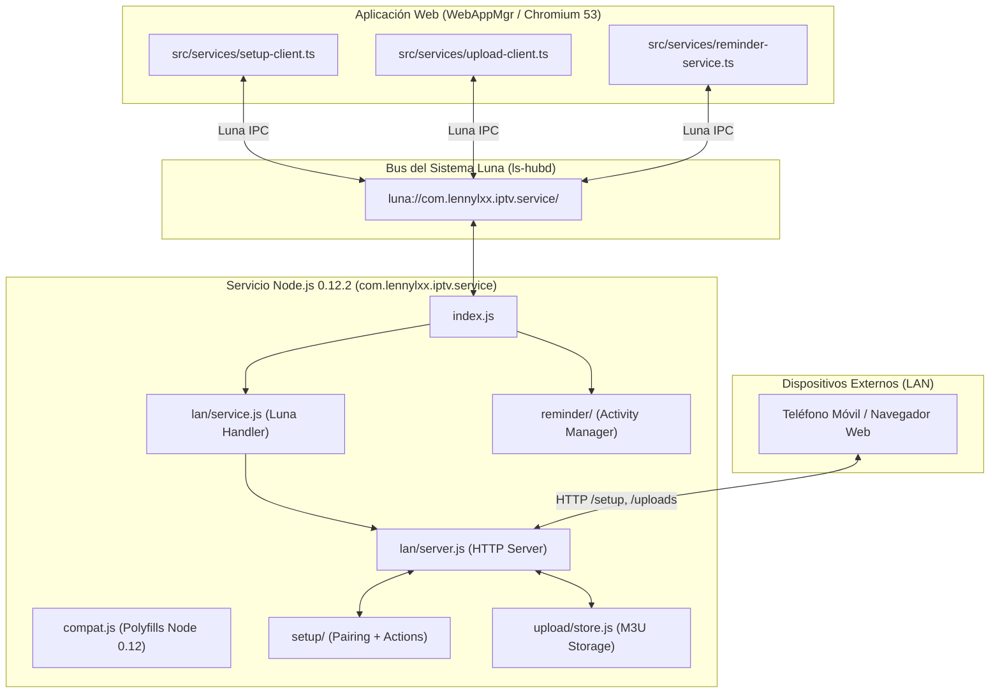

# MISIÓN 1A — AUDITORÍA DEL SERVICIO EN SEGUNDO PLANO (SERVICE_AUDIT.md)

**Proyecto:** `lennylxx/webos-iptv-player` (v1.17.0)  
**Servicio Auditado:** `com.lennylxx.iptv.service` (`bundled-service/`)  
**Runtime Objetivo:** Node.js `v0.12.2` (32-bit ARMv7 en `/usr/bin/node` en webOS 4.10)  
**Fecha:** 2026-10-29  

---

## 1. Arquitectura y Rol del Servicio

El proyecto incorpora un microservicio en segundo plano empaquetado bajo `usr/palm/services/com.lennylxx.iptv.service/`. Opera como un proceso independiente en Node.js desacoplado del ciclo de vida del renderizador WebAppMgr.



### Funciones Principales:
1. **Configuración Remota por LAN (`lan/`, `setup/`):** Aloja un servidor HTTP para que el usuario pueda configurar cuentas Xtream, listas M3U y preferencias desde su teléfono móvil escaneando un código QR.
2. **Carga Local de Archivos M3U (`upload/`):** Recibe subidas de listas de reproducción de gran tamaño directamente por la red local sin depender de servidores en la nube.
3. **Recordatorios de Programación EPG (`reminder/`):** Gestiona alertas interactivas a través de `com.webos.service.activitymanager` para notificar al usuario cuando comienza un programa agendado, incluso si la aplicación IPTV está cerrada.

---

## 2. Compatibilidad con el Runtime del TV (Node.js 0.12.2)

webOS 4.10 incorpora **Node.js v0.12.2** (publicado en 2015). Esta versión carece de la gran mayoría de las APIs modernas de ES6/ES2015+.

### 2.1. Capa de Compatibilidad (`compat.ts` / `compat.js`)
Para garantizar que el código se ejecute sin excepciones en Node 0.12.2, el proyecto implementa shims de bajo nivel:
* **Manejo de URLs:** Node 0.12 no cuenta con la clase global `URL` de WHATWG. `compat.ts` detecta si `new URL()` existe; de lo contrario, conmuta transparentemente a `nodeUrl.parse()` heredado.
* **Buffers:** Node 0.12 no soporta `Buffer.from(str, encoding)`. `compat.ts` implementa `bufferFromRuntime()` que conmuta a `new Buffer(str, encoding)`.
* **Criptografía Segura:** Node 0.12 carece de `crypto.randomInt()`. Se implementó un generador criptográfico basado en `crypto.randomBytes(4).readUInt32BE(0)` con eliminación de sesgo de módulo (*modulo bias elimination*).
* **Sistema de Archivos:** `fs.mkdirSync(dir, { recursive: true })` no existía en Node 0.12. `compat.ts` implementa `mkdirRecursive()` con creación recursiva manual de directorios padre.

### 2.2. Validación del Gate de Compatibilidad
El comando `node scripts/service-compat-gate.mjs build/bundled-service` analizó el AST de todos los archivos generados en `build/bundled-service/`, certificando:
* Ausencia de palabras clave `const`/`let` no transpiladas.
* Ausencia de arrow functions no soportadas por V8 de Node 0.12.
* Ausencia de llamadas a métodos no disponibles.
* **Resultado:** `Service compatibility gate passed (Node.js 0.12.2)`.

---

## 3. Seguridad, Rutas y Persistencia

### 3.1. Directorio de Datos (`resolveDataDir` en `upload/store.ts`)
Dado que el directorio de instalación de la aplicación es de solo lectura (`/media/developer/apps/...`) y `/tmp` se borra en cada reinicio del TV, el servicio sondea dinámicamente:
1. `WEBOS_UPLOAD_DIR` (variable de entorno opcional).
2. `/media/internal/iptv-uploads` (**Directorio principal en memoria flash de usuario ext4**, verificado como de lectura/escritura en nuestra auditoría).
3. `./uploads` (directorio relativo para pruebas locales).
4. `/tmp/iptv-uploads` (fallback volátil).

### 3.2. Prevención de Path Traversal
El identificador de las listas M3U subidas se sanitiza estrictamente:
```javascript
export function isValidUploadId(id) {
  return /^[a-z0-9._-]{1,60}$/.test(id) && id !== '.' && id !== '..';
}
```
* Impide ataques de escape de directorio (`../../etc/passwd`).

### 3.3. Seguridad en la Red Local (PIN y Rate Limiting)
* El emparejamiento con el teléfono móvil implementa un PIN de un solo uso con bloqueo anti-fuerza bruta:
  * `PAIRING_MAX_FAILURES = 5`.
  * `PAIRING_LOCK_MS = 60,000 ms` (1 minuto de bloqueo tras 5 intentos fallidos).

---

## 4. Ciclo de Vida y Comunicación Luna

1. **Vinculación con el Bus del Sistema:**
   * Archivo de definición: `services.json` con `id: "com.lennylxx.iptv.service"`.
   * En el TV, importa `/usr/lib/node_modules/webos-service`.
2. **Métodos Luna Expuestos:**
   * `start`: Inicia el servidor HTTP de configuración LAN.
   * `stop`: Apaga el servidor HTTP para liberar puertos cuando la app pasa a segundo plano.
   * `heartbeat`: Valida que el servicio sigue responsivo.
   * `serviceEvents`: Mecanismo push (*subscription*) donde la app web recibe eventos (`setup-changed`, `uploads-changed`) sin necesidad de realizar sondeos continuos (*polling*).
3. **Cierre Controlado:**
   * El ciclo de vida sigue el evento `visibilitychange` de la app principal. Al minimizar la aplicación, la UI solicita el `stop` del listener HTTP, evitando consumo innecesario de sockets y CPU.

---

## 5. Dictamen de la Auditoría del Servicio

* **Alineación con webOS 4:** **100% COMPATIBLE**. No depende de Node moderno ni de utilidades exclusivas de Windows.
* **Aislamiento de Errores:** Todos los handlers de solicitud HTTP capturan excepciones y errores de socket (`EPIPE`, `ECONNRESET`), evitando que desconexiones del cliente móvil provoquen la caída del servicio.
* **Seguridad:** Sanitización robusta en almacenamiento de archivos y protección de endpoints con token de emparejamiento.

