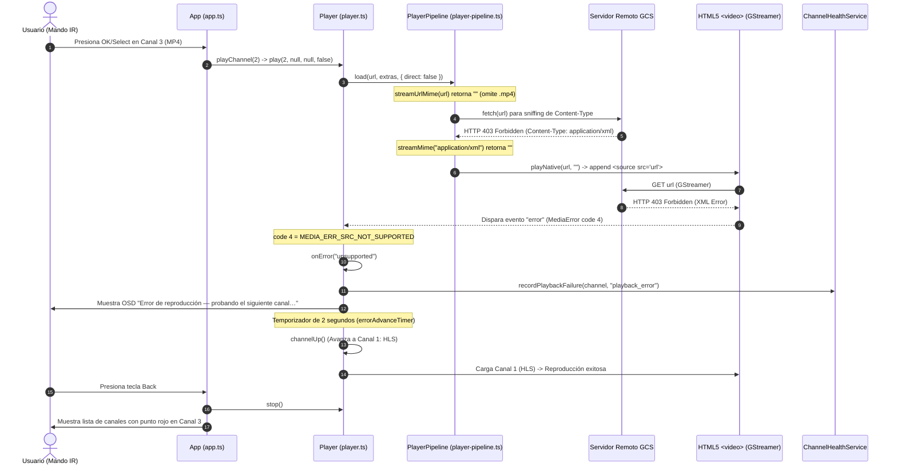

# ANÁLISIS DE CAUSA RAÍZ DEL FALLO MP4 — MISIÓN M2.1
**Dispositivo:** LG 65UM7400PDA  
**Fecha:** 30 de Octubre de 2026  
**Responsable:** Ingeniero Senior de Software Embebido  
**Veredicto de Causa Raíz:** **ERROR DE ACCESO REMOTO HTTP 403 FORBIDDEN EN EL SERVIDOR DE ORIGEN (RECURSO NO DISPONIBLE) + AGRAVANTE DE OMISIÓN DE EXTENSIÓN MP4 EN LA CLASIFICACIÓN RÁPIDA**

---

## 1. Evidencia Empírica del Recurso Remoto

Se inspeccionó la URL exacta del Canal 3 contenida en la lista sintetizada (`scripts/synthetic_test.m3u`):
```text
http://commondatastorage.googleapis.com/gtv-videos-bucket/sample/BigBuckBunny.mp4
```

### 1.1 Cabeceras de Respuesta del Servidor de Origen
```http
HTTP/1.1 403 Forbidden
Content-Type: application/xml; charset=UTF-8
Content-Length: 394
Access-Control-Allow-Origin: *
Access-Control-Expose-Headers: origin, range
Date: Fri, 30 Oct 2026 06:40:01 GMT
Server: UploadServer
```

### 1.2 Cuerpo de Respuesta (XML de Acceso Denegado de Google Cloud Storage)
```xml
<?xml version='1.0' encoding='UTF-8'?>
<Error>
  <Code>AccessDenied</Code>
  <Message>Access denied.</Message>
  <Details>
    Anonymous caller does not have storage.objects.get access to the Google Cloud Storage object.
    Permission 'storage.objects.get' denied on resource '//storage.googleapis.com/projects/_/buckets/gtv-videos-bucket/objects/sample/BigBuckBunny.mp4' (or it may not exist).
  </Details>
</Error>
```

**Conclusión Primaria:** El servidor de almacenamiento remoto (`commondatastorage.googleapis.com`) deniega categóricamente el acceso al archivo MP4 (`HTTP 403`). El televisor **nunca recibió datos de video MP4**, sino un documento XML de error.

---

## 2. Reconstrucción del Recorrido de Ejecución en el Reproductor



---

## 3. Factores Contribuyentes de Arquitectura

### 3.1 Omisión de la Extensión `.mp4` en `streamUrlMime`
En [`src/utils/url.ts`](file:///c:/Users/amaur/Desktop/webos-iptv-player/src/utils/url.ts#L43-L58):
```typescript
export function streamUrlMime(url: string): string {
  if (/\.ts(?:[?#]|$)/i.test(url) ...) return 'video/mp2t';
  if (/\.flv(?:[?#]|$)/i.test(url) ...) return 'video/x-flv';
  if (/\.m3u8?(?:[?#]|$)/i.test(url) ...) return 'application/vnd.apple.mpegurl';
  if (/\.mpd(?:[?#]|$)/i.test(url) ...) return 'application/dash+xml';
  return '';
}
```
* **Impacto:** Mientras que los canales HLS (`.m3u8`) y DASH (`.mpd`) se reconocen inmediatamente por extensión sin latencia de red, las URLs que terminan en `.mp4` son tratadas como dudosas/ambiguas, forzando una petición de sondeo previa (`detectContentType`) mediante `fetch()`.

### 3.2 Manejo del Error de Red en el Pipeline
* Cuando `detectContentType` recibe `application/xml` (debido al error 403 de GCS), no aborta la carga inmediatamente como error HTTP, sino que delega la URL al elemento `<video>` con `mime=""`.
* El elemento de video de Chromium 53 intenta cargar la URL, recibe el 403 y dispara `MediaError.MEDIA_ERR_SRC_NOT_SUPPORTED` (código 4).

---

## 4. Diferencias Respecto a los Flujos HLS y DASH que Funcionaron

| Característica | Canal 1 (HLS) | Canal 2 (DASH) | Canal 3 (MP4) |
| :--- | :--- | :--- | :--- |
| **URL de Origen** | Mux Video CDN | Akamai CDN | Google Cloud Storage (Bucket de muestra) |
| **Respuesta HTTP** | `200 OK` | `200 OK` | **`403 Forbidden` (Acceso denegado)** |
| **Tipo de Contenido** | `application/vnd.apple.mpegurl` | `application/dash+xml` | **`application/xml` (Error de autorización)** |
| **Desmultiplexación** | GStreamer HLS Demuxer | GStreamer DASH Demuxer | Fallo por falta de contenedor de video |
| **Detección Rápida** | Sí (`.m3u8` en `streamUrlMime`) | Sí (`.mpd` en `streamUrlMime`) | No (`.mp4` omitido en `streamUrlMime`) |
| **Resultado en TV** | Reproducción a 1080p | Reproducción a 720p/4K | **Fallback a HLS tras 2 segundos** |

