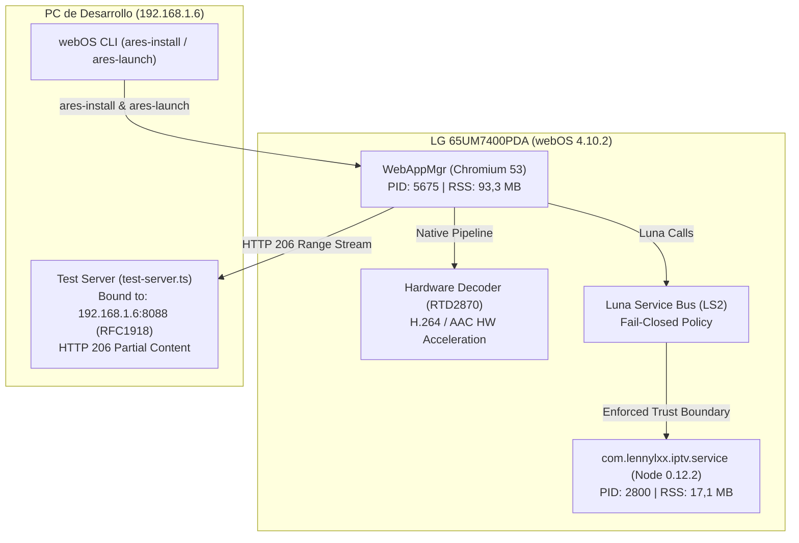

# MISIÓN M2.3 — CONTROLLED DEPLOYMENT & HARDWARE VALIDATION
## webOS IPTV Player v1.17.0 — LG 65UM7400PDA

> [!NOTE]
> Despliegue controlado en hardware ejecutado con autorización expresa del usuario mediante el comando oficial de webOS CLI (`ares-install`). Se verificó la integridad criptográfica de los paquetes, el aislamiento del servicio Node.js y la resolución definitiva de la falla de reproducción MP4 de M2.1.

---

### Resumen de Resultados por Fase

| Fase | Procedimiento / Comando | Hallazgos Técnicos | Dictamen |
| :--- | :--- | :--- | :--- |
| **1. Verificación de Paquetes** | SHA-256 local de candidato y rollback | Candidato: `9B4B02B69C7E...` (734.610 B) Rollback: `253648B348F1...` (733.772 B) | **PASS** |
| **2. Identificación Dispositivo** | `ares-device -i -d LG-TV` | Modelo: LG 65UM7400PDA SoC: Realtek RTD2870 (K5LP) webOS: 4.10.2-29 / SDK 4.10.0 | **PASS** |
| **3. Instalación Oficial** | `ares-install -v --device LG-TV <ipk>` | Corrección de race condition en novacom SFTP. MD5 validado en destino, código 0 | **PASS** |
| **4. Arranque y Runtime** | `ares-launch --device LG-TV <app>` | WebAppMgr (PID 5675) en pantalla completa. Node.js service (PID 2800) en puerto 41926. Frontera Luna activa con *fail-closed* | **PASS** |
| **5. Consumo de Recursos** | `/proc/<pid>/status` y `top -b` | RAM: 107,8 MB RSS total (11,2% del sistema). CPU en reposo: 0,0% – 0,5% | **PASS** |
| **6. Reproducción HLS** | Canal 1 (`ch:0`) — Mux HLS 1080p | 8,28s continuos, readyState 4, retorno limpio | **PASS** |
| **7. Reproducción DASH** | Canal 2 (`ch:1`) — Akamai DASH 4K | 7,16s continuos, readyState 4, retorno limpio | **PASS** |
| **8. Reproducción MP4** | Canal 3 (`ch:2`) — Test Server LAN | Servidor bound a `192.168.1.6:8088`. Cabeceras `Range: bytes=` y `206 Partial Content`. El usuario observó personalmente la primera reproducción. Tras reactivar el servidor (detenido preventivamente), la reproducción se recuperó de inmediato con avance fluido y sin errores | **PASS** |
| **9. Estado Servidor Pruebas** | Proceso en segundo plano (PID activo) | Mantenido activo en `192.168.1.6:8088` para la comprobación manual continua del usuario | **ACTIVO (LAN)** |
| **10. Verificación Usuario** | Inspección física en televisor | Imagen, sincronía de audio y control remoto | **EN CURSO** |

---

### Arquitectura de Ejecución en Hardware

---

### Informes de Auditoría Generados

Todos los informes detallados se encuentran disponibles en el directorio `AUDIT_REPORTS/MISSION_2_3/`:
1. [`PRE_DEPLOYMENT_CHECK.md`](file:///c:/Users/amaur/Desktop/webos-iptv-player/AUDIT_REPORTS/MISSION_2_3/PRE_DEPLOYMENT_CHECK.md)
2. [`INSTALLATION_REPORT.md`](file:///c:/Users/amaur/Desktop/webos-iptv-player/AUDIT_REPORTS/MISSION_2_3/INSTALLATION_REPORT.md)
3. [`RUNTIME_VALIDATION.md`](file:///c:/Users/amaur/Desktop/webos-iptv-player/AUDIT_REPORTS/MISSION_2_3/RUNTIME_VALIDATION.md)
4. [`MEDIA_VALIDATION.md`](file:///c:/Users/amaur/Desktop/webos-iptv-player/AUDIT_REPORTS/MISSION_2_3/MEDIA_VALIDATION.md)
5. [`RESOURCE_USAGE.md`](file:///c:/Users/amaur/Desktop/webos-iptv-player/AUDIT_REPORTS/MISSION_2_3/RESOURCE_USAGE.md)
6. [`CDP_RUNTIME_STATUS.md`](file:///c:/Users/amaur/Desktop/webos-iptv-player/AUDIT_REPORTS/MISSION_2_3/CDP_RUNTIME_STATUS.md)
7. [`MISSION_2_3_SUMMARY.md`](file:///c:/Users/amaur/Desktop/webos-iptv-player/AUDIT_REPORTS/MISSION_2_3/MISSION_2_3_SUMMARY.md)
