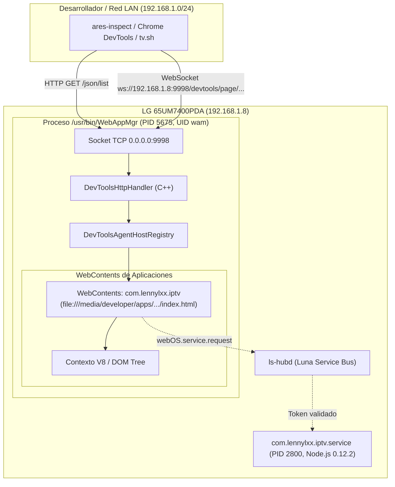

# ANÁLISIS DE LA ARQUITECTURA CDP EN WEBOS 4 (CDP ARCHITECTURE ANALYSIS)
## Misión M2.4 — webOS IPTV Player v1.17.0
**Dispositivo:** LG 65UM7400PDA (webOS TV Lite 4.10.2-29, Kernel Linux 4.4.84, SoC Realtek RTD2870 K5LP)  
**Motor Web:** Chromium Embedded 53.0.2785.34 / Blink  
**Proceso Responsable:** `/usr/bin/WebAppMgr` (PID 5675, usuario `wam`)  

---

## 1. El Chrome DevTools Protocol en Chromium 53

El **Chrome DevTools Protocol (CDP)** permite inspeccionar, perfilar, depurar y controlar de forma remota instancias del motor Blink y la máquina virtual JavaScript V8.

En Chromium 53 (versión base del WebAppMgr en webOS 4.x), la arquitectura interna de CDP está gobernada por los siguientes subsistemas principales:



### 1.1 `DevToolsHttpHandler`
Cuando Chromium se inicializa con el argumento `--remote-debugging-port=<puerto>`, la clase nativa C++ `content::DevToolsHttpHandler` (o su implementación derivada en el framework de WebAppMgr) se instancia en el hilo de E/S (`IOThread`).
* Crea un socket de escucha TCP en el puerto configurado (en este caso `9998`).
* En la implementación adaptada de LG para televisores en modo desarrollador, el socket se enlaza a la dirección comodín `0.0.0.0` (o `INADDR_ANY`), permitiendo conexiones entrantes desde cualquier dispositivo en la subred LAN privada.

### 1.2 Endpoints Servidos por el Handler HTTP
El servidor HTTP embebido atiende peticiones REST básicas en formato JSON:
1. `GET /json` o `GET /json/list`: Retorna un array JSON con los objetivos de inspección activos (`WebContents` o `RenderViewHost`).
2. `GET /json/version`: Retorna metadatos del navegador (`Browser: Chrome/53.0.2785.34`, `Protocol-Version: 1.2`, `User-Agent`).
3. `GET /json/new?{url}`: Crea una nueva página (deshabilitado o restringido en WAM según configuración).
4. `GET /json/activate/{targetId}`: Trae la ventana seleccionada al frente.
5. `GET /json/close/{targetId}`: Cierra la página especificada.
6. `GET /json/protocol`: Retorna el esquema JSON con todos los dominios soportados (DOM, CSS, Page, Runtime, Network, etc.).

---

## 2. Estructura de la Respuesta Obtenida en Hardware

Durante las pruebas forenses de la Misión M2.3, la consulta a `http://192.168.1.8:9998/json/list` devolvió:

```json
[
  {
    "description": "",
    "devtoolsFrontendUrl": "/devtools/inspector.html?ws=192.168.1.8:9998/devtools/page/8ffc34f8-2c53-4bd0-b0d0-62841e6d35c2",
    "id": "8ffc34f8-2c53-4bd0-b0d0-62841e6d35c2",
    "title": "webOS IPTV Player",
    "type": "page",
    "url": "file:///media/developer/apps/usr/palm/applications/com.lennylxx.iptv/index.html",
    "webSocketDebuggerUrl": "ws://192.168.1.8:9998/devtools/page/8ffc34f8-2c53-4bd0-b0d0-62841e6d35c2"
  }
]
```

### Características de la Respuesta:
* **`id`**: Identificador UUID generado dinámicamente por `DevToolsAgentHost` para representar la instancia de la página web. Cambia en cada arranque de la aplicación.
* **`devtoolsFrontendUrl`**: Ruta relativa para cargar el frontend visual de DevTools (embebido en los recursos de Chromium o cargado desde un navegador cliente).
* **`webSocketDebuggerUrl`**: Canal de transporte bidireccional asíncrono para el envío de comandos JSON-RPC 2.0 (como `Runtime.evaluate`, `Page.navigate`, `DOM.getDocument`).
* **`url`**: Confirma que el paquete se ejecuta directamente desde la partición de desarrollo (`/media/developer/apps/...`).

---

## 3. Modelo de Procesos y Concurrencia en WebAppMgr

En webOS TV Lite 4.10.2 (ejecutándose en un procesador ARMv7 Cortex-A53 de 4 núcleos limitado a ~1 GB de RAM total), `WebAppMgr` optimiza el uso de memoria respecto al Chromium de escritorio:

1. **Gestión de WebContents:**
   `WebAppMgr` actúa como el proceso maestro del navegador (Browser Process). Mantiene la infraestructura de ventanas gráficas (Wayland/EGL) conectada al compositor de pantalla `surface-manager` (`LSM`).
2. **Procesos de Renderizado:**
   Dependiendo de las directrices de memoria de SAM (`System Application Manager`), las aplicaciones web de terceros corren en hilos de renderizado o procesos hijos dedicados bajo el UID `wam`.
3. **Punto Único de Depuración:**
   El puerto `9998` es propiedad exclusiva de la instancia en ejecución de `/usr/bin/WebAppMgr`. No es creado por el código JavaScript ni por el empaquetado IPK de la aplicación web.

---

## 4. Fronteras de Privilegios y Aislamiento

El análisis de arquitectura demuestra una estricta separación de privilegios entre los distintos componentes del sistema:

| Nivel / Componente | Identidad de Sistema (UID/GID) | Alcance de Acceso | Capacidad de CDP |
| :--- | :--- | :--- | :--- |
| **Contexto DOM / V8** | Renderizado dentro de `wam` | Limitado al árbol DOM, LocalStorage, IndexedDB y Web APIs estándar. | **Total:** CDP puede inspeccionar el DOM y evaluar JavaScript en este contexto. |
| **Proceso WebAppMgr** | `wam:wam` (UID ~6000) | Acceso al compositor gráfico, decodificadores de hardware y socket 9998. | **Propietario:** Administra el socket y despacha mensajes al agente de V8. |
| **Luna Bus (`ls-hubd`)** | `root:root` (Daemon central) | Enrutamiento de mensajes IPC inter-proceso protegidos por grupos de seguridad. | **Indirecto:** Un comando JavaScript emitido por CDP solo puede solicitar llamadas Luna autorizadas para el App ID. |
| **Servicio LAN Node.js** | UID de servicio dedicado | Servicio background Node.js (`com.lennylxx.iptv.service`). | **Protegido:** Requiere token de autorización y opera bajo política fail-closed. |
| **Sistema Base Linux** | `root:root` (Kernel 4.4.84) | Particiones del sistema, red, drivers, hardware. | **Inaccesible:** CDP no otorga acceso a shell ni escape del proceso `wam`. |

---

## 5. Conclusión de la Arquitectura

El listener en el puerto 9998 es un servicio de infraestructura a nivel de proceso nativo de `WebAppMgr`. El código JavaScript de la aplicación web carece de interfaces para cerrar sockets del sistema operativo, desinstalar el handler HTTP de Chromium o desenlazar el puerto de red.

