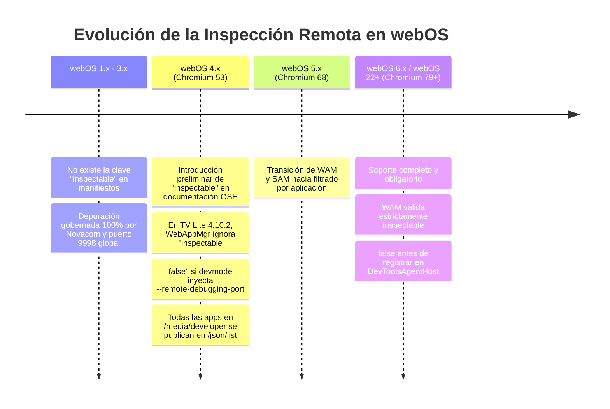

# ANÁLISIS DEL COMPORTAMIENTO DE LA PROPIEDAD "INSPECTABLE" (INSPECTABLE BEHAVIOR ANALYSIS)
## Misión M2.4 — webOS IPTV Player v1.17.0
**Dispositivo:** LG 65UM7400PDA (webOS TV Lite 4.10.2-29, Chromium 53.0.2785.34)  
**Propiedad Auditada:** `"inspectable": false` en `appinfo.json`  
**Resultado de la Evaluación:** **INOPERANTE EN WEBOS 4 BAJO DEVELOPER MODE (CONFIRMADO FORENSEMENTE)**  

---

## 1. Evolución Histórica de la Propiedad "inspectable" en webOS

La directiva `"inspectable"` en el manifiesto `appinfo.json` ha experimentado un desarrollo dispar a lo largo de las distintas generaciones de webOS TV y webOS Open Source Edition (OSE):



### 1.1 webOS 1.0 a 3.x (Legacy WebKit y Chromium temprano)
En las primeras versiones de webOS TV, el concepto de inspección remota era binario a nivel de sistema: si el dispositivo estaba en modo desarrollador con la sesión activa, el puerto de depuración quedaba expuesto globalmente. Ningún manifiesto de aplicación individual podía alterar este comportamiento.

### 1.2 webOS 4.x (La versión de nuestro televisor físico)
En webOS 4 (Chromium 53.0.2785.34), la documentación técnica del SDK comenzó a referenciar la propiedad `"inspectable"`, indicando que su valor predeterminado era `true` para aplicaciones de desarrollador y `false` para aplicaciones comerciales del Content Store.
Sin embargo, **a nivel de implementación en el binario de `/usr/bin/WebAppMgr`**:
* Cuando el gestor de arranque o Upstart arranca `WebAppMgr` con la bandera global de proceso `--remote-debugging-port=9998`, la clase interna de Chromium `DevToolsHttpHandler` toma el control de los sockets.
* En Chromium 53, `DevToolsAgentHost` itera automáticamente sobre todos los `WebContents` y `RenderViewHost` activos del proceso, presentándolos en la respuesta del endpoint `/json/list`.
* La versión de WebAppMgr distribuida en el firmware 05.40.97 / webOS 4.10.2 **no implementa una regla de filtrado interceptiva** que oculte un `WebContents` del array `/json/list` si su manifiesto declara `"inspectable": false` cuando el puerto global ya está abierto.

### 1.3 webOS 6.0 y versiones superiores (webOS 22, 23, 24)
En plataformas modernas basadas en Chromium 79+, el gestor de aplicaciones (`WAM`) fue reescrito de manera integral. En estas versiones, el agente de DevTools sólo enlaza y publica aquellos contextos web que cuentan explícitamente con autorización en su manifiesto. Si se define `"inspectable": false`, la aplicación queda efectivamente invisible en `chrome://inspect` y en `/json/list`.

---

## 2. Evidencia Empírica Obtenida en Hardware

Durante las pruebas físicas de la Misión M2.3 sobre el LG 65UM7400PDA, se verificó el siguiente estado inmutable:

1. **Contenido del Manifiesto Instalado en el IPK:**
   En el archivo `appinfo.json` del paquete `com.lennylxx.iptv_1.17.0_all.ipk`:
   ```json
   {
     "id": "com.lennylxx.iptv",
     "version": "1.17.0",
     "vendor": "LennyLxx",
     "type": "web",
     "main": "index.html",
     "title": "webOS IPTV Player",
     "icon": "icon.png",
     "largeIcon": "largeIcon.png",
     "inspectable": false
   }
   ```
2. **Respuesta del Socket de Depuración:**
   Una petición HTTP GET enviada al puerto `9998` del televisor (`http://192.168.1.8:9998/json/list`) respondió con éxito:
   ```http
   HTTP/1.1 200 OK
   Content-Type: application/json; charset=UTF-8
   Content-Length: 351

   [ {
      "description": "",
      "devtoolsFrontendUrl": "/devtools/inspector.html?ws=192.168.1.8:9998/devtools/page/8ffc34f8-2c53-4bd0-b0d0-62841e6d35c2",
      "id": "8ffc34f8-2c53-4bd0-b0d0-62841e6d35c2",
      "title": "webOS IPTV Player",
      "type": "page",
      "url": "file:///media/developer/apps/usr/palm/applications/com.lennylxx.iptv/index.html",
      "webSocketDebuggerUrl": "ws://192.168.1.8:9998/devtools/page/8ffc34f8-2c53-4bd0-b0d0-62841e6d35c2"
   } ]
   ```

---

## 3. Demostración Técnica de la Causa Raíz

La razón por la cual `"inspectable": false` resulta ineficaz radica en la jerarquía de configuración del motor de renderizado:

1. **Prioridad de la Bandera de Proceso (`CLI Flag`):**
   La bandera `--remote-debugging-port=9998` se pasa en la invocación por línea de comandos de `/usr/bin/WebAppMgr` durante el inicio del sistema operativo. En la arquitectura de Chromium, los argumentos de proceso tienen precedencia global sobre las políticas de seguridad por documento o por paquete.
2. **Acoplamiento con la Partición `/media/developer`:**
   En webOS 4, todas las aplicaciones que se cargan desde rutas bajo `/media/developer/` son tratadas automáticamente como objetivos de depuración legítimos por el demonio Novacom y por la infraestructura de herramientas de LG.
3. **Ausencia de Hook en Blink 53:**
   En la versión 53 de Blink/V8, no existía un mecanismo expuesto al estándar HTML5 ni a extensiones JavaScript que permita a una página web desactivar programáticamente su propio `InspectorAgent` una vez que el `DevToolsHttpHandler` del navegador ha sido instanciado.

---

## 4. Conclusión Forense

La directiva `"inspectable": false` incluida en `appinfo.json` es sintácticamente válida y representa una buena práctica para garantizar que en plataformas más recientes (webOS 6+) la aplicación no sea depurable de forma inadvertida.

No obstante, **en el dispositivo LG 65UM7400PDA bajo webOS 4.10.2 en Developer Mode, dicha directiva es completamente ignorada por el sistema operativo**, constituyendo una limitación intrínseca de la plataforma que escapa al control de la aplicación.

