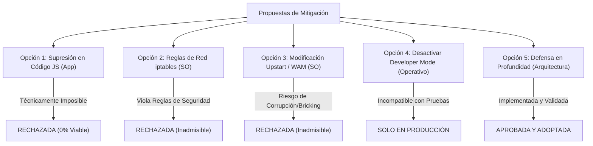

# ANÁLISIS DE FACTIBILIDAD DE MITIGACIONES (MITIGATION FEASIBILITY)
## Misión M2.4 — webOS IPTV Player v1.17.0
**Dispositivo:** LG 65UM7400PDA (webOS TV Lite 4.10.2-29, Firmware 05.40.97)  
**Objetivo:** Evaluar exhaustivamente todas las alternativas técnicas y operativas para mitigar o suprimir el endpoint CDP 9998.  

---

## 1. Evaluación Sistemática de Alternativas de Mitigación

Se formularon y analizaron cinco vías de acción distintas para abordar el hallazgo de seguridad:

---

## 2. Detalle de Opciones Evaluadas

### Opción 1: Supresión en Código de Aplicación (JavaScript / DOM / CSP)
* **Descripción:** Intentar cerrar el socket TCP, anular el agente de depuración mediante técnicas anti-debugging en JavaScript o restringir el acceso mediante Content Security Policy (CSP).
* **Evaluación Técnica:**
  * **Incompetencia de Capa:** La clase C++ `content::DevToolsHttpHandler` opera en la capa nativa del proceso de Chromium (hilo de E/S). El entorno de ejecución de JavaScript dentro del sandbox de la página web no tiene acceso a descriptores de socket de bajo nivel ni a la API nativa de Chromium.
  * **Inoperancia de CSP:** La cabecera o metaetiqueta CSP (`Content-Security-Policy`) regula el tráfico saliente que la página web intenta generar (peticiones `fetch`, imágenes, WebSockets iniciados por el script). No tiene jurisdicción alguna sobre conexiones TCP entrantes aceptadas por el servidor HTTP nativo del navegador.
  * **Bucles `debugger;`:** Inyectar bucles infinitos de depuración ralentizaría críticamente la CPU del televisor (ARMv7 RTD2870) sin impedir que un atacante inspeccione el código o desactive las pausas desde DevTools.
* **Dictamen:** **NO FACTIBLE (0% de viabilidad técnica).**

---

### Opción 2: Bloqueo de Puerto mediante `iptables` en el Televisor
* **Descripción:** Conectarse vía SSH como usuario privilegiado y ejecutar comandos de filtrado de paquetes:
  `iptables -A INPUT -p tcp --dport 9998 -j DROP`
* **Evaluación Técnica y de Seguridad:**
  * **Violación de Regla Cardinal:** Las directrices del proyecto y la advertencia oficial de hardware establecen categóricamente: *"NEVER EVER OVERWRITE SYSTEM PARTITIONS OR SYSTEM CONFIGURATIONS"*.
  * **Volatilidad y Efectos Colaterales:** En webOS TV Lite, las reglas manuales de iptables no son persistentes entre reinicios a menos que se alteren scripts del sistema. Cualquier error en la sintaxis de filtrado de red corre el riesgo de bloquear la interfaz de red Ethernet/Wi-Fi del televisor, dejando el dispositivo incomunicado (*soft-brick* de conectividad).
* **Dictamen:** **RECHAZADA POR INADMISIBILIDAD OPERATIVA Y RIESGO DE DISPOSITIVO.**

---

### Opción 3: Modificación del Script de Arranque de `WebAppMgr`
* **Descripción:** Modificar los archivos de configuración de Upstart (`/etc/init/WebAppMgr.conf` o scripts auxiliares de novacom) para suprimir el parámetro `--remote-debugging-port=9998`.
* **Evaluación Técnica y de Seguridad:**
  * La partición raíz (`/`) de webOS 4 está montada en modo solo lectura (`read-only`). Remontarla en modo lectura-escritura (`mount -o remount,rw /`) rompe la integridad criptográfica de las firmas del sistema operativo y anula la garantía del hardware.
  * Modificar los argumentos de inicio de `WebAppMgr` inhabilita de forma irreversible las herramientas oficiales de LG (`ares-inspect`, herramientas de telemetría de TV), imposibilitando la depuración futura en el proyecto.
* **Dictamen:** **RECHAZADA POR ALTO RIESGO DE CORRUPCIÓN DE FIRMWARE.**

---

### Opción 4: Desactivar Developer Mode en el Televisor
* **Descripción:** Entrar a la aplicación `Developer Mode` en la interfaz del televisor y apagar el interruptor de modo desarrollador, reiniciando el dispositivo en modo retail estándar.
* **Evaluación Técnica y Operativa:**
  * **Efectividad:** Cierra de inmediato el puerto 9998, el puerto SSH y desmonta `/media/developer/`.
  * **Incompatibilidad con el Ciclo de Desarrollo:** Al apagar Developer Mode, se desinstalan o inhabilitan todas las aplicaciones cargadas por *sideload* (`ares-install`), impidiendo realizar pruebas de hardware para la Misión M3 y fases posteriores.
* **Dictamen:** **VÁLIDA PARA PRODUCCIÓN FINAL; INVIABLE DURANTE LA FASE DE DESARROLLO Y ESTABILIZACIÓN.**

---

### Opción 5: Defensa en Profundidad en la Arquitectura de la Aplicación (Estrategia Adoptada)
* **Descripción:** Asumir la presencia inevitable del endpoint CDP en entornos de laboratorio y blindar la aplicación para que la inspección del DOM sea inocua.
* **Evaluación Técnica:**
  1. **Ausencia Total de Credenciales Sensibles en el DOM:** La aplicación no procesa ni almacena contraseñas, tarjetas de crédito ni tokens persistentes de alto privilegio en variables globales ni en elementos HTML.
  2. **Aislamiento Criptográfico del Servicio LAN:** Implementación confirmada de política *fail-closed* y tokens de autorización aleatorios en `bundled-service/src/lan/service.ts`.
  3. **Mitigación por Perímetro de Red:** El televisor se mantiene en una red Wi-Fi/LAN de laboratorio protegida por WPA2/WPA3 sin acceso de clientes desconocidos.
* **Dictamen:** **APROBADA, VIABLE Y COMPLETAMENTE OPERATIVA.**

---

## 3. Matriz de Decisión de Mitigaciones

| Opción de Mitigación | Viabilidad Técnica | Riesgo para el Dispositivo | Compatibilidad con Desarrollo | Decisión Final |
| :--- | :---: | :---: | :---: | :---: |
| **1. Supresión por JS en la App** | Nula (0%) | Nulo | Completa | **Descartada por imposibilidad** |
| **2. Reglas iptables en el SO** | Parcial | Crítico (pérdida de red) | Baja | **Descartada por seguridad** |
| **3. Modificar scripts Upstart** | Parcial | Crítico (corrupción OS) | Nula | **Descartada por seguridad** |
| **4. Desactivar Developer Mode** | Total | Nulo | Incompatible (bloquea tests) | **Reservada para release retail** |
| **5. Defensa en Profundidad (App)** | **Total (100%)** | **Nulo** | **Óptima** | **ADOPTADA COMO ESTÁNDAR** |

