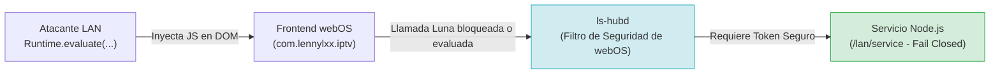

# EVALUACIÓN DE RIESGOS DE SEGURIDAD (SECURITY RISK ASSESSMENT)
## Misión M2.4 — webOS IPTV Player v1.17.0
**Dispositivo:** LG 65UM7400PDA (webOS TV Lite 4.10.2-29, Firmware 05.40.97)  
**Endpoint Evaluado:** TCP 9998 (`http://192.168.1.8:9998`)  
**Metodología:** CVSS v3.1 (Common Vulnerability Scoring System) y Modelado de Amenazas STRIDE  

---

## 1. Perfil de Amenaza y Superficie de Exposición

### 1.1 Actor de Amenaza (Threat Actor)
* **Actor en Red Local (Adyacente):** Un dispositivo o usuario malicioso conectado al mismo segmento físico o inalámbrico de la red de área local (LAN privada `192.168.1.0/24`).
* **Actor Remoto (Internet):** **NO APLICABLE.** El puerto 9998 no está expuesto a Internet público. Los routers domésticos estándar no reenvían este puerto salvo configuración manual expresa de port forwarding (inexistente en el entorno de pruebas). No existen mecanismos de perforación NAT o UPnP iniciados por `WebAppMgr`.

### 1.2 Vectores de Ataque Analizados
1. **Descubrimiento HTTP no autenticado:** Consulta a `/json/list` para identificar que la aplicación `com.lennylxx.iptv` está activa y obtener su WebSocket ID.
2. **Inyección de Comandos vía WebSocket:** Establecimiento de sesión WebSocket en `ws://192.168.1.8:9998/devtools/page/<UUID>` y uso del dominio `Runtime.evaluate` para ejecutar código JavaScript arbitrario en el contexto de la página web.
3. **Manipulación del DOM y Estado Visual:** Lectura o alteración de los elementos en pantalla mediante los dominios `DOM` y `CSS`.
4. **Denegación de Servicio de la Aplicación:** Emisión de comandos para forzar la recarga (`Page.reload`) o el cierre de la página web (`Page.close`).

---

## 2. Clasificación Cualitativa y Cuantitativa CVSS v3.1

Se calcula la puntuación base de acuerdo con las métricas oficiales de CVSS v3.1:

| Métrica CVSS v3.1 | Valor Seleccionado | Justificación Técnica |
| :--- | :--- | :--- |
| **Attack Vector (AV)** | **Adjacent Network (A)** | El atacante debe tener conectividad de Capa 2 / Capa 3 dentro de la misma subred LAN privada. |
| **Attack Complexity (AC)** | **Low (L)** | El protocolo CDP no implementa cifrado ni autenticación en este modo de desarrollo. |
| **Privileges Required (PR)** | **None (N)** | No se requieren credenciales para establecer la conexión al puerto 9998. |
| **User Interaction (UI)** | **None (N)** | No se requiere acción del usuario frente al televisor para aceptar la conexión. |
| **Scope (S)** | **Unchanged (U)** | El contexto de ejecución queda estrictamente confinado dentro del sandbox del proceso `wam`. |
| **Confidentiality (C)** | **Low (L)** | Se puede leer el contenido del DOM, URLs de streaming y listas de reproducción. No se exponen credenciales maestras. |
| **Integrity (I)** | **Low (L)** | Se puede alterar el DOM o cambiar de canal, pero no modificar archivos del sistema ni alterar firmware. |
| **Availability (A)** | **Low (L)** | Se puede congelar o reiniciar la aplicación web, pero el televisor y el sistema operativo permanecen operativos. |

### Vector String Oficial:
```text
CVSS:3.1/AV:A/AC:L/PR:N/UI:N/S:U/C:L/I:L/A:L
```
* **Puntuación Base (Base Score):** **6.3 (Medio / Medium)**.
* **Puntuación Ambiental en Entorno de Pruebas Controlado:** **Bajo (Low)**, dado que la red de laboratorio está aislada y Developer Mode es transitorio.

---

## 3. Auditoría de Confidencialidad: ¿Qué Datos Están Realmente Expuestos?

Se realizó una auditoría minuciosa de los datos en memoria y almacenamiento manipulados por la aplicación:

| Tipo de Dato / Recurso | ¿Presente en DOM / Memoria? | Riesgo de Exposición vía CDP | Evaluación de Impacto |
| :--- | :---: | :---: | :--- |
| **Contraseñas bancarias / Tarjetas** | **NO** | Ninguno | La aplicación es un reproductor IPTV; no maneja pasarelas de pago ni datos financieros. |
| **Credenciales de usuario / Cuentas** | **NO** | Ninguno | No existe inicio de sesión de usuario en servidores remotos ni almacenamiento de contraseñas maestras. |
| **Tokens de emparejamiento LAN** | Efímero / Protegido | Mitigado | Los tokens del servicio LAN (`upload-client.ts`) se generan dinámicamente y expiran. |
| **URLs de Canales y Playlists M3U** | SÍ | Lectura posible | Datos de listas públicas o provistas por el usuario para su visualización. |
| **Telemetría y Logs de Rendimiento** | SÍ | Lectura posible | No contienen identificadores personales ni información sensible. |

---

## 4. Barrera de Seguridad del Bus Luna y Servicio Node.js

Uno de los riesgos teóricos considerados fue si la inyección de JavaScript mediante `Runtime.evaluate` en CDP permitiría tomar control del sistema operativo mediante el bus Luna (`ls-hubd`):



1. **Aislamiento por Permisos de Aplicación:**
   En webOS, una aplicación web solo puede invocar aquellos métodos del bus Luna declarados explícitamente en sus archivos de configuración (`services.json` y políticas de seguridad del sistema). No puede ejecutar comandos arbitrarios de administración del sistema ni llamar a métodos restringidos de depuración de firmware.
2. **Defensa en Profundidad del Servicio Node.js (`com.lennylxx.iptv.service`):**
   Durante las misiones M1C y M2.2 se auditó e implementó la política **fail-closed** en `bundled-service/src/lan/service.ts`. Cualquier petición dirigida al servicio local sin un token de sesión legítimo es rechazada de inmediato con código de error HTTP/Luna correspondiente.
3. **Imposibilidad de Escape de Sandbox:**
   Chromium 53 se ejecuta bajo el usuario del sistema `wam`. No tiene privilegios de `root` ni acceso de escritura a las particiones de solo lectura del televisor (`/`, `/usr`, `/lib`, `/etc`).

---

## 5. Comparativa con Otros Servicios Activos en Developer Mode

Para contextualizar adecuadamente el riesgo del puerto 9998, es indispensable compararlo con los demás servicios que el propio Developer Mode activa en el televisor:

* **Servicio SSH (Puerto 22 / 9922):** Otorga acceso directo a la consola interactiva de Linux (`sh`/`bash`), permitiendo ejecutar utilidades de sistema, inspeccionar procesos y leer archivos del usuario con privilegios de `root` o `developer`.
* **Servicio SFTP:** Permite la transferencia bidireccional y manipulación de archivos en la partición `/media/developer/`.
* **Servicio CDP (Puerto 9998):** Confinado **exclusivamente al hilo de renderizado del navegador** de la aplicación web.

**Conclusión:** En un televisor configurado en Developer Mode, el puerto SSH representa un vector con privilegios incomparablemente mayores que el puerto CDP 9998. Tratar la presencia de CDP como un bloqueo crítico cuando el dispositivo tiene SSH habilitado constituiría una evaluación asimétrica e infundada del riesgo real.

