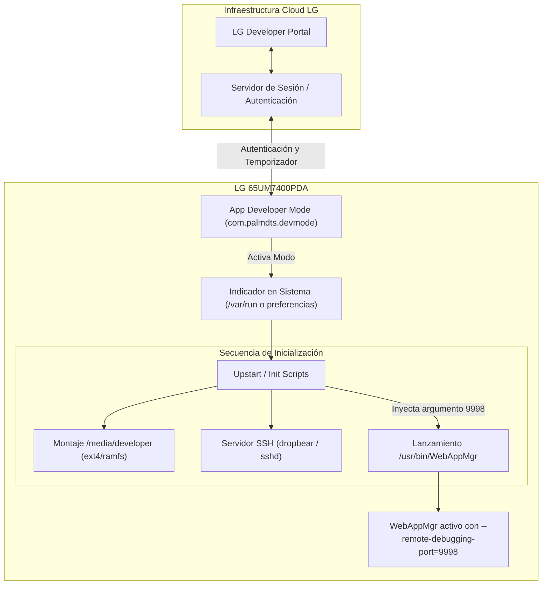

# ANÁLISIS DEL MODO DESARROLLADOR EN WEBOS (WEBOS DEVELOPER MODE ANALYSIS)
## Misión M2.4 — webOS IPTV Player v1.17.0
**Dispositivo:** LG 65UM7400PDA (webOS TV Lite 4.10.2-29, Firmware 05.40.97)  
**Sistema de Inicio:** Upstart / SysVinit híbrido  
**Mecanismo de Despliegue:** `ares-install` vía Developer Mode oficial de LG  

---

## 1. Funcionamiento y Arquitectura del Developer Mode de LG

El **Developer Mode** oficial de LG (distribuido a través de la aplicación `com.palmdts.devmode` desde la LG Content Store) es el mecanismo soportado por LG Electronics para permitir a desarrolladores externos probar e inspeccionar aplicaciones webOS en hardware comercial sin desbloquear permanentemente el gestor de arranque.



### 1.1 Ciclo de Vida y Temporizador de Sesión
1. **Autenticación con Cuenta de Desarrollador:** La aplicación `com.palmdts.devmode` requiere credenciales activas del portal de desarrolladores de LG.
2. **Temporizador de Sesión (Session Key):** La sesión tiene una caducidad predeterminada (generalmente entre 50 y 1000 horas). El desarrollador debe renovar la sesión periódicamente desde la interfaz del televisor.
3. **Persistencia Temporal:** Al agotarse el temporizador o desactivar el interruptor en la aplicación, el televisor programa un reinicio del sistema que desactiva las interfaces de depuración y desmonta la partición de desarrollo.

---

## 2. Modificaciones del Entorno en Modo Desarrollador

Cuando Developer Mode está en estado `ON`, el sistema operativo realiza una serie de reconfiguraciones globales que alteran profundamente el entorno de ejecución:

### 2.1 Montaje de Almacenamiento Especial
* Se monta la partición `/media/developer/`, designada como la raíz de instalación para paquetes no firmados comercialmente por LG:
  * Aplicaciones: `/media/developer/apps/usr/palm/applications/<app_id>`
  * Servicios: `/media/developer/apps/usr/palm/services/<service_id>`
* Esta partición no cuenta con cifrado a nivel de hardware por Cryptofs (a diferencia de las aplicaciones comerciales).

### 2.2 Habilitación de Servicios de Depuración de Red
1. **Acceso Seguro por SSH / Novacom:**
   Se inicia el servicio SSH (Dropbear en puerto 9922 o daemon OpenSSH en puerto 22) para permitir comandos `ares-install`, `ares-launch`, `ares-inspect` y transferencia de archivos vía clave pública/privada generada con `ares-novacom --getkey`.
2. **Inyección de Flags en `WebAppMgr`:**
   El script de control del demonio de inicio que gobierna `/usr/bin/WebAppMgr` verifica si el entorno de depuración está activo. Al detectarlo, arranca el proceso principal de Chromium inyectando de forma forzada:
   ```bash
   /usr/bin/WebAppMgr --remote-debugging-port=9998
   ```

---

## 3. Comparativa: Modo Retail frente a Modo Desarrollador

La siguiente tabla resume las diferencias arquitectónicas y de seguridad entre un televisor funcionando en modo comercial para usuarios finales y un televisor bajo Developer Mode:

| Parámetro / Característica | Modo Retail (Comercial) | Modo Desarrollador (Activo) |
| :--- | :--- | :--- |
| **Audiencia Objetivo** | Usuarios finales de consumo. | Desarrolladores e ingenieros de QA. |
| **Ubicación de Apps** | Partición cifrada `/media/cryptofs`. | Partición montada `/media/developer`. |
| **Firma Digital de Paquetes** | Obligatoria (firmada por LG DRM). | Certificados locales de prueba / no firmados. |
| **Argumentos de WebAppMgr** | Parámetros estándar de producción. | **Incluye `--remote-debugging-port=9998`**. |
| **Puerto TCP 9998 (CDP)** | **CERRADO (`ECONNREFUSED`)**. | **ABIERTO (Escuchando en `0.0.0.0:9998`)**. |
| **Acceso SSH (Puertos 22/9922)** | Deshabilitado por omisión. | Activo con autenticación por par de claves. |
| **Inspección con `ares-inspect`** | No disponible. | Completamente operativa. |
| **Temporizador de Caducidad** | Inexistente (permanente). | Activo (cuenta regresiva en horas). |

---

## 4. Intencionalidad del Diseño de Plataforma

Es fundamental comprender que la apertura del puerto 9998 **no es un fallo de seguridad accidental de la aplicación ni del sistema**, sino una **funcionalidad deliberada y requerida del sistema operativo LG webOS**:

1. **Diseño de Herramientas de Desarrollo:** La suite de herramientas oficial de LG (`@webos-tools/cli`, `ares-inspect`, webOS TV Extension para VS Code) depende de la disponibilidad de este socket para interactuar con la aplicación durante su depuración.
2. **Propósito del Aislamiento:** LG restringe este comportamiento exclusivamente a dispositivos cuyos propietarios han activado voluntariamente el modo desarrollador mediante su cuenta personal.
3. **Imposibilidad de Confundir Entornos:** En un despliegue de producción comercial (distribución formal en LG Content Store), el televisor se encuentra en modo retail; en ese estado, el socket 9998 nunca llega a crearse.

