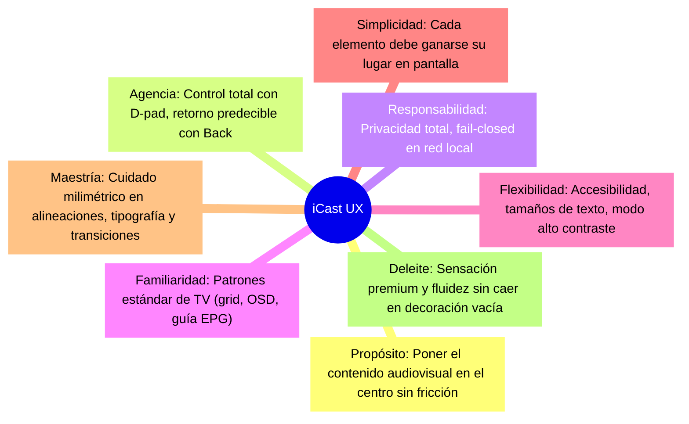

# INTEGRACIÓN Y AUDITORÍA DE APPLE DESIGN SKILL (APPLE DESIGN SKILL AUDIT)
## Misión M3.0 — iCast Design System & Premium TV UX Blueprint
**Fecha:** 2026-10-31  
**Skill Integrada:** `apple-design`  
**Ubicación:** `.agents/skills/apple-design/`  

---

## 1. Registro de Clonación e Integridad del Repositorio

La skill **Apple Design** se ha incorporado al repositorio del proyecto como marco de referencia metodológico y de excelencia visual para la refundación de la identidad y experiencia de usuario de **iCast**.

### 1.1 Metadatos Criptográficos y de Control de Versiones
* **URL de Origen:** `https://github.com/dickwu/apple-design-skill.git`
* **Rama Activa:** `main` (seguimiento a `origin/main`)
* **Commit SHA:** `ff4ebddf0488598723a82bfdce1afb04de0b1c44`
* **Mensaje de Commit:** `Merge pull request #7 from dickwu/chore/hig-refresh-2026-10-28`
* **Fecha del Commit de Origen:** `2026-10-28 09:28:09 -0500`
* **Fecha de Clonación Local:** `2026-10-31`
* **Total de Archivos:** `164 archivos`
* **Total de Directorios:** `20 directorios`
* **Tamaño Total en Disco:** `1.797.258 bytes (~1,8 MB)`

### 1.2 Estructura del Directorio Clonado
```text
.agents/skills/apple-design/
├── .cursorrules
├── .git/                        (Historial Git interno preservado)
├── .github/
├── .gitignore
├── AGENTS.md                    (Manual operativo para agentes)
├── GEMINI.md                    (Punto de entrada Antigravity/Gemini)
├── README.md                    (Documentación general)
├── SKILL.md                     (Instrucciones maestras de diseño)
├── references/
│   ├── code-audit.md            (Patrones de auditoría de código)
│   ├── cross-platform.md        (Traducción de vocabulario multiplataforma)
│   ├── hig-lookup.md            (Tabla generada de resumen de 124 guías)
│   └── hig/                     (124 páginas oficiales HIG en Markdown)
│       ├── liquid-glass.md      (Guía curada del material Liquid Glass)
│       ├── accessibility.md
│       ├── focus-and-selection.md
│       ├── playing-video.md
│       └── ... (120 páginas adicionales)
└── scripts/
    └── pull-hig.mjs             (Script de sincronización — no ejecutado)
```

### 1.3 Tratamiento del Repositorio Anidado y Protección Git
Para evitar que el repositorio principal `webos-iptv-player` interprete erróneamente la carpeta clonada como un *gitlink* o un submódulo incompleto:
1. **Exclusión Local (.git/info/exclude):** Se añadió la regla `.agents/skills/apple-design/` al archivo `.git/info/exclude` del repositorio principal.
2. **Cero Impacto en Archivos Rastreados:** No se modificó el archivo `.gitignore` del proyecto ni se alteró `.gitmodules`.
3. **Preservación del Historial:** Se mantuvo intacto el subdirectorio `.git/` de la skill, permitiendo futuras actualizaciones sin ensuciar el `git status` del proyecto principal.

---

## 2. Inventario y Selección de Referencias HIG

El repositorio contiene **124 páginas** de las Human Interface Guidelines (HIG) de Apple actualizadas a octubre de 2026. Siguiendo las directrices del autor, se evitaron cargas indiscriminadas y se seleccionaron con rigor las guías pertinentes para una experiencia de televisión de salón.

### 2.1 Referencias Prioritarias Analizadas y su Justificación en iCast

| Archivo de Referencia | Sección HIG | Aplicación Directa en iCast |
| :--- | :--- | :--- |
| `references/hig/design-principles.md` | Getting Started | Los 8 principios de diseño que rigen la arquitectura de la interfaz. |
| `references/hig/accessibility.md` | Foundations | Contraste de texto en TV (4.5:1 para cuerpo, 3:1 para titulares), tamaños mínimos. |
| `references/hig/layout.md` | Foundations | Jerarquía en 10-foot UI, márgenes de seguridad para televisores (safe areas). |
| `references/hig/typography.md` | Foundations | Escala tipográfica legible a 3 metros de distancia, pesos y espaciado. |
| `references/hig/color.md` | Foundations | Uso semántico de colores, paleta de acentos, luminancia y contraste en paneles oscuros. |
| `references/hig/dark-mode.md` | Foundations | Darks profundos (#0A0C10, #12151C), jerarquía de elevación de superficies. |
| `references/hig/materials.md` | Foundations | Separación estricta entre la capa de contenido y la capa funcional flotante. |
| `references/hig/liquid-glass.md` | Curated Guide | Principios de translucidez, bordes de refracción, halos especulares y reglas de sobriedad. |
| `references/hig/motion.md` | Foundations | Microinteracciones intencionales (100–180 ms), GPU acceleration y reducción de movimiento. |
| `references/hig/icons.md` | Foundations | Geometría vectorial consistente, grosor de trazo uniforme y legibilidad a distancia. |
| `references/hig/app-icons.md` | Foundations | Silueta icónica, composición en capas y contraste para el launcher de webOS. |
| `references/hig/branding.md` | Foundations | Subordinación de la marca al contenido, uso comedido de logotipos y acentos. |
| `references/hig/collections.md` | Layout | Grids de canales, tiles virtuales y rieles de navegación continua. |
| `references/hig/focus-and-selection.md`| Inputs | Halo de foco, distinción entre foco (target activo) y selección (OK pulsado). |
| `references/hig/playing-video.md` | Patterns | Transición limpia a vídeo, controles de transporte, OSD no intrusivo y retorno con Back. |
| `references/hig/playing-audio.md` | Patterns | Gestión de pistas de audio multilingües y metadatos de emisión. |
| `references/hig/loading.md` | Patterns | Skeletons y spinners discretos sobre fondo negro para evitar deslumbramientos. |
| `references/hig/feedback.md` | Patterns | Confirmación inmediata de acciones del mando a distancia sin interrumpir la reproducción. |
| `references/hig/settings.md` | Patterns | Categorización limpia de opciones infrecuentes y navegación bidireccional. |
| `references/cross-platform.md` | Companion | Traducción de terminología Apple a CSS/Vanilla TS en motores web embebidos. |
| `references/code-audit.md` | Companion | Detección de abusos visuales y anti-patrones en el renderizado de vidrio. |

---

## 3. Los 8 Principios de Apple (Junio 2026) Aplicados a iCast



1. **Purpose (Propósito):** El reproductor existe para ver televisión y contenido VOD con rapidez y estabilidad. Toda pantalla debe facilitar que el usuario alcance su emisión en menos de dos pulsaciones del mando.
2. **Agency (Agencia):** El usuario navega con libertad mediante el D-pad. Pulsar `Back` siempre revierte el estado sin sorpresas y los errores de emisión permiten reintentar o cambiar de canal sin bloquear la aplicación.
3. **Responsibility (Responsabilidad):** La aplicación no recolecta telemetría invasiva, no expone datos del usuario en la red y mantiene el servicio local bajo estrictos tokens de emparejamiento.
4. **Familiarity (Familiaridad):** Los componentes respetan las convenciones de televisión: barra de navegación superior anclada, selector de canales vertical y OSD flotante inferior con barra de progreso.
5. **Flexibility (Flexibilidad):** Soporte de escalado de fuentes (80% a 150%), modo de movimiento reducido para evitar mareos o sobrecarga de hardware, y compatibilidad con D-pad y puntero Magic Remote.
6. **Simplicity (Simplicidad):** Menos es más. Se eliminan marcos decorativos innecesarios, bordes brillantes excesivos y efectos de cristal apilados que saturen la pantalla.
7. **Craft (Maestría en el Detalle):** Espaciados consistentes basados en múltiplos de 8px, alineaciones ópticas perfectas y contraste de texto verificado numéricamente.
8. **Delight (Deleite Humano):** Una respuesta instantánea al control remoto (< 16 ms), un sutil halo luminoso en el tile enfocado y transiciones armónicas que transmiten calidad y solidez.

---

## 4. Adaptación Crítica a la Realidad de webOS TV (10-Foot UI)

Las directrices de Apple están concebidas fundamentalmente para interfaces táctiles (iOS/iPadOS) y de puntero/ratón (macOS). Su adopción en iCast requiere una rigurosa adaptación a las exigencias de un televisor de salón:

| Dimensión | Enfoque Apple Táctil / Desktop | Adaptación Obligatoria en iCast (webOS TV) |
| :--- | :--- | :--- |
| **Dispositivo de Entrada** | Toque directo o ratón/trackpad. | **Control remoto físico D-Pad** (Arriba, Abajo, Izquierda, Derecha, OK, Back). |
| **Modelo de Foco** | Foco dinámico o cursor flotante. | **Foco visual permanente y obligatorio**. Nunca puede desaparecer el indicador de qué elemento está seleccionado. |
| **Distancia Visual** | 30 a 60 cm (móvil/pantalla escritorio). | **2,5 a 4,5 metros (10-foot UI)**. Los textos base deben ser de al menos 20px a 24px en canvas de 1080p. |
| **Materiales y Blur** | `backdrop-filter: blur(24px)` con GPU Apple. | **Prohibido en Chromium 53**. Se utiliza simulación óptica estática mediante gradientes CSS, iluminación de borde de 1px y opacidades calibradas. |
| **Acciones de Retorno** | Gestos de swipe o botones de cerrar en esquina. | **Tecla física `Back` del mando**. Debe cerrar modales, luego overlays, luego retornar a canales y finalmente confirmar salida. |
| **Controles de Pantalla** | Múltiples botones pequeños agrupados. | **Zonas interactivas amplias (mínimo 60×60 px)** con separación clara para evitar pulsaciones erróneas. |

---

## 5. Reglas de Autoridad y Cita Metodológica durante M3

A lo largo de toda la fase M3 se aplicarán las siguientes reglas de rigor metodológico:
1. **Cita Formal:** Cada decisión de diseño relevante citará la guía de origen y encabezado (ej. `liquid-glass.md › Review checklist`, `focus-and-selection.md › Best practices`).
2. **Diferenciación Explícita:** Cuando una solución provenga de una adaptación específica para webOS (como la ausencia de blur dinámico en Chromium 53), se identificará explícitamente como un **Juicio de Ingeniería Propio** motivado por restricciones de hardware.
3. **No Invención:** Queda terminantemente prohibido atribuir a Apple principios o valores inexistentes en sus documentos oficiales.
4. **Originalidad de Marca:** iCast debe poseer una identidad gráfica propia y reconocible. No se utilizarán iconos, logotipos ni marcas registradas de Apple (prohibido el uso de la manzana `U+F8FF`, terminología SF Symbols sin adaptación, o reproducciones del logotipo de Apple TV).

