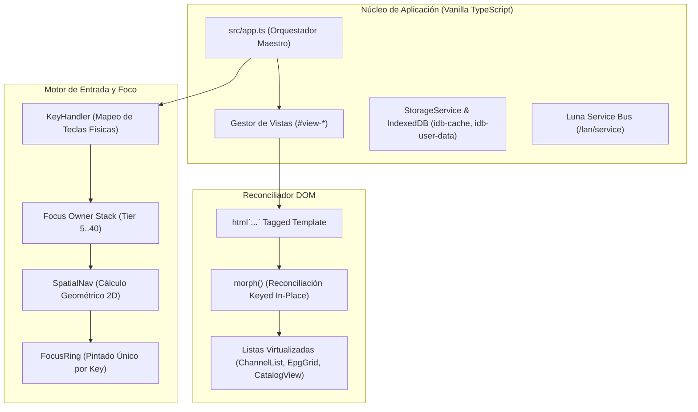

# AUDITORÍA DEL ESTADO ACTUAL DE LA APLICACIÓN (APP CURRENT STATE AUDIT)
## Misión M3.0 — iCast Design System & Premium TV UX Blueprint
**Proyecto:** webOS IPTV Player (v1.17.0) -> Transición a **iCast**  
**Pila Tecnológica:** TypeScript, Vanilla DOM Reconciler (`morph()`), esbuild, IndexedDB, Luna Bus  
**Dispositivo:** LG 65UM7400PDA (webOS TV Lite 4.10.2-29, Chromium 53.0.2785.34)  

---

## 1. Pila Tecnológica y Arquitectura de Renderizado

La aplicación actual está construida con una arquitectura de alto rendimiento diseñada específicamente para sortear las limitaciones de hardware de televisores inteligentes sin incurrir en el sobrecoste de frameworks pesados como React, Vue o Angular:

### 1.1 Características del Motor Frontend:
* **Vanilla DOM + `morph()`:** No existe virtual DOM pesado. La interfaz se reconcilia directamente sobre el DOM existente mediante `morph(target, safeHtml)`. Los nodos con `data-key` estable se reutilizan, preservando el foco del mando a distancia, el estado de scroll y los eventos delegados.
* **Empaquetado esbuild con Target `chrome53`:** El bundle JavaScript se compila a sintaxis ECMAScript compatible con Chromium 53, garantizando que ninguna sintaxis moderna no soportada rompa el motor en webOS 4.
* **Separación de Servicios:** El acceso a disco crítico utiliza `localStorage` para claves `iptv_*` y base de datos relacional IndexedDB para playlists y cachés de EPG/catálogo. El backend Node.js (`com.lennylxx.iptv.service`) se ejecuta como un proceso Luna independiente.
* **Pipeline Multimedia Nativo:** El elemento `<video id="video-player">` aprovecha los decodificadores por hardware (`vdec`/`omx`) del SoC Realtek RTD2870 a través del subsistema multimedia nativo de webOS.

---

## 2. Auditoría de la Identidad Visual Existente

La identidad actual de la aplicación refleja un enfoque técnico y utilitario, desarrollado para validar la funcionalidad pero carente del acabado y refinamiento de un producto comercial de primera línea:

### 2.1 Identidad de Marca y Naming
* **Nombre:** "webOS IPTV Player". Es un nombre meramente descriptivo, genérico y atado a la plataforma técnica, lo que impide construir un valor de marca memorable.
* **Logotipo:** No existe logotipo diseñado. La aplicación simplemente renderiza texto plano en mayúsculas/minúsculas dentro de la barra de navegación: `.tab-bar-title { font-size: 30px; font-weight: 700; color: var(--accent); }`.
* **Iconografía de Aplicación:** El icono actual en `appinfo.json` (`icon.png` 80×80 e `largeIcon.png` 130×130) consiste en una ilustración plana de un televisor con una antena, recurso visual anticuado que contradice la modernidad del streaming digital.

### 2.2 Sistema de Color Actual
* **Tema por Defecto ("Midnight"):**
  * Fondo: `#0a0a0f` (negro azulado muy oscuro).
  * Superficie Secundaria: `#12121a`.
  * Superficie Terciaria: `#1a1a2e`.
  * Tarjetas / Paneles: `#16213e`.
  * Color de Acento: `#00d4ff` (cian eléctrico de alto brillo).
  * Texto Primario: `#e8e8e8`.
  * Texto Secundario: `#a0a0b0`.
  * Bordes: `#2a2a3e`.
* **Dispersión Cromática:** El archivo `css/themes.css` contiene 13 temas distintos (midnight, ember, emerald, amethyst, daylight, plum-night, arctic, ocean-dark, vintage-amber, pastel-mocha, neon-night, pastel-latte, paper-light). Muchos de ellos fueron agregados sin un estudio de contraste ni cohesión con el contenido audiovisual.
* **Uso Excesivo del Acento:** El cian `#00d4ff` se utiliza indiscriminadamente en títulos, bordes de foco, botones activos, iconos de grupos y barras de progreso, diluyendo el foco visual del usuario.

### 2.3 Tipografía y Jerarquía
* **Pila de Fuentes:** `-apple-system, 'LG Smart UI', 'Helvetica Neue', Arial, sans-serif`.
* **Tamaños:**
  * Base de documento: 24px (adecuado para 10-foot UI).
  * Títulos H2: 32px (peso 600).
  * Títulos H3: 26px (peso 500).
  * Pestañas superiores: 30px (peso 700).
* **Deficiencias Detectadas:** Los subtítulos de canales y metadatos de emisión carecen de escala armónica; la falta de pesos semánticos produce bloques de texto homogéneos difíciles de escanear desde el sofá.

---

## 3. Auditoría de Componentes y Disposición Espacial

1. **Barra de Navegación Superior (`TabBar`):**
   * Altura fija de 96px (`background: var(--bg-secondary); border-bottom: 1px solid var(--border)`).
   * Contiene el título del app, pestañas de sección (**Live, Guide, Movies, Series, Settings, Search**), botón de búsqueda expansible y avatar del conmutador de cuentas.
   * *Problema de Diseño:* Ocupa demasiado espacio vertical permanente cuando se navega por el catálogo, reduciendo el área útil de visualización de canales a 984px.
2. **Navegador de Canales (`ChannelList`):**
   * Barra lateral izquierda (`.sidebar`, ancho 380px) con selector de playlists, contador de canales y lista virtualizada de grupos.
   * Área principal derecha (`.channel-main`) con lista virtualizada vertical de canales y panel lateral de mini-preview de vídeo (`#live-preview`).
   * *Problema de Diseño:* La disposición es eminentemente una lista tabular rígida. No utiliza tarjetas visuales ni tiles modernos con logotipos prominentes que faciliten la identificación inmediata del canal.
3. **Superposiciones del Reproductor (`PlayerOsd`, `Sidebar`, `PlayerMenu`):**
   * El OSD inferior es un rectángulo oscuro flotante (`background: rgba(30, 30, 50, 0.75)` con `border-radius: 12px; backdrop-filter: blur(16px)`).
   * *Problema de Compatibilidad en webOS 4:* Como Chromium 53 no soporta `backdrop-filter`, el archivo `css/legacy-webos-overrides.css` fuerza la regla `@supports not (backdrop-filter: blur(1px)) { .player-osd { background: rgb(10, 10, 15); } }`, convirtiendo el OSD en una caja opaca negra sin la sutileza visual prevista.
4. **Modales y Diálogos:**
   * Diálogos de confirmación (`ConfirmationPrompt`) y selector de PIN parental (`ParentalPinPrompt`) se renderizan como recuadros oscuros planos centrados en pantalla con botones toscos (`.btn`, `.btn-primary`).

---

## 4. Oportunidades Clave para el Rediseño iCast

La auditoría demuestra que la base técnica subyacente es excepcionalmente sólida, rápida y estable. Sin embargo, su presentación visual requiere un salto cualitativo integral:

| Área Auditada | Estado Actual (webOS IPTV Player) | Oportunidad de Transformación (iCast) |
| :--- | :--- | :--- |
| **Identidad** | Genérica, utilitaria, sin imagotipo. | Marca premium, isotipo icónico geométrico, tipografía cuidada. |
| **Materiales** | Vidrio que colapsa a negro opaco en webOS 4. | **Liquid Glass adaptado**: simulación óptica mediante gradientes y halos sin blur dinámico. |
| **Canales** | Lista vertical monótona de texto. | **Tiles visuales enriquecidos**, halos de foco nítidos y badges luminosos. |
| **Color** | 13 temas dispersos, cian omnipresente. | Paleta curada **Dark & Light Mode** con ratios WCAG calculados y acento zafiro selectivo. |
| **Navegación TV** | Funcional pero visualmente rígida. | Transiciones fluidas, elevación espacial al enfocar y feedback instantáneo al D-pad. |

