# CONCEPTOS DE IDENTIDAD DE MARCA (BRAND IDENTITY CONCEPTS)
## Misión M3.0 — iCast Design System & Premium TV UX Blueprint
**Objetivo:** Exploración conceptual y fundamentación geométrica de la identidad visual de **iCast**.  

---

## 1. Metáforas Visuales y Significado de iCast

La concepción gráfica de **iCast** se fundamenta en la interacción entre la **luz**, el **vidrio óptico** y la **emisión continua de datos**:

```mermaid
flowchart LR
    A["Luz de Emisión\n(Contenido IPTV)"] --> B["Prisma / Vidrio Óptico\n(iCast Runtime)"]
    B --> C["Experiencia de Salón\n(Gran Pantalla OLED / LED)"]
    
    style B fill:#182030,stroke:#3b82f6,stroke-width:2px
```



* **El Punto 'i' como Haz de Apertura:** El punto superior de la letra 'i' deja de ser un círculo tipográfico estático y se convierte en un emisor óptico de luz (el halo de señal que ilumina la interfaz).
* **El Fuste 'Cast' como Lente de Refracción:** El cuerpo inferior simboliza una superficie de cristal curvado que refracta y proyecta los canales hacia el espectador con nitidez cristalina.

---

## 2. Las Tres Direcciones Conceptuales de Identidad

Se desarrollaron tres propuestas conceptuales exhaustivas, evaluadas bajo los estándares de diseño de televisión y la estética de Liquid Glass:

---

### Dirección Alpha: "Cinematic Prism" (Prisma Cinematográfico) — DIRECCIÓN RECOMENDADA

```text
       ┌──────────┐
       │   ●      │   <-- Punto óptico emisor (Apertura de luz)
       │  ╱ ╲     │
       │ ╱   ╲    │   <-- Fuste de vidrio curvado continuo
       │ ╲   ╱    │       (Efecto de refracción espectral)
       │  ╲ ╱     │
       └──────────┘
```

* **Concepto:** Una cinta geométrica continua de vidrio templado que fluye formando una 'i' estilizada. La parte superior es un emisor circular con brillo especular de 1px; el fuste es un prisma aerodinámico que transmite solidez y fluidez.
* **Paleta Asociada:** Obsidiana Profunda (`#0A0C10`), Gris Pizarra (`#161A22`) y Acento Zafiro Espectral (`#3B82F6` con destellos `#60A5FA`).
* **Sensación Transmitida:** Máxima elegancia, sobriedad cinematográfica, precisión de alta fidelidad. Recuerda a las interfaces de referencia de Apple y salas de proyección privadas.
* **Comportamiento en Fondos:**
  * En Dark Mode: El cuerpo del isotipo es de vidrio gris pizarra translúcido con un halo de luz zafiro en la corona superior.
  * En Light Mode: Se transforma en un sólido de tono grafito profundo (`#1E2430`) con un destello azul cobalto.

---

### Dirección Beta: "Fluid Orbit" (Órbita Fluida)

```text
       ╭──────╮
     ╭─╯  ●   ╰─╮    <-- Anillo orbital exterior en expansión
    │   ╭───╮    │   <-- Núcleo de difusión central
     ╰─╮╰───╯╭──╯
       ╰──────╯
```

* **Concepto:** Dos arcos elípticos concéntricos en movimiento que envuelven un núcleo central, simbolizando la difusión de señales broadcast que convergen en la pantalla del salón.
* **Paleta Asociada:** Azul Medianoche (`#0D1117`), Azul Cobalto Eléctrico (`#2563EB`) y Cian Luminoso (`#06B6D4`).
* **Sensación Transmitida:** Alta tecnología, dinamismo digital, agilidad y conectividad global.
* **Evaluación Crítica:** Es una propuesta muy energética, pero su geometría circular compleja puede restar legibilidad al escalar el icono a dimensiones reducidas (80×80 px en webOS launcher).

---

### Dirección Gamma: "Atelier Screen" (Pantalla de Autor)

```text
     ┌───────────┐
     │  ┌─────┐  │   <-- Marco de precisión cinematográfico
     │  │  i  │  │   <-- Tipografía geométrica pura
     │  └─────┘  │   <-- Bisel de cobre/ámbar cálido
     └───────────┘
```

* **Concepto:** Una cuadrícula de proporción áurea inspirada en los monitores de referencia de estudio cinematográfico, con una 'i' tipográfica de caja baja tallada con precisión óptica y un bisel cálido.
* **Paleta Asociada:** Carbón Ahumado (`#141416`), Grafito Suave (`#222226`) y Ámbar Cobre Bruñido (`#F59E0B`).
* **Sensación Transmitida:** Artesanal, sofisticada, cálida y de autor.
* **Evaluación Crítica:** Aunque posee gran distinción editorial, el tono cálido/ámbar compite visualmente con los carteles y pósteres de películas y series en la interfaz del reproductor.

---

## 3. Matriz Comparativa y Decisión

| Criterio de Selección | Dirección Alpha: "Cinematic Prism" | Dirección Beta: "Fluid Orbit" | Dirección Gamma: "Atelier Screen" |
| :--- | :---: | :---: | :---: |
| **Personalidad y Distinción** | **Excelente (9.6/10)** | Buena (8.2/10) | Muy Buena (8.8/10) |
| **Legibilidad a 3 Metros en TV** | **Excelente (9.8/10)** | Aceptable (7.8/10) | Buena (8.5/10) |
| **Escalabilidad (80x80 a 1080p)** | **Excelente (9.5/10)** | Media (7.2/10) | Buena (8.4/10) |
| **Afinidad con Liquid Glass** | **Perfecta (10/10)** | Media (7.5/10) | Baja (6.8/10) |
| **Subordinación al Contenido** | **Óptima (9.7/10)** | Media (7.0/10) | Buena (8.2/10) |
| **Rendimiento en Chromium 53** | **Óptimo (100% SVG estático)**| Óptimo (SVG) | Óptimo (SVG) |

### Dictamen de Dirección Creativa:
Se adopta formalmente la **Dirección Alpha ("Cinematic Prism")** como la identidad visual oficial de **iCast**. Su geometría limpia garantiza un reconocimiento icónico instantáneo tanto en el tile de 80×80 px del launcher de webOS como en la cabecera de la aplicación y en las comunicaciones del proyecto.

