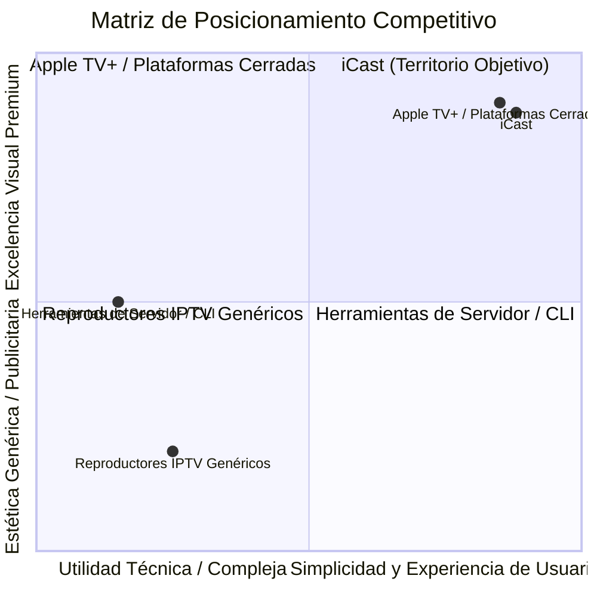

# ESTRATEGIA Y POSICIONAMIENTO DE MARCA (BRAND STRATEGY)
## Misión M3.0 — iCast Design System & Premium TV UX Blueprint
**De:** `webOS IPTV Player`  
**Hacia:** **iCast**  
**Categoría:** Reproductor Multimedia de Televisión de Gama Alta  

---

## 1. La Transformación: De Herramienta Técnica a Marca de Consumo Premium

El nombre anterior, `webOS IPTV Player`, cumplió una función instrumental durante las fases de investigación técnica, desarrollo de compatibilidad con Chromium 53 y estabilización de protocolos (Misiones M0 a M2.4). Sin embargo, como producto de consumo final presentaba tres limitaciones insalvables:
1. **Descriptivo y Frío:** Describía la tecnología subyacente y la plataforma, no la experiencia emocional del espectador.
2. **Atado a una Sola Plataforma:** La mención explícita de "webOS" limitaba conceptualmente la identidad del software.
3. **Asociación con Clichés de Baja Calidad:** El término "IPTV Player" arrastra una connotación de reproductores saturados de publicidad, interfaces caóticas y estética pirata.

# **iCast**

El nuevo nombre encarna la convergencia entre:
* **"i"**: Interactivo, Inteligente, Individual, Inmediato, Íntimo.
* **"Cast"**: Difusión, Transmisión, Proyección audiovisual, Lanzamiento fluido de contenido hacia la gran pantalla.

---

## 2. Los Cuatro Pilares de la Marca iCast

### Pilar 1: Fluidez Pura (Pure Fluidity)
El software responde a la velocidad del pensamiento. Cuando el usuario pulsa un botón en el mando físico, la interfaz reacciona en menos de 16 milisegundos. No existen pantallas de carga innecesarias, animaciones bloqueantes ni tartamudeos en el menú.

### Pilar 2: Claridad Óptica (Optical Clarity)
Inspirado en la óptica física y en los principios de **Liquid Glass**, iCast utiliza superficies translúcidas depuradas, bordes sutiles que atrapan la luz y una jerarquía tipográfica impecable. Cada elemento en pantalla ha tenido que ganarse su derecho a estar presente.

### Pilar 3: Respeto por el Salón (Living Room Sanctuary)
La televisión es el centro de reunión del hogar. iCast no satura la vista con colores neón agresivos ni tipografías diminutas. Ofrece una experiencia sosegada, cinematográfica y legible a 3 metros de distancia, donde el contenido de las emisiones es siempre el protagonista absoluto.

### Pilar 4: Control Soberano y Privacidad (Sovereign Control)
A diferencia de los servicios de suscripción cerrados que imponen algoritmos publicitarios, iCast otorga al usuario el control absoluto sobre sus fuentes M3U, guías EPG y bibliotecas VOD, manteniendo los datos 100% locales en el dispositivo con política *fail-closed*.

---

## 3. Tono de Voz y Personalidad

El tono de comunicación de iCast (en textos de interfaz, avisos, configuración y mensajes de error) sigue los estándares de `writing.md` y `branding.md`:

* **Seguridad sin Arrogancia:** Comunicar con precisión técnica pero en lenguaje claro y accesible.
* **Directo y Sin Relleno:**
  * ❌ *Incorrecto:* "Por favor, espere mientras el sistema intenta conectarse a la fuente de vídeo seleccionada..."
  * ✔️ *iCast:* "Conectando al canal…"
* **Orientado a la Acción y a la Solución:**
  * ❌ *Incorrecto:* "Error 404: Playlist vacía o no disponible."
  * ✔️ *iCast:* "No se encontraron canales. Comprueba la dirección en Ajustes."
* **Humano y Respetuoso:** Cero disculpas serviles en errores y cero jerga técnica innecesaria en la pantalla de inicio.

---

## 4. Regla de Oro: La Marca se Subordina al Contenido

En cumplimiento riguroso de la guía oficial de Apple (`branding.md › Best practices`):
> *"Ensure branding always defers to content. Using screen space for an element that does nothing but display a brand asset can mean there’s less room for the content people care about."*

1. **Sin Logotipos Omnipresentes:** El imagotipo de iCast no se repetirá en cada esquina de la pantalla ni ensuciará la reproducción de vídeo. Aparece únicamente en la pantalla de arranque inicial (`splash`) y en la cabecera minimalista de la barra de navegación superior.
2. **Color de Marca con Comedimiento:** El color acento distintivo de iCast (Zafiro Espectral) se reserva exclusivamente para el estado de selección activa del mando y para badges críticos en directo. El 90% de la interfaz permanece en tonalidades neutras de vidrio oscuro y tipografía blanca de alto contraste.

