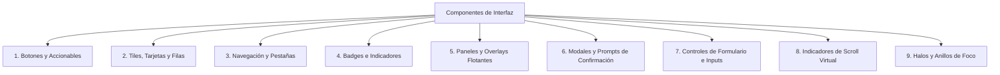

# INVENTARIO DE COMPONENTES DE INTERFAZ (COMPONENT INVENTORY)
## Misión M3.0 — iCast Design System & Premium TV UX Blueprint
**Alcance:** Catalogación exhaustiva de los componentes de UI reutilizables y estilos en `src/components/` y `css/`.  

---

## 1. Clasificación Jerárquica de Componentes

La interfaz actual se compone de 9 categorías de componentes principales que interactúan directamente con el reconciliador de DOM Vanilla (`morph()`) y el sistema de foco espacial (`SpatialNav` / `FocusScope`).



---

## 2. Catálogo Técnico de Componentes Existentes

### 2.1 Botones y Accionables (Buttons)

| Componente / Clase | Archivo Fuente / Líneas | Estilo CSS | Comportamiento en Foco | Deuda Técnica / Oportunidad |
| :--- | :--- | :--- | :--- | :--- |
| **Botón Base (`.btn`)** | `css/main.css:233-247` | Padding 10px 24px, fuente 22px, borde 2px `#2a2a3e`, radio 8px. | `scale(1.03)`, cambio a `--accent-dim` con texto blanco. | Radio de esquina rígido (8px); transición tosca. |
| **Botón Primario (`.btn-primary`)** | `css/main.css:248-251` | Fondo cian atenuado (`--accent-dim`), borde cian brillante. | Halo cian de 20px (`--accent-glow`). | Contraste de texto deficiente en algunos temas. |
| **Botón de Peligro (`.btn-danger`)** | `css/main.css:252-256`, `css/navigation.css:25-33` | Fondo y borde rojo `--danger` (`#ff4757`). | Halo rojo difuso (`rgba(255, 71, 87, 0.35)`). | Sin icono de advertencia semántico; color puro. |
| **Botón de Edición (`.channel-edit-btn`)** | `css/channel-list.css:30-58` | Cuadrado de 42×42 px, transparente con icono SVG. | Cambio a `--accent` con fondo `--bg-tertiary`. | Icono muy pequeño para visualización a 3 metros. |
| **Flechas de Riel (`.catalog-rail-arrow`)** | `css/catalog-view.css` | Botones circulares flotantes a izquierda y derecha de carruseles. | Aumento sutil de opacidad y escala. | Difíciles de enfocar con D-pad lateral rápido. |

---

### 2.2 Tiles, Tarjetas y Filas (Tiles & Cards)

| Componente / Clase | Archivo Fuente / Líneas | Dimensiones y Disposición | Estados Visuales | Adaptación Requerida para iCast |
| :--- | :--- | :--- | :--- | :--- |
| **Fila de Canal (`.channel-item`)** | `css/channel-list.css:221-350` | Altura fija 72px (virtualizada), flex horizontal. | Normal, `.active` (reproduciendo), `.focused` (foco D-pad). | Transformar de fila simple a **Tile Premium con logotipo y metadatos vítreos**. |
| **Fila de Grupo (`.group-item`)** | `css/channel-list.css:108-160` | Altura fija 60px, padding 14px 16px, radio 8px. | Fondo `--bg-tertiary`, borde cian en foco. | Añadir iconografía de género personalizada y jerarquía visual. |
| **Póster VOD (`.catalog-card`)** | `css/catalog-view.css:80-180` | Relación de aspecto 2:3 (vertical), 200×300 px aprox. | Escala a 1.05 en foco con sombra y halo de acento. | Introducir efecto de **relieve de cristal Liquid Glass** en la selección. |
| **Bloque EPG (`.epg-programme`)** | `css/epg.css:120-240` | Ancho variable proporcional a la duración (30 min = 240px). | Fondo azul marino, borde cian en foco. | Rediseñar títulos truncados; añadir barras de progreso de emisión. |
| **Muestra de Tema (`.theme-swatch`)** | `css/settings.css:320-390` | Bloques rectangulares de 160×90 px con chips de previsualización. | Borde cian grueso en foco. | Simplificar a opciones curadas Dark / Light / OLED Black. |

---

### 2.3 Navegación y Pestañas (Navigation)

| Componente / Clase | Archivo Fuente / Líneas | Estilo y Métricas | Función Operativa | Oportunidad de Rediseño |
| :--- | :--- | :--- | :--- | :--- |
| **Barra Superior (`.tab-bar`)** | `css/tab-bar.css:1-168` | Fija en top: 0, altura 96px, fondo `--bg-secondary`. | Aloja las 6 secciones maestras y el conmutador de perfiles. | **Convertir en barra funcional flotante translúcida** con esquinas redondeadas. |
| **Pestaña de Navegación (`.tab-bar-item`)** | `css/tab-bar.css:59-84` | Fuente 30px peso 700, padding 4px 2px, borde inferior 3px. | Línea inferior activa al sintonizar la sección. | Usar píldoras de cristal elevadas en lugar de simples subrayados. |
| **Pestaña de Playlist (`.playlist-tab`)** | `css/channel-list.css:69-95` | Pestañas horizontales superiores en la barra de canales. | Conmuta entre fuentes M3U o Xtream. | Rediseñar con badges de estado y nombres compactos. |

---

### 2.4 Badges e Indicadores (Badges & Indicators)

| Componente / Clase | Archivo Fuente / Líneas | Apariencia Visual | Función en la Interfaz | Regla HIG de Referencia |
| :--- | :--- | :--- | :--- | :--- |
| **Badge En Vivo (`.live-badge`)** | `src/components/live-badge.ts`, `css/main.css:63-88` | Píldora roja (`--danger`) con punto blanco que pulsa (`liveBadgeDotPulse`). | Señala que el stream actual es emisión en tiempo real. | `branding.md`: Usar colores de estado con alta diferenciación. |
| **Punto de Salud (`.channel-health-dot`)** | `css/main.css:39-62` | Círculo de 10×10 px en verde (`healthy`), amarillo (`suspect`) o rojo (`unavailable`). | Indica la disponibilidad del canal comprobada en background. | `accessibility.md`: Acompañar el color con texto o forma semántica. |
| **Badge Parental (`.parental-badge`)** | `src/components/parental-badge.ts` | Icono de candado con borde amarillo/dorado. | Identifica canales o VOD restringidos por PIN. | Requiere simplificación de trazo para lectura limpia en miniaturas. |
| **Ecualizador Activo (`.playing-indicator`)** | `css/channel-list.css:480-520` | Tres barras verticales animadas que suben y bajan. | Muestra qué canal está emitiendo en el reproductor. | Desactivar en modo de movimiento reducido para ahorrar CPU. |

---

### 2.5 Paneles y Overlays Flotantes (Overlays)

| Componente / Clase | Archivo Fuente / Líneas | Capa y Z-Index | Desafío en Chromium 53 | Solución iCast |
| :--- | :--- | :--- | :--- | :--- |
| **OSD del Reproductor (`.player-osd`)** | `css/player.css:46-120` | Z-index 60, inferior flotante. | `backdrop-filter: blur(16px)` ignorado; forzado a negro opaco. | **Capa de cristal estática**: degradado sutil con borde especular superior de 1px. |
| **Barra Lateral (`.player-sidebar`)** | `css/player.css:241-380` | Z-index 60, deslizamiento lateral. | Bloque negro masivo sobre el vídeo. | Panel semi-translúcido con viñeta lateral integrada. |
| **Menú de Ajustes (`.player-menu`)** | `css/player.css:451-590` | Z-index 60, superior/central. | Colapso a caja opaca sin profundidad. | Estructura en tarjetas flotantes tipo panel de control. |

---

### 2.6 Modales y Prompts de Confirmación (Modals)

| Componente / Clase | Archivo Fuente / Líneas | Prioridad de Foco (Tier) | Acciones y Rutas | Directriz Apple HIG |
| :--- | :--- | :--- | :--- | :--- |
| **Prompt Confirmación (`.confirmation-prompt`)** | `src/components/confirmation-prompt.ts` | `Tier.prompt` (30) | Botón primario y botón de cancelar. | `alerts.md`: Foco inicial siempre en la opción no destructiva (Cancelar). |
| **Prompt PIN Parental (`.parental-pin-prompt`)** | `src/components/parental-pin-prompt.ts` | `Tier.critical` (40) | 4 dígitos numéricos en casillas individuales. | `modality.md`: Tarea única, clara, con salida inmediata mediante Back. |
| **Prompt Recordatorio (`.reminder-prompt`)** | `src/components/reminder-prompt.ts` | `Tier.prompt` (30) | "Sintonizar ahora" vs "Descartar". | Notificación no modal que no debe interrumpir el vídeo abruptamente. |

---

### 2.7 Indicadores de Foco y Navegación (Focus Engine)

* **Clase Maestra `.focused`:** Aplicada dinámicamente por `FocusRing` al nodo cuyo `data-key` coincide con el foco lógico del propietario activo.
* **Estilo Actual en `css/navigation.css`:**
  ```css
  [data-focusable].focused {
    border-color: var(--focus-ring) !important;
    box-shadow: 0 0 0 3px var(--accent-glow), 0 0 20px var(--accent-glow);
    z-index: 10;
  }
  ```
* **Diagnóstico Crítico:** El resplandor difuso (`box-shadow: 0 0 20px ...`) produce coste de rasterizado en la GPU Realtek RTD2870. En iCast se evolucionará hacia un **borde nítido dual de alto contraste** (anillo exterior luminoso de 2px + anillo interior de separación de 1px), mucho más nítido y eficiente para hardware de televisión.

---

## 3. Plan de Unificación para la Nueva Arquitectura

El inventario evidencia que existen estilos duplicados de botones y fondos repartidos en más de 8 hojas CSS distintas (`player.css`, `channel-list.css`, `epg.css`, `settings.css`, `tab-bar.css`, etc.).
Durante las fases de implementación de M3:
1. Todos los botones convergerán en un único componente base de token semántico (`iCastButton`).
2. Las tarjetas de canal, pósteres de películas y bloques EPG compartirán el sistema de elevación y radio de esquina (`iCastTile`).
3. Todos los paneles flotantes consumirán las clases de material estático (`iCastGlass`).

