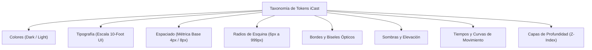

# ARQUITECTURA DE TOKENS DE DISEÑO (DESIGN TOKENS)
## Misión M3.0 — iCast Design System & Premium TV UX Blueprint
**Formato de Entrega:** CSS Custom Properties + Tipos Estrictos en TypeScript  
**Compatibilidad:** Chromium 53+, motor Vanilla DOM `morph()`  

---

## 1. Taxonomía de Tokens de iCast

Los tokens de diseño constituyen la única fuente de verdad cromática, dimensional y temporal de **iCast**. Evitan que los valores numéricos o colores queden dispersos como números mágicos en el código TypeScript o en hojas de estilo desacopladas.



---

## 2. Definición Maestra de CSS Custom Properties

El bloque oficial de variables CSS de **iCast** se declara en el nivel raíz `:root` y se sobreescribe de forma limpia mediante los atributos `data-theme="dark"` y `data-theme="light"`:

```css
/* ==========================================================================
   iCast Design System — Master CSS Tokens
   ========================================================================== */

:root {
  /* 1. Métrica Espacial Base (Escala Proporcional 4px/8px) */
  --icast-space-1: 4px;
  --icast-space-2: 8px;
  --icast-space-3: 12px;
  --icast-space-4: 16px;
  --icast-space-5: 20px;
  --icast-space-6: 24px;
  --icast-space-8: 32px;
  --icast-space-10: 40px;
  --icast-space-12: 48px;
  --icast-space-16: 64px;

  /* 2. Radios de Curvatura (Bordes Suavizados) */
  --icast-radius-sm: 6px;     /* Badges muy pequeños, tags técnicos */
  --icast-radius-md: 8px;     /* Botones secundarios compactos */
  --icast-radius-tile: 12px;  /* Tiles estándar de canal y categoría */
  --icast-radius-card: 16px;  /* Pósteres VOD y tarjetas de carrusel */
  --icast-radius-modal: 20px; /* Paneles flotantes de cristal y modales */
  --icast-radius-pill: 999px; /* Píldoras de estado LIVE y tuning rápido */

  /* 3. Escala Tipográfica (1920x1080 / 10-Foot UI) */
  --icast-font-family: -apple-system, 'LG Smart UI', 'SF Pro Display', 'Helvetica Neue', Arial, sans-serif;
  --icast-font-display: 44px;
  --icast-font-title-1: 36px;
  --icast-font-title-2: 30px;
  --icast-font-title-3: 24px;
  --icast-font-body: 20px;
  --icast-font-callout: 17px;
  --icast-font-caption: 14px;

  /* 4. Tiempos y Aceleración de Movimiento */
  --icast-ease-out: cubic-bezier(0.16, 1, 0.3, 1);
  --icast-ease-in: cubic-bezier(0.4, 0, 1, 1);
  --icast-dur-micro: 120ms;
  --icast-dur-focus: 140ms;
  --icast-dur-modal: 160ms;
  --icast-dur-panel: 180ms;
  --icast-dur-scene: 200ms;

  /* 5. Jerarquía de Capas Z-Index */
  --icast-z-video: 0;       /* Superficie nativa de vídeo hardware */
  --icast-z-subtitles: 2;   /* Capa de subtítulos de vídeo */
  --icast-z-content: 10;    /* Cuadrículas de canales, listas, EPG */
  --icast-z-tabbar: 40;     /* Barra superior anclada */
  --icast-z-osd: 60;        /* Controles de reproducción flotantes */
  --icast-z-modal: 80;      /* Modales de confirmación y menús */
  --icast-z-critical: 100;  /* PIN Parental, avisos de sistema */
  --icast-z-toast: 120;     /* Notificaciones transitorias */
}

/* ==========================================================================
   Modo Oscuro (iCast Dark Mode — Oficial)
   ========================================================================== */
html[data-theme="dark"],
:root {
  --icast-bg-primary: #080A0F;
  --icast-bg-surface: #11151F;
  --icast-bg-elevated: #182030;
  --icast-text-primary: #F1F5F9;
  --icast-text-secondary: #94A3B8;
  --icast-text-muted: #64748B;
  
  --icast-accent: #3B82F6;
  --icast-accent-highlight: #60A5FA;
  --icast-accent-dim: #1D4ED8;
  --icast-focus-ring: #60A5FA;

  --icast-success: #10B981;
  --icast-warning: #F59E0B;
  --icast-danger: #EF4444;

  --icast-border-subtle: rgba(255, 255, 255, 0.08);
  --icast-border-glass: rgba(255, 255, 255, 0.16);
  --icast-border-specular: rgba(255, 255, 255, 0.28);
  --icast-overlay-scrim: rgba(4, 6, 10, 0.85);

  --icast-shadow-tile: 0 4px 12px rgba(0, 0, 0, 0.35);
  --icast-shadow-focus: 0 8px 24px rgba(0, 0, 0, 0.50);
  --icast-shadow-modal: 0 16px 40px rgba(0, 0, 0, 0.65);
}

/* ==========================================================================
   Modo Claro (iCast Light Mode — Diurno)
   ========================================================================== */
html[data-theme="light"] {
  --icast-bg-primary: #F4F6F9;
  --icast-bg-surface: #FFFFFF;
  --icast-bg-elevated: #FFFFFF;
  --icast-text-primary: #0F172A;
  --icast-text-secondary: #475569;
  --icast-text-muted: #64748B;
  
  --icast-accent: #2563EB;
  --icast-accent-highlight: #1D4ED8;
  --icast-accent-dim: #DBEAFE;
  --icast-focus-ring: #2563EB;

  --icast-success: #059669;
  --icast-warning: #D97706;
  --icast-danger: #DC2626;

  --icast-border-subtle: rgba(0, 0, 0, 0.08);
  --icast-border-glass: rgba(0, 0, 0, 0.14);
  --icast-border-specular: rgba(255, 255, 255, 0.80);
  --icast-overlay-scrim: rgba(15, 23, 42, 0.60);

  --icast-shadow-tile: 0 2px 8px rgba(0, 0, 0, 0.06);
  --icast-shadow-focus: 0 6px 16px rgba(37, 99, 235, 0.20);
  --icast-shadow-modal: 0 12px 32px rgba(0, 0, 0, 0.15);
}
```

---

## 3. Tipado Estricto de Tokens en TypeScript

Para garantizar la integridad y evitar discrepancias en la lógica de renderizado en Vanilla TypeScript, se define el contrato formal de tokens en código:

```typescript
// src/types/tokens.ts (Modelo de Tokens iCast)

export interface ColorTokens {
  readonly bgPrimary: string;
  readonly bgSurface: string;
  readonly bgElevated: string;
  readonly textPrimary: string;
  readonly textSecondary: string;
  readonly textMuted: string;
  readonly accent: string;
  readonly accentHighlight: string;
  readonly accentDim: string;
  readonly focusRing: string;
  readonly success: string;
  readonly warning: string;
  readonly danger: string;
  readonly borderSubtle: string;
  readonly borderGlass: string;
}

export interface MetricTokens {
  readonly spaceBase: number; // 4
  readonly radiusTile: number; // 12
  readonly radiusCard: number; // 16
  readonly radiusModal: number; // 20
  readonly fontBody: number; // 20
  readonly fontTitle3: number; // 24
  readonly fontTitle2: number; // 30
  readonly fontTitle1: number; // 36
  readonly fontDisplay: number; // 44
}
```

