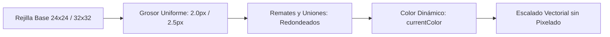

# SISTEMA DE ICONOGRAFÍA VECTORIAL (ICONOGRAPHY SYSTEM)
## Misión M3.0 — iCast Design System & Premium TV UX Blueprint
**Formato de Entrega:** SVG Vectorial Inline Puro  
**Rejillas Base:** 24 × 24 px (Secundarios) y 32 × 32 px (Primarios / Transporte)  
**Geometría:** Trazos Continuos de Grosor Uniforme (2.0 px / 2.5 px)  

---

## 1. Principios de Diseño de Iconos para Televisión

En consonancia con las directrices de Apple HIG (`icons.md` y `sf-symbols.md`) y la arquitectura de webOS:
1. **Cero Dependencia de Icon Fonts:** Las fuentes de iconos (como FontAwesome) son propensas a fallos de renderizado en Chromium 53 y añaden peso innecesario.
2. **Cero Unicode Exótico:** Por regla técnica de webOS, los símbolos Unicode no estándar (como `↺`) se renderizan como recuadros vacíos (*tofu*) en la fuente del televisor. **Todo icono interactivo en iCast es un SVG vectorial optimizado con `fill: currentColor`**.
3. **Consistencia Óptica y Geométrica:** Todos los iconos comparten el mismo radio de curvatura en esquinas (`rx="2"` / `ry="2"`), remates redondeados (`stroke-linecap="round"`) y uniones suaves (`stroke-linejoin="round"`).



---

## 2. Catálogo Maestro de Iconografía iCast

### 2.1 Navegación Principal y Pestañas (Rejilla 32×32 px)

| Icono / Función | Nombre de Identificador | Geometría SVG Esencial | Uso en Interfaz |
| :--- | :--- | :--- | :--- |
| **TV en Vivo** | `icon-nav-live` | Pantalla rectangular moderna con pedestal mínimo y punto de emisión en esquina. | Pestaña "Live" en TabBar. |
| **Guía de TV** | `icon-nav-guide` | Rejilla horizontal de 3 filas con bloques asimétricos simulando la línea temporal. | Pestaña "Guide" en TabBar. |
| **Películas (VOD)**| `icon-nav-movies` | Claqueta de cine minimalista inclinada a 15° con tres bandas superiores. | Pestaña "Movies" en TabBar. |
| **Series (VOD)** | `icon-nav-series` | Dos pantallas superpuestas en perspectiva sutil (pantalla frontal y dorsal). | Pestaña "Series" en TabBar. |
| **Ajustes** | `icon-nav-settings`| Tres deslizadores horizontales de precisión con controles alineados. | Pestaña "Settings" en TabBar. |
| **Búsqueda** | `icon-nav-search` | Lente circular centrada con haz de luz diagonal a 45°. | Botón de búsqueda en TabBar. |
| **Perfil/Cuenta** | `icon-nav-account` | Círculo perimetral con busto geométrico minimalista. | Conmutador de perfiles Xtream. |

---

### 2.2 Controles de Reproducción y Transporte Multimedia (Rejilla 32×32 px)

| Icono / Función | Nombre de Identificador | Geometría SVG Esencial | Uso en Interfaz |
| :--- | :--- | :--- | :--- |
| **Play** | `icon-player-play` | Triángulo equilátero suavizado con esquinas redondeadas (`r=2px`). | Botón central de reproducción. |
| **Pausa** | `icon-player-pause`| Dos barras verticales paralelas redondeadas separadas por 8px. | Pausa en VOD y directos. |
| **Retroceso** | `icon-player-rewind`| Dos puntas de flecha consecutivas orientadas a la izquierda. | Salto de -10 seg / -30 seg. |
| **Avance** | `icon-player-forward`| Dos puntas de flecha consecutivas orientadas a la derecha. | Salto de +10 seg / +30 seg. |
| **Subtítulos** | `icon-player-subs` | Bocadillo de diálogo rectangular con dos líneas de texto internas. | Selector de pistas de subtítulos. |
| **Pistas Audio** | `icon-player-audio`| Onda sonora estéreo simétrica que emana de un núcleo central. | Selector de idiomas de audio. |
| **Relación Aspecto**| `icon-player-aspect`| Rectángulo 16:9 con cuatro marcas de encuadre en las esquinas. | Conmutador de aspect ratio. |
| **Catchup / Grabación**| `icon-player-catchup`| Esfera de reloj con aguja a las 9:00 y flecha circular de retorno exterior. | Canales con función de archivo. |

---

### 2.3 Acciones de Sistema y Estados de Contenido (Rejilla 24×24 px)

| Icono / Función | Nombre de Identificador | Geometría SVG Esencial | Significado Semántico |
| :--- | :--- | :--- | :--- |
| **Favorito Activo** | `icon-fav-active` | Estrella geométrica de 5 puntas rellena en color dorado/zafiro. | Canal guardado en favoritos. |
| **Favorito Inactivo**| `icon-fav-inactive`| Estrella con silueta hueca de trazo 2px (`fill: none`). | Añadir a favoritos. |
| **Bloqueo Parental**| `icon-parental-lock`| Candado con arco cerrado sobre cuerpo rectangular sólido. | Categoría o canal restringido. |
| **Actualizar Lista** | `icon-sync-refresh` | Flechas circulares en bucle cerrado (diseño propietario iCast). | Sincronización de playlist. |
| **Atrás / Volver** | `icon-action-back` | Chevron simple orientado a la izquierda (`<`). | Indicador de retorno con Back. |
| **Comprobado / OK** | `icon-action-check`| Marca de verificación en ángulo agudo (`✓`). | Ajuste seleccionado y guardado. |
| **Alerta / Aviso** | `icon-alert-warn` | Triángulo equilátero con signo de exclamación central. | Notificación de error o advertencia. |

---

## 3. Estados Interactivos de los Iconos

Los iconos de iCast reaccionan en tiempo real a las acciones del control remoto:

```css
/* Estados Interactivos de Iconografía iCast: */
.icast-icon {
  width: 28px;
  height: 28px;
  display: inline-flex;
  align-items: center;
  justify-content: center;
  color: var(--icast-text-secondary);
  transition: color 140ms ease, transform 140ms ease;
}

/* En reposo: */
.icast-tile:not(.focused) .icast-icon {
  color: var(--icast-text-secondary);
  opacity: 0.85;
}

/* En foco D-pad: */
.icast-tile.focused .icast-icon,
.tab-bar-item.focused .icast-icon {
  color: var(--icast-accent-highlight);
  transform: scale(1.10);
  opacity: 1.0;
}

/* Seleccionado / Activo: */
.tab-bar-item.active .icast-icon {
  color: var(--icast-accent);
}

/* Deshabilitado: */
.icast-btn:disabled .icast-icon {
  color: var(--icast-text-muted);
  opacity: 0.35;
}
```

### Optimización de Memoria:
Cada icono SVG tiene un peso inferior a **400 bytes**. La colección completa de 24 iconos suma menos de **10 KB**, consumiendo una fracción imperceptible de memoria RAM en comparación con bibliotecas externas de varios megabytes.

