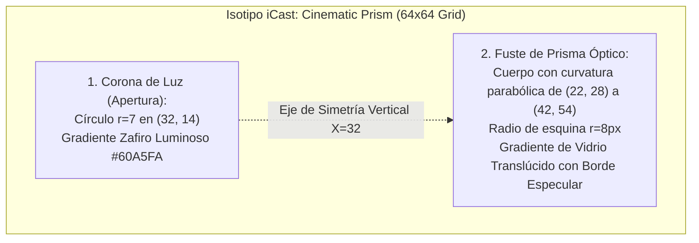
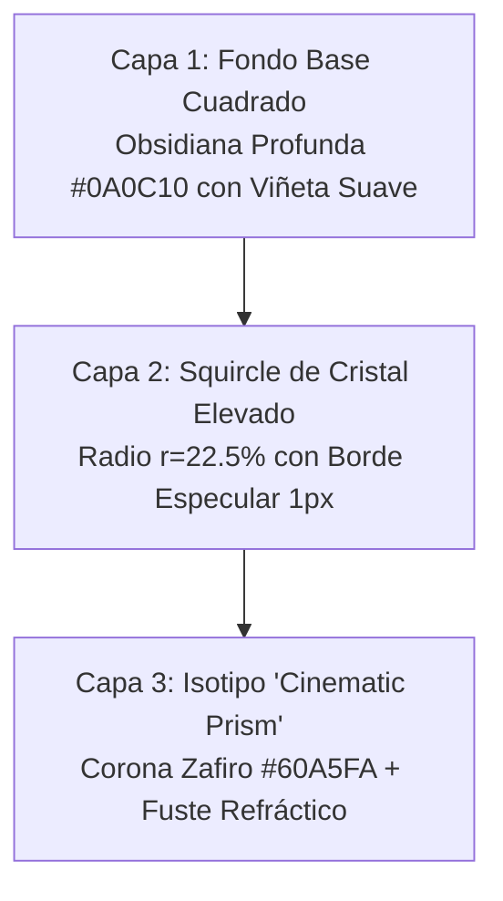

# ESPECIFICACIÓN DEL LOGOTIPO E ICONO DE APLICACIÓN (LOGO & APP ICON DIRECTION)
## Misión M3.0 — iCast Design System & Premium TV UX Blueprint
**Identidad Seleccionada:** Concepto Alpha ("Cinematic Prism")  
**Formatos Objetivo:** webOS Launcher, Splash Screen, TabBar, Documentación  

---

## 1. Geometría y Construcción del Isotipo iCast

El isotipo de **iCast** se construye sobre una cuadrícula de precisión de 64×64 unidades vectoriales. Está compuesto por dos entidades geométricas interconectadas por la luz:



### 1.1 Especificación Matemática de Trazos
1. **La Corona (Punto 'i'):**
   * Coordenadas centrales: `cx = 32`, `cy = 14`, radio `r = 7`.
   * Iluminación: Degradado radial desde el centro `#93C5FD` hacia el perímetro `#3B82F6` con halo de dispersión de 2px.
2. **El Fuste (Cuerpo 'Cast'):**
   * Rectángulo con deformación óptica y esquinas suavizadas (`border-radius: 8px`).
   * Borde superior con bisel especular de 1px: `stroke: rgba(255, 255, 255, 0.45)`.
   * Relleno interior: Gradiente lineal a 135° de `rgba(59, 130, 246, 0.22)` a `rgba(30, 41, 59, 0.65)`.
   * Borde inferior de apoyo: `stroke: rgba(59, 130, 246, 0.3)`.

---

## 2. Tipografía del Logotipo (Wordmark)

El logotipo completo combina el isotipo con el nombre **iCast**:

```text
    ┌──────┐
    │  ●   │   iCast
    │ ╱ ╲  │
    └──────┘
```

* **Composición Tipográfica:**
  * La **"i"** inicial se renderiza en caja baja con fuste recto y espaciado métrico ajustado al fuste del isotipo.
  * La partícula **"Cast"** se renderiza con 'C' mayúscula en peso Bold (700), transmitiendo solidez y presencia.
* **Proporciones de Escala:**
  * Altura del Isotipo = 1.25 × Altura de la 'X' de la tipografía.
  * Separación horizontal entre Isotipo y Wordmark = 16px en canvas de 1080p.
* **Versiones del Logotipo:**
  1. **Bloque Horizontal Primario:** Isotipo a la izquierda (48×48 px) + texto "iCast" (32px). Utilizado en la barra de navegación superior (`TabBar`).
  2. **Bloque Vertical Centrado (Splash / About):** Isotipo ampliado (128×128 px) centrado sobre el texto "iCast" (44px) con el subtítulo secundario *"Televisión Redefinida"*.
  3. **Versión Monocromática Pura:** Silueta 100% vector blanco (`#FFFFFF`) para fondos fotográficos complejos y silueta negro grafito (`#1E2430`) para documentos impresos.

---

## 3. Especificación del Icono de Aplicación para webOS

El icono de la aplicación gobernará la presencia de iCast en el lanzador oficial de LG webOS (barra inferior de tarjetas del televisor):



### 3.1 Requisitos de Formato de LG webOS
| Formato de Imagen | Dimensiones Requeridas | Ubicación en el Paquete | Función en la Plataforma |
| :--- | :---: | :--- | :--- |
| **`icon.png`** | **80 × 80 px** | Raíz del paquete IPK (`appinfo.json:icon`) | Icono estándar en la barra de inicio de webOS. |
| **`largeIcon.png`** | **130 × 130 px** | Raíz del paquete IPK (`appinfo.json:largeIcon`) | Tarjeta expandida en menús de edición y tienda. |
| **`splashBackground.png`** | **1920 × 1080 px** | Raíz del paquete (`appinfo.json:splashBackground`)| Fondo de arranque instantáneo mientras carga el motor. |

### 3.2 Reglas HIG Aplicadas al Icono (`app-icons.md`):
1. **Sin Texto:** Se excluye terminantemente la palabra "iCast" dentro del icono de 80×80 px. A esa distancia y tamaño, el texto es ilegible. El sistema operativo ya muestra el título debajo de la tarjeta.
2. **Silueta Icónica Inconfundible:** El prisma óptico con su punto superior iluminado proporciona un contraste de más de 12:1 contra el fondo oscuro, haciéndolo reconocible al instante entre las demás apps del televisor.
3. **Cero Imitación de Marcas de Terceros:** El diseño no utiliza la manzana de Apple, ni engranajes de configuración, ni símbolos de antena de televisión analógica.

---

## 4. Fondos y Transparencias

* **Tile de webOS:** El fondo del squircle utiliza un valor HEX sólido `#0E121A` con degradado a `#161D2B`. webOS aplica un recorte perimetral nativo según la versión del sistema, por lo que el diseño respeta un margen de seguridad interior del 15% para evitar que las esquinas corten el isotipo.
* **Splash Screen de 1080p:** Fondo negro cinemático `#06080B` con un brillo radial sutil al 12% en el centro geométrico donde reposa el isotipo de iCast, garantizando una transición impecable hacia el reproductor sin destellos blancos molestos en habitaciones oscuras.

