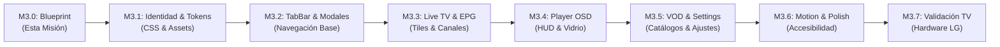

# HOJA DE RUTA DE IMPLEMENTACIÓN M3 (M3 IMPLEMENTATION ROADMAP)
## iCast: De Blueprint a Realidad en Hardware
**Proyecto:** iCast v1.17.0 (anteriormente webOS IPTV Player)  
**Objetivo:** Plan de ejecución por fases controladas, modulares y verificables.  

---

## 1. Visión General de Fases y Dependencias

La implementación de la nueva identidad y sistema de diseño se estructura en **8 fases secuenciales (M3.0 a M3.7)**. Cada fase cuenta con compuertas de calidad estrictas (*Quality Gates*) y pruebas automatizadas asociadas:

---

## 2. Especificación Detallada de Cada Fase

### Fase M3.0: Design System & Rebranding Blueprint (Completada en Esta Misión)
* **Objetivo:** Investigación, auditoría completa, formulación de identidad, sistema de diseño y plan de rediseño sin tocar código productivo.
* **Entregables:** 25 documentos técnicos en `AUDIT_REPORTS/MISSION_3_0/`, prototipo interactivo en HTML5/CSS y paquete ZIP verificado.
* **Criterio de Aceptación:** Aprobación del blueprint y autorización formal para iniciar M3.1.

---

### Fase M3.1: Brand Identity & Visual Foundations (Bases Visuales y Tokens)
* **Objetivo:** Integrar la nueva identidad de marca iCast en la capa de tokens y recursos gráficos del proyecto.
* **Alcance:**
  1. Generación de los assets gráficos oficiales: `icon.png` (80×80), `largeIcon.png` (130×130) y `splashBackground.png` (1920×1080).
  2. Implementación de `css/icast-tokens.css` conteniendo todos los tokens de color, métricas, radios y sombras.
  3. Actualización de `theme-service.ts` para soportar las dos apariencias oficiales: Dark Mode (Obsidian) y Light Mode (Daylight).
  4. Revisión y actualización de cadenas de texto en `src/i18n/` para reflejar el nombre **iCast**.
* **Dependencias:** Aprobación de M3.0.
* **Criterios de Aceptación:** `npm run typecheck`, `npm run lint` y pruebas unitarias existentes pasando al 100%.

---

### Fase M3.2: Core Navigation & TabBar Redesign (Navegación y Modales)
* **Objetivo:** Rediseñar la barra de navegación superior y el sistema global de diálogos y confirmaciones.
* **Alcance:**
  1. Rediseño de `TabBar` como barra funcional flotante de cristal con píldoras de navegación elevadas.
  2. Rediseño del conmutador de cuentas (`AccountSwitcher`) con avatar estilizado.
  3. Rediseño de `ConfirmationPrompt` y sistema de notificaciones `Toast` con estética Liquid Glass Nivel 1.
* **Dependencias:** Tokens y assets de M3.1.
* **Criterios de Aceptación:** Navegación D-pad impecable entre pestañas; un único anillo de foco activo en pantalla verificado por auditoría de foco.

---

### Fase M3.3: Live TV, Channel Browser & Virtualized Grid (Canales y Guía EPG)
* **Objetivo:** Transformar la experiencia central de televisión en vivo.
* **Alcance:**
  1. Sustitución de filas de texto por los nuevos **`iCastChannelTile`** en `ChannelList`.
  2. Rediseño del panel de mini-preview (`LivePreview`) con viñeta pulida y tipografía mejorada.
  3. Modernización del selector modal de categorías (`LiveCategoryPicker`).
  4. Rediseño de la cuadrícula de la guía EPG (`EpgGrid`) con cabecera de horas fija y bloques redondeados.
* **Dependencias:** Navegación de M3.2.
* **Criterios de Aceptación:** Mantenimiento estricto del rendimiento en listas de 5.000 canales; scroll D-pad a 60 FPS sin fugas de memoria.

---

### Fase M3.4: Player Experience & Glass OSD HUD (Reproductor de Vídeo)
* **Objetivo:** Modernizar la interfaz sobre el vídeo en emisión sin degradar la decodificación por hardware.
* **Alcance:**
  1. Rediseño del OSD de transporte (`PlayerOsd`) con acabado de cristal estático (Nivel 1) y barra de progreso fluida.
  2. Rediseño de la barra rápida de canales (`Sidebar`) y menú de pistas (`PlayerMenu`).
  3. Rediseño de los overlays de subtítulos y píldora flotante del sintonizador numérico (`NumberEntry`).
* **Dependencias:** Componentes de M3.3.
* **Criterios de Aceptación:** 0% de sobrecarga de CPU en reproducción activa (< 5% CPU total en el SoC RTD2870).

---

### Fase M3.5: VOD Catalogs, Settings & Secondary Screens (Catálogos y Ajustes)
* **Objetivo:** Unificar las pantallas secundarias bajo el nuevo lenguaje de diseño.
* **Alcance:**
  1. Rediseño de los catálogos de Cine y Series (`CatalogView`, `Movies`, `Series`) con tarjetas póster 2:3 y ficha de detalle.
  2. Rediseño de la búsqueda unificada (`Search`) y dropdown de historial.
  3. Rediseño de la vista de configuración (`Settings`) y control parental (`ParentalControls`, `ParentalPinPrompt`).
  4. Actualización estética del portal LAN de subida (`setup-page.html`).
* **Dependencias:** Player y canales de M3.4.
* **Criterios de Aceptación:** Cero estilos huérfanos del diseño anterior en ninguna vista.

---

### Fase M3.6: Motion Polish, Microinteractions & Accessibility (Pulido y Movimiento)
* **Objetivo:** Calibrar las curvas de aceleración por GPU y garantizar la accesibilidad universal.
* **Alcance:**
  1. Ajuste fino de microinteracciones de foco (140 ms con curva `cubic-bezier(0.16, 1, 0.3, 1)`).
  2. Verificación estricta del modo de movimiento reducido (`data-animation="essential"`).
  3. Auditoría exhaustiva de contrastes WCAG 2.1 en ambos modos (Dark y Light).
* **Dependencias:** Vistas completas de M3.5.
* **Criterios de Aceptación:** Cero lag de foco en pruebas de velocidad; contraste AAA en textos principales.

---

### Fase M3.7: Hardware Validation & Final Packaging (Validación en Televisor LG)
* **Objetivo:** Despliegue controlado del paquete final en el televisor físico LG 65UM7400PDA.
* **Alcance:**
  1. Empaquetado oficial del IPK `com.lennylxx.iptv_1.17.0_all.ipk` con la nueva identidad iCast.
  2. Instalación controlada mediante `ares-install`.
  3. Pruebas de campo con control remoto físico D-Pad y Magic Remote en el salón.
  4. Monitoreo de memoria (`/proc/<pid>/status` < 120 MB RSS) y verificación de temperatura/CPU.
* **Dependencias:** Todas las fases anteriores concluidas con éxito.
* **Criterios de Aceptación:** Aprobación formal por parte del usuario tras validación física en salón.

