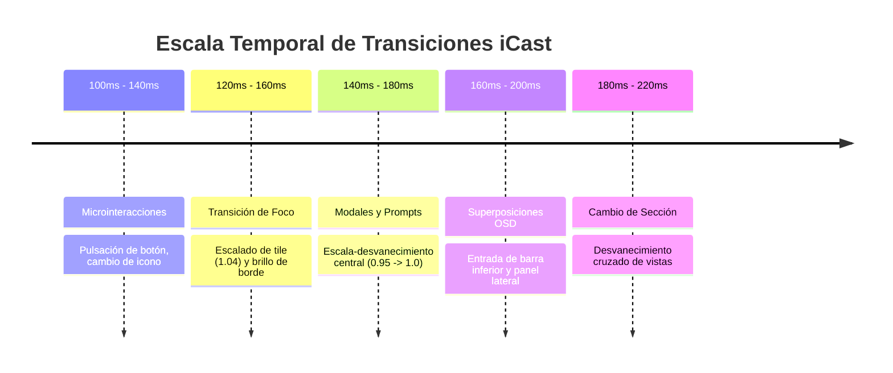

# SISTEMA DE MOVIMIENTO Y ANIMACIONES (MOTION DESIGN SYSTEM)
## Misión M3.0 — iCast Design System & Premium TV UX Blueprint
**Filosofía:** Movimiento Funcional, Inmediato y Subordinado al Mando  
**Curva Temporal Predeterminada:** `cubic-bezier(0.16, 1, 0.3, 1)` (Desaceleración Fluida Apple-Grade)  
**Tasa de Cuadros Objetivo:** 60 FPS Estables en SoC Realtek RTD2870  

---

## 1. Principios de Movimiento para Televisión

En el entorno de un televisor de salón, las animaciones excesivas o prolongadas son una de las principales fuentes de frustración. El usuario espera que al pulsar un botón en el mando físico la acción ocurra de forma instantánea.

Siguiendo las pautas de Apple HIG (`motion.md`):
1. **El Movimiento Comunica, No Decora:** Cada transición cumple una función cognitiva: orientar espacialmente al usuario, confirmar que una pulsación fue registrada o revelar un menú contextual.
2. **Cero Retraso en la Entrada (Input Lag 0 ms):** Las animaciones son visualmente acompañantes; **jamás bloquean el hilo principal de eventos ni retrasan la siguiente pulsación del D-pad**.
3. **Aceleración Estricta por Hardware (GPU Only):**
   * ✅ **Propiedades Permitidas:** Exclusivamente `transform: translate3d(...)`, `transform: scale(...)` y `opacity`.
   * ❌ **Propiedades Terminantemente Prohibidas:** Jamás animar `width`, `height`, `top`, `left`, `margin`, `padding` o `filter`. Estas propiedades provocan el recálculo forzado de la geometría (*layout reflow*) y destruyen el rendimiento en Chromium 53.

---

## 2. Catálogo Maestro de Tiempos y Curvas de Transición



### Tabla de Parámetros de Animación:

| Tipo de Animación | Duración | Curva Bézier | Propiedades Animadas | Justificación de Experiencia |
| :--- | :---: | :---: | :--- | :--- |
| **Foco de Tile** | **140 ms** | `ease-out` | `transform: scale(1.04)`, `box-shadow` | Proporciona sensación táctil inmediata sin sensación de retardo. |
| **Pestaña Activa** | **120 ms** | `ease` | `color`, `border-color`, `transform` | Desplazamiento ágil del indicador entre pestañas superiores. |
| **Entrada de OSD** | **180 ms** | `cubic-bezier(0.16, 1, 0.3, 1)` | `transform: translate3d(0, 100%, 0) -> (0,0,0)`, `opacity` | Deslizamiento vertical suave desde la base de la pantalla. |
| **Salida de OSD** | **140 ms** | `ease-in` | `transform: translate3d(0, 100%, 0)`, `opacity` | Ocultación rápida para no estorbar la visión de la escena. |
| **Apertura de Modal** | **160 ms** | `cubic-bezier(0.2, 0.9, 0.3, 1)` | `transform: scale(0.96) -> scale(1.0)`, `opacity: 0 -> 1` | Entrada elegante desde el centro con profundidad de cristal. |
| **Cierre de Modal** | **120 ms** | `ease-in` | `opacity: 1 -> 0`, `transform: scale(0.98)` | Retorno inmediato al pulsar Back. |
| **Cambio de Sección**| **200 ms** | `ease-in-out` | `opacity: 0 -> 1` (Crossfade puro) | Transición fluida entre Live, Guide, Movies y Settings. |

---

## 3. Especificación Técnica de Clases de Animación

```css
/* Curva maestra y variables de movimiento iCast: */
:root {
  --icast-ease-out: cubic-bezier(0.16, 1, 0.3, 1);
  --icast-ease-in: cubic-bezier(0.4, 0, 1, 1);
  --icast-dur-focus: 140ms;
  --icast-dur-panel: 180ms;
  --icast-dur-modal: 160ms;
}

/* 1. Transición de Foco en Tiles (Optimizada en GPU) */
.icast-tile {
  transition:
    transform var(--icast-dur-focus) var(--icast-ease-out),
    border-color var(--icast-dur-focus) ease,
    box-shadow var(--icast-dur-focus) ease;
  will-change: transform;
}

/* 2. Entrada / Salida del OSD del Reproductor */
.icast-osd-hud {
  transition:
    transform var(--icast-dur-panel) var(--icast-ease-out),
    opacity var(--icast-dur-panel) var(--icast-ease-out);
}
.icast-osd-hud.is-hidden {
  transform: translate3d(0, 120%, 0);
  opacity: 0;
  pointer-events: none;
}

/* 3. Entrada de Modales de Cristal */
.icast-modal-scrim {
  transition: opacity var(--icast-dur-modal) ease;
}
.icast-modal-card {
  transition:
    transform var(--icast-dur-modal) var(--icast-ease-out),
    opacity var(--icast-dur-modal) ease;
}
.icast-modal-scrim.is-hidden .icast-modal-card {
  transform: scale(0.96);
  opacity: 0;
}
```

---

## 4. Estrategia de Movimiento Reducido y Accesibilidad

En estricto cumplimiento de `accessibility.md › Motion` y las capacidades de configuración de iCast:
* El sistema evalúa la preferencia `prefers-reduced-motion` del sistema y el ajuste interno de la aplicación `data-animation="essential"` o `data-animation="none"`.
* **Modo Movimiento Reducido Activo:**
  1. Todas las duraciones de transición se reducen a `0.001ms` mediante reglas de anulación:
     ```css
     html[data-animation="essential"] .icast-tile,
     html[data-animation="essential"] .icast-osd-hud,
     html[data-animation="essential"] .icast-modal-card {
       transition: none !important;
       animation: none !important;
       transform: none !important;
     }
     ```
  2. Los elementos enfocados cambian de borde de forma instantánea sin escalado físico, beneficiando a personas propensas a cinetosis y reduciendo el consumo de CPU al mínimo absoluto en hardware con batería o recursos críticos.

