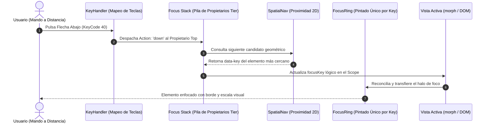
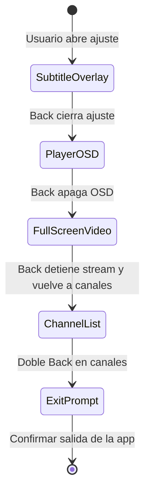

# AUDITORÍA DE NAVEGACIÓN Y MODELO DE FOCO (NAVIGATION & FOCUS AUDIT)
## Misión M3.0 — iCast Design System & Premium TV UX Blueprint
**Subsistema Auditado:** `src/navigation/` (`KeyHandler`, `FocusScope`, `FocusRing`, `SpatialNav`, `InputMode`)  
**Dispositivo:** LG 65UM7400PDA (Control Remoto LG D-Pad y Magic Remote)  

---

## 1. Arquitectura del Motor de Navegación de iCast

La navegación en televisión no es un añadido estético; es el **esqueleto funcional del producto**. A diferencia de aplicaciones web de escritorio donde el cursor puede situarse libremente en cualquier coordenada `(x, y)`, una aplicación de televisión depende de una **máquina de estados finitos bidimensional** gobernada por eventos discretos de teclado físico.

---

## 2. Pila de Propietarios de Foco (The Focus Owner Stack)

El archivo `src/navigation/focus-scope.ts` implementa un modelo de **propiedad exclusiva de teclas por niveles de prioridad (`Tier`)**. Este diseño previene uno de los defectos más graves en interfaces de TV: que una pulsación de mando a distancia sea procesada simultáneamente por dos superficies superpuestas.

### 2.1 Niveles de Prioridad (`Tier`)
| Nivel (`Tier`) | Valor Numérico | Superficies que lo Registran | Comportamiento con Teclas y Puntero |
| :--- | :---: | :--- | :--- |
| **Panel** | `5` | Paneles secundarios de reproductor (búsqueda de subtítulos). | Cede las teclas a cualquier menú u overlay superior. |
| **Overlay** | `10` | OSD del reproductor, menús desplegables, historial de búsqueda. | Intercepta flechas y OK mientras está visible. |
| **Bar** | `20` | Barra de navegación superior (`TabBar`). | Gobierna el cambio de secciones; al pulsar Abajo transfiere foco al contenido. |
| **Prompt** | `30` | Modales de confirmación (`ConfirmationPrompt`), reanudación catchup. | **Aísla el foco por completo (`self-only`)**. Impide que clics o hover alcancen el fondo. |
| **Critical** | `40` | Diálogo de PIN Parental (`ParentalPinPrompt`). | **Máxima prioridad absoluta**. Sobrescribe cualquier prompt o temporizador en cola. |

### 2.2 Principio de Invariante de Foco Lógico
* **Enfoque por `data-key`, nunca por nodo DOM:** Los scopes almacenan un identificador alfanumérico persistente (`focusKey: string`), jamás una referencia directa a un elemento HTML (`HTMLElement`).
* **Inmunidad a la Reconciliación Virtual:** Cuando una lista de 5.000 canales o una cuadrícula EPG se desplaza o re-renderiza con `morph()`, los nodos DOM se reciclan y destruyen continuamente. Al estar el foco guardado como `data-key`, el motor vuelve a pintar el halo de foco en el nodo reciclado sin que el usuario pierda su posición.

---

## 3. Pintado del Halo de Foco (`FocusRing`)

La regla cardinal establecida en `src/navigation/focus-ring.ts` y auditada rigurosamente en las pruebas E2E determina:
> **"Únicamente la superficie que posee las teclas en la cima de la pila puede mostrar un anillo de foco."**

1. **Prevención de Doble Foco:** Si un modal está abierto (`Tier.prompt`), ningún botón ni canal de la vista inferior puede retener estilos de foco.
2. **Atributos Forenses:** El sistema inyecta en el DOM los atributos `data-ring-owner` y `data-focus-scope` para certificar en tiempo real qué componente es el propietario legítimo.
3. **Manejo del Puntero (Magic Remote):**
   * El modo de entrada se registra en `InputMode` (`keyboard-nav` vs `pointer`).
   * Al mover el puntero del Magic Remote, el anillo de foco del teclado se oculta temporalmente (`FocusRing.defer()`), activando únicamente el estilo hover en el elemento bajo el cursor.
   * La primera pulsación de una tecla de dirección apaga el puntero y restaura inmediatamente el anillo de foco nítido en el último elemento activo.

---

## 4. Navegación Espacial 2D (`SpatialNav`)

El archivo `src/navigation/spatial-nav.ts` resuelve la transición entre elementos interactivos marcados con `[data-focusable]`:
* **Cono de Proyección Euclidiana:** Al pulsar una flecha (ej. Derecha), evalúa los rectángulos límite (`getBoundingClientRect()`) de todos los elementos focusables en el contenedor actual (`[data-nav-container]`).
* **Ponderación de Distancia y Alineación:** Prioriza elementos que se encuentren directamente en el eje de desplazamiento, penalizando aquellos que requieran desviación diagonal.
* **Separación de Responsabilidades:** `SpatialNav` **sólo calcula y propone** el siguiente candidato; jamás aplica clases CSS ni altera el DOM directamente. La decisión final corresponde al `FocusScope`.

---

## 5. El Botón Back y la Jerarquía de Salida

El comportamiento de la tecla física `Back` (código webOS 461 / Escape 27) es uno de los pilares de la experiencia de usuario:

1. **Desapilado Escalonado:** Una pulsación de `Back` nunca cierra abruptamente la aplicación si existe algún overlay abierto.
2. **Orden de Cierre:**
   * Cierra modales críticos (PIN parental o confirmaciones).
   * Cierra menús de subtítulos o audio.
   * Oculta el OSD del reproductor si está desplegado.
   * Si se está reproduciendo vídeo a pantalla completa sin OSD, `Back` detiene el reproductor y devuelve el foco al último canal seleccionado en la lista.
   * En la vista de canales, un segundo `Back` en menos de 2 segundos abre el diálogo de confirmación para salir de la aplicación.

---

## 6. Zonas Seguras para el Rediseño iCast

La auditoría confirma que **el motor de navegación (`src/navigation/`) es sumamente maduro, está completamente testeado y no debe modificarse en su lógica interna**.

Las mejoras de iCast se concentrarán exclusivamente en la **capa visual y táctil de los componentes**:
1. **Sustitución de la clase `.focused`:** Reemplazar el resplandor difuso cian (`box-shadow: 0 0 20px ...`) por un **borde dual nítido** con micro-escala (`scale(1.04)` vía GPU), eliminando lag de repintado.
2. **Tiles con Áreas de Foco Cohesivas:** Diseñar tiles donde el logotipo, nombre y metadatos conformen un único bloque semántico con su `data-key`, evitando saltos erráticos de foco dentro de un mismo canal.
3. **Píldoras Flotantes en TabBar:** Permitir que las pestañas superiores se seleccionen visualmente como píldoras elevadas al recibir el foco del D-pad.

