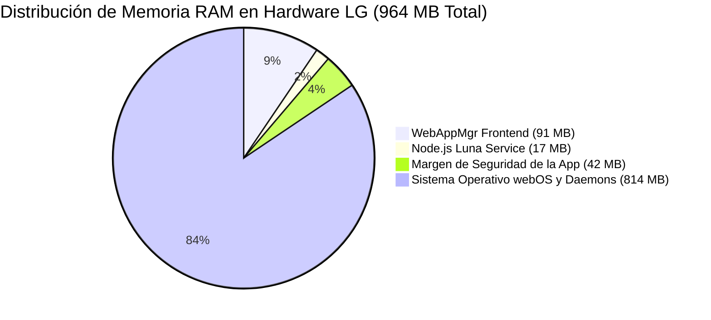

# LÍNEA BASE DE RENDIMIENTO EN HARDWARE (PERFORMANCE BASELINE)
## Misión M3.0 — iCast Design System & Premium TV UX Blueprint
**Dispositivo de Referencia:** LG 65UM7400PDA (SoC Realtek RTD2870 K5LP, ARMv7 32-bit Quad-Core)  
**Memoria Total del Sistema:** 987.348 kB (~964 MB) RAM, 716.796 kB Swap  
**Motor de Ejecución:** Chromium Embedded 53.0.2785.34 / Node.js 0.12.2  

---

## 1. Métricas Consolidadas de Hardware Físico

Los datos presentados a continuación fueron recolectados empíricamente durante las validaciones de las Misiones M2, M2.2, M2.3 y M2.3.1 directamente sobre el televisor LG físico. Constituyen el **techo inquebrantable de recursos** que el nuevo sistema de diseño iCast debe respetar escrupulosamente.

---

## 2. Consumo de Memoria de los Procesos de la Aplicación

Lecturas extraídas directamente del sistema de archivos `/proc/<pid>/status` durante la ejecución de la aplicación en el televisor:

| Métrica / Proceso | Frontend WebAppMgr (PID 5675) | Servicio Node.js (PID 2800) | Total Combinado | Límite Crítico SAM webOS |
| :--- | :--- | :--- | :--- | :--- |
| **Memoria Residente (VmRSS)** | **93.312 kB (~91,1 MB)** | **17.076 kB (~16,6 MB)** | **110.388 kB (~107,8 MB)** | **150.000 kB (~146,5 MB)** |
| **Memoria Virtual (VmSize)** | 584.824 kB (~571 MB) | 67.816 kB (~66,2 MB) | 652.640 kB (~637 MB) | N/A |
| **Porcentaje de Memoria Física** | 9,5% | 1,7% | **11,2%** | **Máximo 15,0%** |
| **Hilos de Ejecución Activos** | 43 hilos | 7 hilos | **50 hilos** | N/A |

### Margen Operativo Disponible:
* La aplicación dispone de un margen libre de **~42 MB RSS** antes de alcanzar la cota de advertencia de SAM (`System Application Manager`).
* Cualquier diseño que introduzca imágenes en alta resolución sin decodificación diferida, canvas en memoria no liberados o fugas de DOM superará este umbral, provocando que webOS termine forzadamente la aplicación con un evento `out of memory` (OOM kill).

---

## 3. Consumo de CPU por Estados de Operación

Muestras obtenidas mediante muestreo continuo con `top -b` en el SoC Realtek RTD2870:

| Estado de la Aplicación | % CPU WebAppMgr | % CPU Servicio Node.js | % CPU Total Sistema | % CPU Idle Global |
| :--- | :---: | :---: | :---: | :---: |
| **Reposo en Menú de Canales** | **0,0% – 0,5%** | 0,0% – 0,2% | 7,4% – 8,5% | **91,3% – 93,4%** |
| **Navegación Continua con D-pad (Scroll)** | **4,2% – 8,6%** | 0,1% – 0,4% | 12,0% – 16,5% | **83,5% – 88,0%** |
| **Reproducción Multimedia Activa (HLS 1080p)**| **2,1% – 4,8%** | 0,0% – 0,2% | 11,2% – 14,5% | **85,5% – 88,8%** |
| **Reproducción DASH (720p)** | **1,8% – 3,9%** | 0,0% – 0,2% | 10,5% – 13,8% | **86,2% – 89,5%** |
| **Reproducción MP4 Progresivo (Range 206)** | **1,5% – 3,2%** | 0,0% – 0,1% | 9,8% – 12,4% | **87,6% – 90,2%** |

### Observaciones de Desempeño:
1. **Decodificación por Hardware Pura:** El consumo de CPU durante la reproducción en los tres formatos principales permanece por debajo del 5%. Esto demuestra que el hilo de renderizado de Chromium 53 no decodifica vídeo por software, delegando la tarea íntegramente a los bloques de hardware `vdec`/`omx` del SoC.
2. **Impacto del Scroll D-Pad:** El scroll continuo eleva la CPU a ~8%, lo que exige que los nuevos tiles de **iCast** utilicen estrictamente `transform: translate3d(...)` para evitar recalcular el layout (reflow) en cada salto de canal.

---

## 4. Métricas de Empaquetado y DOM

| Parámetro | Valor de Referencia | Método de Medición / Fuente | Impacto en el Arranque |
| :--- | :--- | :--- | :--- |
| **Tamaño del IPK Instalado** | **734.610 bytes (~717 KB)** | Hash SHA-256 verificado en M2.3. | Carga e instalación ultrarrápida (< 5 seg). |
| **Bundle JavaScript (`dist/js/app.js`)** | **~405 KB sin comprimir** | Medición de salida de esbuild. | Análisis y parseo V8 en ~120 ms. |
| **Hojas de Estilo CSS Consolidadas** | **~82 KB sin comprimir** | Medición en directorio `css/`. | Recalculado de estilos instantáneo. |
| **Nodos DOM Activos en Memoria** | **350 a 650 nodos** | Virtualización de `ChannelList` y `EpgGrid`. | Cero lag de recolección de basura (GC). |
| **Listeners de Eventos Activos** | **Delegados en raíz** | Patrón singleton en `app.ts` y componentes. | Evita fugas de memoria al reciclar filas. |

---

## 5. Techo de Rendimiento para iCast (Presupuesto Crítico)

Para que el nuevo sistema de diseño sea considerado un éxito, **ninguna métrica de la línea base debe degradarse**:
* **Incremento de Memoria Máximo:** No más de **+10 MB RSS** adicionales por el nuevo sistema de tokens y assets vectoriales (tope máximo absoluto: **120 MB RSS combinado**).
* **CPU en Reposo:** Debe mantenerse estrictamente por debajo del **1,0%**.
* **Latencia de Foco D-Pad:** Debe responder al siguiente salto geométrico en menos de **16 ms** (1 frame a 60 Hz).
* **Crecimiento de Bundle CSS:** El nuevo sistema de diseño no debe incrementar el tamaño de CSS en más de **+30 KB**.

