# PRESUPUESTO DE RENDIMIENTO VISUAL (PERFORMANCE BUDGET)
## Misión M3.0 — iCast Design System & Premium TV UX Blueprint
**Principio Rector:** El rendimiento gobierna el diseño. Ningún efecto estético justifica la pérdida de fluidez.  
**Plataforma de Referencia:** SoC Realtek RTD2870 (Quad-Core ARMv7, 1 GB RAM, Chromium 53)  

---

## 1. Clasificación Tripartita de Efectos Visuales

Para evitar que el entusiasmo de diseño introduzca patrones incompatibles con el hardware de televisión, se establece un **sistema de semáforo estricto** para todas las propiedades visuales y de animación:

```mermaid
graph TD
    PB["Presupuesto Visual iCast"] --> G["VERDE: Efectos Permitidos (Acelerados por GPU)"]
    PB --> Y["AMARILLO: Efectos Condicionados (Uso Medido y Restringido)"]
    PB --> R["ROJO: Efectos Terminantemente Prohibidos"]

    G --> G1["transform: translate3d / scale"]
    G --> G2["opacity: 0 a 1"]
    G --> G3["Gradientes lineales estáticos"]
    G --> G4["Bisel especular de 1px (inset shadow)"]
    G --> G5["SVG vectoriales inline ligeros"]

    Y --> Y1["box-shadow exterior (solo en tile enfocado / modales)"]
    Y --> Y2["Micro-escalado (máximo scale 1.04)"]
    Y --> Y3["Listas virtualizadas (máximo 30 filas simultáneas)"]

    R --> R1["backdrop-filter sin encapsulación @supports"]
    R --> R2["Animación de width, height, top, left, margin"]
    R --> R3["Sombras difusas gigantes (blur > 20px) masivas"]
    R --> R4["Animaciones continuas de background-position"]
    R --> R5["Fuentes web externas (FOUT / lag de red)"]
```

---

## 2. Matriz Detallada de Costes y Riesgos de Renderizado

| Elemento / Propiedad CSS | Coste en GPU / CPU | Riesgo en Chromium 53 | Dictamen de Ingeniería |
| :--- | :---: | :---: | :--- |
| **`transform: translate3d(x, y, 0)`** | **Muy Bajo (0% CPU)** | **Cero** | **Preferido.** Se ejecuta en el Compositor Thread de la GPU. |
| **`transform: scale(1.04)`** | **Muy Bajo (0% CPU)** | **Cero** | **Preferido.** Microinteracción ideal para el foco del D-pad. |
| **`opacity: 0 -> 1`** | **Muy Bajo (0% CPU)** | **Cero** | **Preferido.** Utilizado en crossfade de vistas y modales. |
| **Gradientes Lineales Estáticos** | **Bajo (Raster inicial)** | **Cero** | **Permitido.** Se rasterizan una sola vez al montar el panel. |
| **Bordes Especulares de 1px** | **Nulo** | **Cero** | **Preferido.** Da la ilusión de cristal sin coste alguno. |
| **`box-shadow: inset 0 1px 1px ...`**| **Bajo** | **Bajo** | **Permitido.** Otorga relieve físico a tarjetas y tiles. |
| **`box-shadow` Exterior Acotada** | **Medio** | **Medio** | **Condicionado.** Permitido **únicamente en el elemento con foco activo** o en modales; prohibido en listas completas de canales. |
| **`backdrop-filter: blur(...)`** | **Crítico / Inoperante** | **Alto** | **Terminantemente Prohibido como base.** Solo permitido como mejora progresiva bajo `@supports`. |
| **Animación de `width`/`height`** | **Crítico (Reflow continuo)**| **Alto** | **Terminantemente Prohibido.** Provoca recálculo geométrico del árbol DOM en cada frame. |
| **Animación de `background-position`** | **Alto (Repaint continuo)**| **Alto** | **Terminantemente Prohibido.** Re-rasteriza gradientes por software consumiendo CPU. |
| **Fuentes Web Externas (Google Fonts)**| **Variable (Latencia de red)**| **Alto** | **Terminantemente Prohibido.** Se utiliza exclusivamente la fuente nativa `LG Smart UI`. |

---

## 3. Umbrales de Aceptación Cuantitativos (Quality Gates)

Toda implementación del sistema de diseño en las fases M3.1 a M3.7 deberá medirse contra los siguientes límites cuantitativos infranqueables:

| Métrica de Rendimiento | Línea Base M2.3 | Techo Permitido iCast | Método de Medición |
| :--- | :---: | :---: | :--- |
| **Memoria Residente Combinada (RSS)** | 107,8 MB | **Máximo 120,0 MB** | `/proc/<pid>/status` (WebAppMgr + Node.js). |
| **CPU en Reposo (Menú de Canales)** | 0,0% – 0,5% | **Máximo 1,0%** | Muestreo `top -b` en SoC RTD2870. |
| **CPU en Reproducción Activa (1080p)** | 2,1% – 4,8% | **Máximo 5,0%** | Hardware decoding (`vdec`/`omx`). |
| **Latencia de Respuesta al D-Pad** | ~12 ms | **Menos de 16 ms (< 1 frame a 60 Hz)** | Time-to-visual-focus tras evento keydown. |
| **Nodos DOM Activos en Pantalla** | 350 a 650 nodos | **Menos de 750 nodos** | Inspección `document.querySelectorAll('*').length`. |
| **Crecimiento Total de Bundle CSS** | ~82 KB | **Máximo +30 KB (Total < 115 KB)** | Tamaño del build de producción en `dist/css/`. |
| **Cuadros Caídos en Animación (Jank)** | 0 cuadros | **0 cuadros en transiciones de foco** | Auditoría visual y CDP Timeline. |

---

## 4. Mecanismos de Control Automatizado

Para asegurar el cumplimiento de este presupuesto durante el desarrollo:
1. **Linter de CSS Antiguo:** Se mantiene activo Stylelint con las reglas de compatibilidad de webOS 4 (`iptv/no-mixed-legacy-selector`).
2. **Revisión de Reglas Prohibidas:** Toda PR o cambio de código que introduzca `backdrop-filter` fuera de `@supports` o animaciones de layout (`width`/`height`) será rechazada automáticamente en CI.
3. **Auditoría de Dos Anillos:** La suite de pruebas E2E verificará que tras cada pulsación de mando a distancia existe exactamente un único anillo de foco activo en pantalla.

