# INVENTARIO FORENSE DE PANTALLAS Y VISTAS (SCREEN INVENTORY)
## Misión M3.0 — iCast Design System & Premium TV UX Blueprint
**Total de Superficies Identificadas:** **25 Vistas, Overlays y Modales**  
**Metodología:** Inspección completa de `src/app.ts`, `src/components/`, `index.html` y hojas de estilo CSS.  

---

## 1. Resumen Estructurado del Inventario

A diferencia de un catálogo superficial, la inspección del código fuente revela que la aplicación contiene **25 superficies visuales distintas**, divididas entre vistas principales de pantalla completa, paneles laterales acoplados, superposiciones de reproducción multimedia (HUD/OSD), paneles modales con retención de foco y diálogos de notificación.

```mermaid
graph TD
    ROOT["iCast Viewport (1920x1080)"] --> DOCKED["Capa de Navegación Anclada"]
    ROOT --> VIEWS["Vistas Principales (#view-*)"]
    ROOT --> PLAYER_OVR["Superposiciones del Reproductor"]
    ROOT --> MODALS["Modales y Prompts de Foco Crítico"]
    
    DOCKED --> S1["TabBar & Account Switcher (Pestañas Superiores)"]
    
    VIEWS --> V1["Loading Screen"]
    VIEWS --> V2["Live TV (ChannelList + LivePreview)"]
    VIEWS --> V3["EPG TV Guide Grid"]
    VIEWS --> V4["Movies Catalog (CatalogView)"]
    VIEWS --> V5["Series Catalog (CatalogView)"]
    VIEWS --> V6["Unified Search"]
    VIEWS --> V7["Settings (8 categorías)"]
    VIEWS --> V8["Parental Controls View"]
    VIEWS --> V9["Reminder Manager View"]
    
    PLAYER_OVR --> P1["Full-Screen Video Plane"]
    PLAYER_OVR --> P2["Player OSD / Transport Bar"]
    PLAYER_OVR --> P3["Player Quick Channel Sidebar"]
    PLAYER_OVR --> P4["Player Settings Menu (Audio/Tracks)"]
    PLAYER_OVR --> P5["Subtitle Search Overlay"]
    PLAYER_OVR --> P6["Subtitle Offset Calibration Overlay"]
    PLAYER_OVR --> P7["Number Entry Quick-Tuning Box"]
    
    MODALS --> M1["Parental PIN Prompt (Tier 40)"]
    MODALS --> M2["Confirmation Prompt (Tier 30)"]
    MODALS --> M3["Catchup Resume Prompt (Tier 30)"]
    MODALS --> M4["Reminder Alarm Prompt (Tier 30)"]
    MODALS --> M5["Live Category Picker Modal"]
    MODALS --> M6["Channel List Order Editor"]
    MODALS --> M7["Search History Dropdown"]
    MODALS --> M8["Global Toast Notification System"]
    MODALS --> M9["LAN Upload / Pairing Portal (setup-page.html)"]
```

---

## 2. Fichas Técnicas Pantalla por Pantalla

### 2.1 Pantallas de Arranque y Navegación Base

#### Superficie 01: Pantalla de Carga Inicial (Splash & Loading)
* **Identificador DOM:** `#view-loading.view`
* **Archivos Responsables:** `src/app.ts:125-138`, `index.html:35-40`, `css/main.css:188-215`
* **Disparador:** Arranque en frío de la aplicación mientras `StorageService.init()` y `PlaylistService.load()` se completan.
* **Componentes:** `.loading-container`, `.loading-spinner`, `#loading-text`.
* **Estado Actual:** Fondo negro sólido (`#0a0a0f`), spinner circular CSS de 64px con rotación continua y texto "Cargando…".
* **Problemas Detectados:** Muy utilitario, carece de imagotipo o logotipo de marca, la transición a la vista de canales es un corte abrupto de display (`show/hide`).

#### Superficie 02: Barra de Pestañas Superior y Conmutador de Cuentas (TabBar & Account Switcher)
* **Identificador DOM:** `.tab-bar` (fijada en parte superior, altura 96px)
* **Archivos Responsables:** `src/components/tab-bar.ts`, `src/components/account-switcher.ts`, `css/tab-bar.css:1-168`, `css/account-switcher.css`
* **Disparador:** Anclada permanentemente en todas las secciones principales (`Live`, `Guide`, `Movies`, `Series`, `Settings`, `Search`), oculta únicamente en reproducción de vídeo.
* **Componentes:** `.tab-bar-title`, `.tab-bar-item` (pestañas), `.tab-bar-search` (botón de lupa), `.account-avatar` (avatar del perfil activo).
* **Estado Actual:** Barra gris oscura (`#12121a`), borde inferior de 1px, texto "webOS IPTV Player" en cian, línea inferior activa en la pestaña enfocada.
* **Problemas Detectados:** Consume 96px de alto permanentemente sin efecto de translucidez ni integración visual con el contenido inferior.

---

### 2.2 Pantallas de Televisión en Vivo (Live TV)

#### Superficie 03: Navegador Principal de Canales (Channel Browser)
* **Identificador DOM:** `#view-channels.view > #channel-browser`
* **Archivos Responsables:** `src/components/channel-list.ts:1-1200`, `css/channel-list.css:1-851`
* **Disparador:** Vista por omisión al arrancar y al seleccionar la pestaña "Live".
* **Componentes:** Barra lateral de grupos (`.sidebar`, 380px), pestañas de playlists (`.playlist-tabs`), lista virtualizada de canales (`.channel-main`), badges de salud de stream (`.channel-health-dot`).
* **Estado Actual:** Diseño en dos columnas tipo explorador de archivos. Filas de canal con fondo oscuro, número de canal y nombre en texto plano.
* **Problemas Detectados:** Aspecto excesivamente técnico. Los canales se perciben como líneas de texto en lugar de tiles de televisión interactivos y atractivos.

#### Superficie 04: Panel Lateral de Mini-Preview de Vídeo (Live Preview Pane)
* **Identificador DOM:** `#view-channels > #live-preview.aside`
* **Archivos Responsables:** `src/components/live-preview.ts`, `css/live-preview.css`
* **Disparador:** Se activa cuando el usuario se detiene sobre un canal en la lista, iniciando reproducción en una ventana reducida.
* **Componentes:** Contenedor de vídeo mini, metadatos del programa EPG actual (`.live-preview-clock`, `.live-preview-prog`), indicador de favorito.
* **Estado Actual:** Caja rectangular a la derecha que recorta el vídeo. Sin biseles pulidos ni integración con los datos del programa.
* **Problemas Detectados:** Transición rígida al cargar el stream preliminar; metadatos poco legibles a distancia.

#### Superficie 05: Selector Flotante de Categorías (Live Category Picker)
* **Identificador DOM:** `.live-category-picker-modal`
* **Archivos Responsables:** `src/components/live-category-picker.ts`, `css/live-category-picker.css`
* **Disparador:** Botón rojo del mando a distancia o pulsación sobre el selector de categoría.
* **Componentes:** Lista modal centrada con categorías y conteos de canales asociados.
* **Estado Actual:** Recuadro flotante con fondo opaco y borde de foco cian.
* **Problemas Detectados:** Diseño plano, desaprovecha la oportunidad de presentar tarjetas temáticas visuales para cada género televisivo.

#### Superficie 06: Editor de Orden de Canales (Channel List Editor)
* **Identificador DOM:** `.channel-list-editor`
* **Archivos Responsables:** `src/components/channel-list-editor.ts`, `css/channel-list.css`
* **Disparador:** Activación del modo edición mediante botón dedicado en la cabecera del canal.
* **Componentes:** Controles para subir, bajar, ocultar y fijar canales favoritos en el orden de visualización.
* **Estado Actual:** Lista con botones de flechas simples.
* **Problemas Detectados:** Iconografía básica y feedback visual tosco al mover elementos.

---

### 2.3 Experiencia del Reproductor (Video Player & OSD)

#### Superficie 07: Plano de Vídeo a Pantalla Completa (Full-Screen Video Plane)
* **Identificador DOM:** `#video-player` (etiqueta `<video>` nativa HTML5 en raíz)
* **Archivos Responsables:** `src/components/player.ts`, `src/components/player-pipeline.ts`, `index.html:33`
* **Disparador:** Selección de canal mediante `OK` o reproducción de VOD.
* **Componentes:** Superficie de aceleración hardware directa con subsistema webOS Media.
* **Estado Actual:** Ocupa la totalidad del canvas de 1920×1080 detrás de los overlays.
* **Problemas Detectados:** La transición desde el menú no realiza fade cruzado armónico.

#### Superficie 08: Barra de Transporte y OSD del Reproductor (Player OSD)
* **Identificador DOM:** `#player-osd.player-osd`
* **Archivos Responsables:** `src/components/player-osd.ts`, `css/player.css:46-240`
* **Disparador:** Cualquier pulsación de flecha o botón `OK` / `Info` durante la reproducción de vídeo.
* **Componentes:** Número y nombre del canal, logo, título del programa en emisión, barra de tiempo transcurrido, resolución (1080p/720p), codec de audio, badges de subtítulos y catchup.
* **Estado Actual:** Panel rectangular inferior flotante (`bottom: 20px; left: 40px; right: 40px;`). Fondo negro opaco forzado en webOS 4 (`rgba(10, 10, 15)`).
* **Problemas Detectados:** Pierde la estética Liquid Glass en hardware real debido a la ausencia de `backdrop-filter` en Chromium 53, luciendo como una caja negra pesada sobre el vídeo.

#### Superficie 09: Barra Lateral de Canales en Reproductor (Quick Player Sidebar)
* **Identificador DOM:** `#player-sidebar.player-sidebar`
* **Archivos Responsables:** `src/components/sidebar.ts`, `css/player.css:241-450`
* **Disparador:** Pulsación de flecha Izquierda mientras se reproduce vídeo a pantalla completa.
* **Componentes:** Lista compacta de canales agrupada para cambio rápido de sintonía sin salir del vídeo.
* **Estado Actual:** Barra lateral oscura de 420px de ancho que se superpone a la izquierda.
* **Problemas Detectados:** Oculta gran parte de la imagen de forma opaca y no utiliza jerarquía de vidrio translúcido funcional.

#### Superficie 10: Menú de Pistas y Ajustes del Reproductor (Player Menu)
* **Identificador DOM:** `#player-menu.player-menu`
* **Archivos Responsables:** `src/components/player-menu.ts`, `css/player.css:451-680`
* **Disparador:** Flecha Arriba o botón Menú durante la reproducción.
* **Componentes:** Opciones de pista de audio multilingüe, pistas de subtítulos (cerrados / DVB / WebVTT), relación de aspecto (16:9, zoom, original), sincronización.
* **Estado Actual:** Menú desplegable lateral con elementos seleccionables tipo lista.
* **Problemas Detectados:** Densidad visual excesiva y tipografía poco contrastada.

#### Superficie 11: Búsqueda y Descarga de Subtítulos (Subtitle Search Overlay)
* **Identificador DOM:** `#subtitle-search`
* **Archivos Responsables:** `src/components/subtitle-search-overlay.ts`, `css/player.css`
* **Disparador:** Selección de "Buscar subtítulos online" en el menú de reproducción.
* **Componentes:** Campo de búsqueda por idioma y lista de resultados de fuentes OpenSubtitles/locales.
* **Estado Actual:** Ventana modal con lista vertical.
* **Problemas Detectados:** Interfaz desalineada con el resto del reproductor.

#### Superficie 12: Calibración de Desfase de Subtítulos (Subtitle Offset Overlay)
* **Identificador DOM:** `#subtitle-offset`
* **Archivos Responsables:** `src/components/subtitle-offset-overlay.ts`, `css/player.css`
* **Disparador:** Ajuste fino de milisegundos de sincronización de subtítulos.
* **Componentes:** Control deslizante/stepper con indicación en milisegundos (`-2500 ms ... +2500 ms`).
* **Estado Actual:** Tarjeta flotante compacta.
* **Problemas Detectados:** Falta de indicador visual gráfico intuitivo de avance/retraso.

#### Superficie 13: Sintonizador Numérico Rápido (Number Entry Quick-Tuning Box)
* **Identificador DOM:** `.number-entry`
* **Archivos Responsables:** `src/components/number-entry.ts`, `src/app.ts:34`
* **Disparador:** Pulsación de cualquier dígito numérico (0-9) en el mando a distancia.
* **Componentes:** Caja flotante en la esquina superior derecha que muestra los números ingresados (`Ej: "102"`) antes de saltar al canal.
* **Estado Actual:** Recuadro rectangular oscuro con números grandes.
* **Problemas Detectados:** Tipografía simple sin refinamiento de píldora de vidrio flotante.

---

### 2.4 Guía de Programación y Catchup (EPG)

#### Superficie 14: Cuadrícula de Programación Electrónica (EPG TV Guide Grid)
* **Identificador DOM:** `#view-epg.view > .epg-view`
* **Archivos Responsables:** `src/components/epg-grid.ts:1-1400`, `css/epg.css:1-750`
* **Disparador:** Pestaña "Guide" en la barra superior.
* **Componentes:** Selector de fecha/día horizontal, columna vertical de canales con logos, cuadrícula horizontal de programas dividida en bloques temporales de 30 minutos, indicador de emisión en directo (barra roja de ahora).
* **Estado Actual:** Matriz densa de bloques de programa. El foco salta geométricamente entre programas de distinta duración.
* **Problemas Detectados:** La cuadrícula se siente comprimida y pesada; los bloques de programas breves truncan los títulos de forma antiestética.

#### Superficie 15: Diálogo de Reanudación de Catchup (Catchup Resume Prompt)
* **Identificador DOM:** `.catchup-resume-prompt`
* **Archivos Responsables:** `src/components/catchup-resume-prompt.ts`, `src/components/confirmation-prompt.ts`
* **Disparador:** Selección de un programa ya emitido con soporte de grabación/catchup que tiene progreso guardado.
* **Componentes:** Botón "Reanudar desde mm:ss" y botón "Comenzar desde el inicio".
* **Estado Actual:** Modal estándar de confirmación.
* **Problemas Detectados:** No muestra captura ni miniatura del punto de reanudación.

---

### 2.5 Catálogos Bajo Demanda (VOD Movies & Series)

#### Superficie 16: Catálogo de Películas (Movies Catalog View)
* **Identificador DOM:** `#view-movies.view`
* **Archivos Responsables:** `src/components/movies.ts`, `src/components/catalog-view.ts`, `css/catalog-view.css`
* **Disparador:** Pestaña "Movies" (disponible cuando la cuenta Xtream está conectada).
* **Componentes:** Rieles horizontales de carrusel ("Seguir viendo", "Añadidos recientemente", "Por género"), pósteres verticales de películas, modal de ficha de detalles con sinopsis, director, año y botón de reproducción.
* **Estado Actual:** Diseño tipo carrusel moderno pero con bordes de foco toscos y fondos oscuros planos.
* **Problemas Detectados:** Los pósteres carecen de efecto de elevación y el sombreado de la ficha de detalle es plano.

#### Superficie 17: Catálogo de Series y Episodios (Series Catalog View)
* **Identificador DOM:** `#view-series.view`
* **Archivos Responsables:** `src/components/series.ts`, `src/components/catalog-view.ts`, `css/catalog-view.css`
* **Disparador:** Pestaña "Series" en la barra superior.
* **Componentes:** Rieles de series, selector de temporadas (dropdown o píldoras), lista de episodios con número, duración y miniaturas horizontales (16:9).
* **Estado Actual:** Comparte la infraestructura de `CatalogView`.
* **Problemas Detectados:** La navegación entre temporadas y selección de capítulos produce saltos visuales en el foco del D-pad.

---

### 2.6 Búsqueda, Configuración y Control Parental

#### Superficie 18: Búsqueda Unificada (Search View)
* **Identificador DOM:** `#view-search.view`
* **Archivos Responsables:** `src/components/search.ts`, `css/search.css`
* **Disparador:** Pestaña "Search" o botón de lupa en la barra superior.
* **Componentes:** Teclado virtual / campo de entrada de texto, resultados agrupados por pestañas o secciones: "Canales", "Programas EPG", "Películas", "Series".
* **Estado Actual:** Pantalla dividida con campo superior y resultados inferiores virtualizados.
* **Problemas Detectados:** El teclado virtual y los resultados están saturados de texto sin diferenciación iconográfica clara por tipo de contenido.

#### Superficie 19: Desplegable de Historial de Búsquedas (Search History Dropdown)
* **Identificador DOM:** `.search-history-panel`
* **Archivos Responsables:** `src/components/search-history-dropdown.ts`, `css/search.css`
* **Disparador:** Enfoque del campo de búsqueda cuando existen consultas previas guardadas.
* **Componentes:** Lista de términos recientes y botón para limpiar historial.
* **Estado Actual:** Menú desplegable con fondo semitransparente que se fuerza a opaco en webOS 4.
* **Problemas Detectados:** Contraste deficiente frente a los resultados que quedan por debajo.

#### Superficie 20: Vista de Configuración General (Settings View)
* **Identificador DOM:** `#view-settings.view`
* **Archivos Responsables:** `src/components/settings.ts`, `css/settings.css`
* **Disparador:** Pestaña "Settings".
* **Componentes:** Menú lateral de navegación con 8 categorías: Playlists & Cuentas, EPG, Reproducción, Interfaz & Temas, Control Parental, Recordatorios, Red & Servicio, Acerca de.
* **Estado Actual:** Layout de dos columnas: categorías a la izquierda, formulario de opciones a la derecha con selectores, toggles y campos de texto.
* **Problemas Detectados:** Exceso de texto explicativo en cada opción; swatches de tema apiñados.

#### Superficie 21: Gestión de Control Parental (Parental Controls View)
* **Identificador DOM:** `#view-parental-controls.view`
* **Archivos Responsables:** `src/components/parental-controls.ts`, `css/parental-controls.css`
* **Disparador:** Sección de control parental en configuración o acceso a contenido restringido.
* **Componentes:** Interruptor maestro de bloqueo, lista de categorías restringidas (Adultos, Noticias sensibles) con checkboxes.
* **Estado Actual:** Lista simple con toggles y botones de estado.
* **Problemas Detectados:** Iconografía de candado anticuada y falta de jerarquía de advertencia visual.

#### Superficie 22: Prompt de PIN Parental (Parental PIN Challenge Prompt)
* **Identificador DOM:** `.parental-pin-prompt` (Tier 40 - Máxima prioridad de foco)
* **Archivos Responsables:** `src/components/parental-pin-prompt.ts`
* **Disparador:** Intento de reproducir un canal o abrir una categoría bloqueada por PIN.
* **Componentes:** Teclado numérico en pantalla (4 dígitos) con 4 casillas de PIN vacías/llenas y teclado virtual 0-9.
* **Estado Actual:** Recuadro centrado oscuro con casillas de puntos de contraseña.
* **Problemas Detectados:** Botones numéricos pequeños y feedback de entrada lento.

#### Superficie 23: Gestor de Recordatorios y Notificaciones EPG (Reminder Manager & Prompt)
* **Identificador DOM:** `#view-reminders.view` y `.reminder-prompt` (Tier 30)
* **Archivos Responsables:** `src/components/reminder-manager.ts`, `src/components/reminder-prompt.ts`, `css/reminder-manager.css`
* **Disparador:** Acceso a recordatorios agendados o activación del temporizador de un programa a punto de iniciar.
* **Componentes:** Lista de recordatorios con botón de borrado; modal de aviso emergente con botones "Sintonizar ahora" y "Descartar".
* **Estado Actual:** Alertas emergentes rectangulares sin animación fluida.
* **Problemas Detectados:** La alerta emergente interrumpe bruscamente la visión sin una estética de tarjeta flotante pulida.

#### Superficie 24: Modales Globales de Confirmación y Toasts (Confirmation Prompt & Toast)
* **Identificador DOM:** `.confirmation-prompt` (Tier 30) y `.toast`
* **Archivos Responsables:** `src/components/confirmation-prompt.ts`, `src/components/toast.ts`, `css/main.css`
* **Disparador:** Acciones destructivas (eliminar playlist, borrar caché) y mensajes informativos temporales.
* **Componentes:** Título de advertencia, mensaje explicativo, botón de cancelación (foco seguro por omisión) y botón de acción (destructiva o afirmativa).
* **Estado Actual:** Cuadro gris oscuro en el centro de pantalla con dos botones. Toasts aparecen en la parte inferior como píldoras negras.
* **Problemas Detectados:** Falta de refinamiento tipográfico y de transiciones suaves de entrada/salida.

#### Superficie 25: Portal LAN de Subida y Emparejamiento (LAN Setup Client)
* **Identificador DOM:** Servido externamente por el backend Node.js en `/setup/` y consumido por `SetupClient`.
* **Archivos Responsables:** `bundled-service/src/setup/setup-page.html`, `src/services/setup-client.ts`
* **Disparador:** Pantalla mostrada en navegador móvil o PC para subir archivos M3U por red local.
* **Componentes:** Interfaz web con código de emparejamiento PIN de 4 dígitos, área de drag-and-drop de archivos y barra de progreso.
* **Estado Actual:** Página web independiente que aún conserva el nombre "webOS IPTV Player".
* **Problemas Detectados:** Desalineada con la nueva identidad de marca iCast; debe actualizarse visualmente para mantener coherencia en la experiencia multipantalla.

---

## 3. Conclusión del Inventario

Las **25 superficies auditadas** representan la totalidad del ecosistema visual de la aplicación.
Ninguna pantalla quedará desatendida en el plan de rediseño de la **Fase I (SCREEN_REDESIGN_PLAN.md)**, asegurando que la transformación a **iCast** sea integral, consistente y libre de vestigios visuales del diseño anterior.

