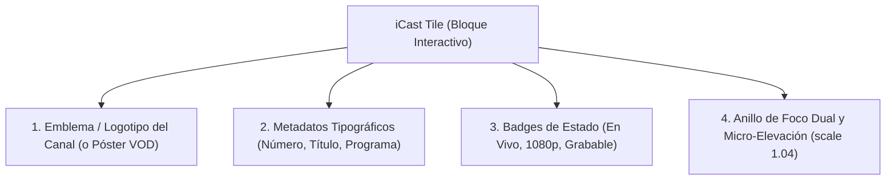
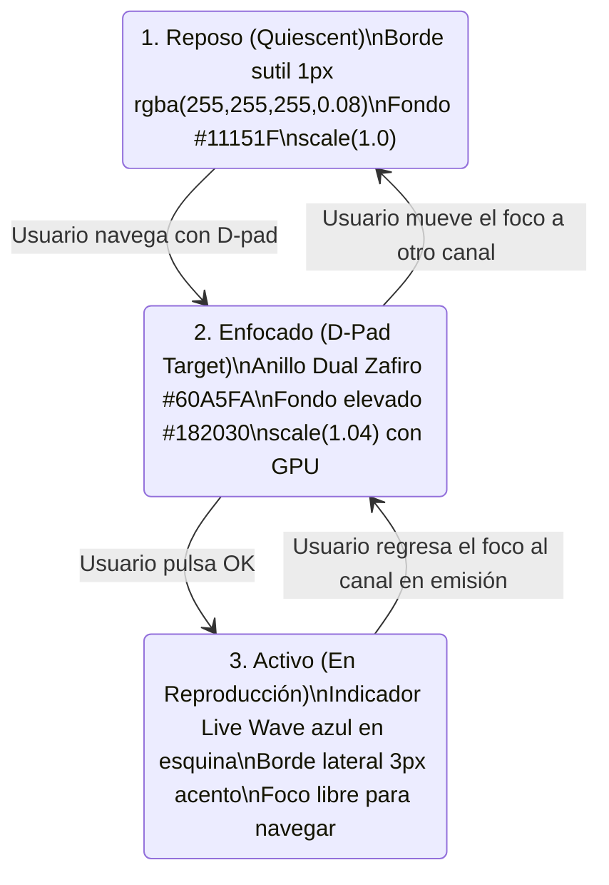

# SISTEMA DE TILES Y COMPONENTES REUTILIZABLES (TILE & COMPONENT SYSTEM)
## Misión M3.0 — iCast Design System & Premium TV UX Blueprint
**Enfoque de Diseño:** Televisión de Salón (10-Foot UI)  
**Elemento Central de Identidad:** El Tile Táctil iCast  

---

## 1. El Tile como Unidad Fundamental de Interacción

En la experiencia de televisión, el usuario no hace clic en hipervínculos de texto ni navega con cursores libres. La unidad atómica de interacción es el **Tile (Baldosa Interactiva)**: un bloque tridimensional que agrupa un objetivo visual, su estado y sus metadatos.



---

## 2. Catálogo de Variantes de Tiles en iCast

### 2.1 Tile de Canal de Televisión (`.icast-tile-channel`)
Sustituye la antigua fila de texto plano de `channel-item` por un tile rectangular interactivo:
* **Dimensiones:** Ancho flexible dentro del contenedor, altura fija de **80 px** (optimizada para la zancada del virtualizador).
* **Radio de Esquina:** `12 px`.
* **Disposición Interior (Flexbox Horizontal):**
  * Columna 1 (Izquierda, 70 px): Emblema / Logo del canal enmarcado en squircle con fondo sutil (`rgba(255, 255, 255, 0.04)`).
  * Columna 2 (Central, Flexible):
    * Fila superior: Número de canal en tono secundario (`#94A3B8`) + Nombre del canal en titular `Title 3` (`#F1F5F9`).
    * Fila inferior: Título del programa EPG en emisión en tono callout (`#94A3B8`) con barra de progreso de tiempo transcurrido (2px).
  * Columna 3 (Derecha, Fija): Badges compactos (indicador de favorito ⭐, resolución `HD`/`4K`, estado de salud del stream).

### 2.2 Tile de Categoría y Género (`.icast-tile-category`)
* **Dimensiones:** Cuadrícula de 220 × 120 px.
* **Radio de Esquina:** `16 px`.
* **Disposición Interior:** Icono de género en gran formato (36 px) centrado sobre el nombre de la categoría (ej. "Cine & Series", "Deportes", "Noticias") con un contador sutil de canales activos.

### 2.3 Tile de Póster VOD (`.icast-tile-poster`)
Para el catálogo de películas y series bajo demanda:
* **Relación de Aspecto:** Estándar cinematográfico `2:3` (220 px de ancho × 330 px de alto).
* **Radio de Esquina:** `14 px`.
* **Tratamiento Visual:** Póster fotográfico de alta calidad con viñeta inferior degradada (`rgba(0, 0, 0, 0.85)`) donde descansa el título, año y badge de calidad (ej. "4K HDR").
* **Efecto en Foco:** Escala suave `scale(1.05)`, borde perimetral Zafiro luminoso y elevación con sombra profunda (`0 16px 36px rgba(0, 0, 0, 0.60)`).

### 2.4 Tarjeta Destacada Hero (`.icast-card-hero`)
* **Dimensiones:** 1100 × 420 px en la cabecera del dashboard.
* **Función:** Destaca el canal más sintonizado, la emisión deportiva del momento o el último contenido en "Continuar Viendo".
* **Composición:** Fondo panorámico 16:9 con máscara de desvanecimiento hacia la izquierda donde se alojan el título en tipografía `Display` (44px), la sinopsis y el botón de acción rápida `Reproducir`.

---

## 3. Estados de Interacción del Tile

Es imperativo diferenciar conceptual y visualmente entre el estado **Enfocado (Foco D-Pad)** y el estado **Activo (Canal en Reproducción)**:



### 3.1 Especificación CSS de Estados:

```css
/* Estado Base en Reposo */
.icast-tile {
  position: relative;
  background-color: var(--icast-bg-surface);
  border: 1px solid var(--icast-border-subtle);
  border-radius: var(--icast-radius-tile);
  transition: transform 140ms ease, border-color 140ms ease, box-shadow 140ms ease;
  transform: translate3d(0, 0, 0); /* Forzar capa en GPU */
  cursor: pointer;
}

/* Estado Enfocado (El mando apunta aquí) */
.icast-tile.focused {
  background-color: var(--icast-bg-elevated);
  border-color: var(--icast-accent-highlight) !important;
  box-shadow:
    0 0 0 2px var(--icast-bg-primary),
    0 0 0 4px var(--icast-focus-ring),
    0 8px 24px rgba(0, 0, 0, 0.50);
  transform: scale(1.04);
  z-index: 10;
}

/* Estado Activo (Canal sintonizado en segundo plano) */
.icast-tile.is-active::before {
  content: '';
  position: absolute;
  left: 0;
  top: 12px;
  bottom: 12px;
  width: 4px;
  background-color: var(--icast-accent);
  border-radius: 0 4px 4px 0;
}
```

---

## 4. Componentes Complementarios del Sistema

### 4.1 Botones de Acción (`.icast-btn`)
* **Botón Primario:** Fondo `--icast-accent` (`#3B82F6`), texto blanco, radio `12 px`. En foco escala a `1.04` con borde zafiro luminoso.
* **Botón Secundario:** Fondo translúcido `rgba(255, 255, 255, 0.08)`, borde sutil `rgba(255, 255, 255, 0.15)`.
* **Botón Destructivo:** Fondo `rgba(239, 68, 68, 0.18)`, borde y texto rojo `--icast-danger` (`#EF4444`). En foco el fondo se vuelve rojo sólido.

### 4.2 Campos de Entrada y Teclado (`.icast-input`)
* Cajas rectangulares redondeadas (`12 px`) con altura de 56 px.
* En reposo: fondo `#11151F` con borde sutil.
* En foco: borde Zafiro luminoso y fondo elevado `#182030` con cursor titilante por hardware.

### 4.3 Píldoras de Estado (Pill Badges)
* Elementos compactos de 24 px de alto con esquinas completamente redondeadas (`border-radius: 999px`), padding horizontal de 10 px y tipografía `Caption` en mayúsculas para codificar información instantánea: `LIVE`, `4K`, `REC`, `PIN`.

