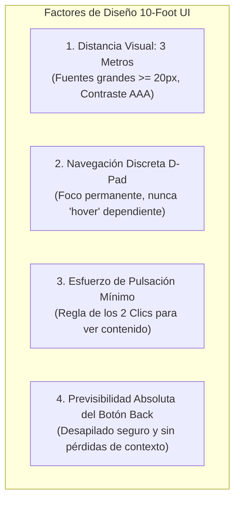

# ERGONOMÍA DE TELEVISIÓN Y CONTROL REMOTO (TV REMOTE UX)
## Misión M3.0 — iCast Design System & Premium TV UX Blueprint
**Entorno de Uso:** Salón Familiar / Distancia de Visualización 2,5 m – 4,5 m  
**Dispositivos de Entrada:** Mando a Distancia Estándar LG (D-Pad) y Magic Remote (Puntero Gyro)  
**Resolución:** 1920 × 1080 px (10-Foot User Interface)  

---

## 1. La Filosofía 10-Foot UI: Diseñar para el Sofá

Una aplicación de televisión no es una página web agrandada ni una aplicación móvil estirada. El usuario de salón se encuentra sentado a varios metros de distancia, en un estado de relajación cognitiva (*lean-back experience*), sosteniendo un control remoto físico con botones táctiles.



---

## 2. El Modelo de Interacción por D-Pad y Teclas de Color

Toda la arquitectura de **iCast** está gobernada por las teclas físicas esenciales presentes en el 100% de los mandos a distancia de televisión:

### 2.1 Teclas Direccionales Primarias (El D-Pad)
* **Arriba / Abajo:** Desplazamiento vertical entre canales, opciones de configuración o filas de rieles. En reproducción de vídeo, `Arriba` despliega el menú de pistas y ajustes (`PlayerMenu`); `Abajo` activa la barra de transporte OSD.
* **Izquierda / Derecha:** Navegación horizontal entre categorías, bloques temporales de la guía EPG o carruseles VOD. En reproducción a pantalla completa, `Izquierda` despliega la lista rápida lateral de canales (`PlayerSidebar`); `Derecha` avanza 30 segundos en VOD / catchup.
* **OK (Select / Enter):**
  * Sobre un canal: Inicia la reproducción inmediata a pantalla completa.
  * Sobre una pestaña: Conmuta la sección.
  * Sobre un botón o ajuste: Ejecuta la acción o conmuta el valor.
* **Back (Retorno / Salida):**
  * Si un menú o modal está abierto: Lo cierra inmediatamente y devuelve el foco al elemento que lo originó.
  * Si se reproduce vídeo a pantalla completa: Detiene la reproducción y regresa a la lista de canales con el foco en el último canal sintonizado.
  * En la lista de canales: Una segunda pulsación confirma la salida de la aplicación.

### 2.2 Botones de Colores Semánticos (Dedicated Color Keys)
Los mandos de televisión webOS cuentan con 4 botones de colores universales en su tercio inferior. iCast los aprovecha para atajos contextuales de un solo clic, mostrando leyendas discretas en la parte inferior de la pantalla:

```text
  [ Rojo ] Categorías     [ Verde ] Audio / Pista     [ Amarillo ] Subtítulos     [ Azul ] Favorito ⭐
```

| Botón de Color | Función en Lista de Canales | Función en Reproductor de Vídeo |
| :---: | :--- | :--- |
| **Rojo (Red)** | Abre el selector modal de Categorías/Grupos. | Alterna el modo de relación de aspecto (16:9, Original, Zoom). |
| **Verde (Green)** | Conmuta entre listas M3U / Cuentas. | Abre el selector rápido de pistas de Audio multilingües. |
| **Amarillo (Yellow)** | Abre la búsqueda global unificada. | Abre el menú de subtítulos y sincronización de offset. |
| **Azul (Blue)** | Marca o desmarca el canal enfocado como Favorito ⭐. | Añade el canal/contenido a la lista de reproducción reciente. |

### 2.3 Teclado Numérico Directo (0–9 Quick Tuner)
* La pulsación de cualquier dígito numérico (ej. `1`, luego `0`, luego `4`) activa inmediatamente la **Píldora Flotante de Sintonizador Numérico** (`NumberEntry`) en la esquina superior derecha.
* Tras un retardo de 1.200 ms sin nuevas pulsaciones (o pulsando `OK`), la aplicación salta y sintoniza directamente el canal correspondiente sin obligar al usuario a recorrer la lista.

---

## 3. Coexistencia con el Puntero (LG Magic Remote)

El televisor LG 65UM7400PDA soporta el mando giroscópico **Magic Remote**, que emite un puntero virtual en pantalla:

1. **Prioridad Dual sin Conflictos:**
   * La aplicación mantiene activa la máquina de estados `InputMode`.
   * Cuando el usuario agita el mando, el puntero aparece y la clase `.focused` de teclado se atenúa discretamente (`FocusRing.defer()`). Los elementos interactivos reaccionan al estado `hover` nativo.
   * En cuanto el usuario pulsa cualquier flecha del D-pad, el puntero del Magic Remote se oculta automáticamente y el anillo de foco del teclado se ilumina con nitidez en el elemento actual.
2. **Activación Segura por Clic:**
   * El evento `click` del Magic Remote activa los elementos exactamente igual que la tecla física `OK`.
   * Los componentes que gestionan su propia pulsación marcan su raíz con `data-self-activate`, evitando dobles disparos en el despachador maestro.
3. **Aislamiento en Modales Pushed:**
   * Cuando se despliega un diálogo modal (como el PIN parental o una confirmación), la capa inferior queda inmunizada: los clics del puntero fuera del modal no pueden activar canales ni botones ocultos en el fondo.

---

## 4. Garantía de Foco Permanente: Cero Foco Fantasma

Uno de los defectos más graves en aplicaciones de Smart TV es el llamado *"Foco Fantasma"* (situación en la que el usuario pulsa flechas pero ningún elemento de la pantalla se ilumina, desorientándolo por completo).

### En iCast, el foco visual es inquebrantable:
* **Foco Inicial Mandatorio (`defaultKey`):** Toda vista o modal nuevo que entra en pantalla define qué elemento específico debe recibir el foco de forma automática.
* **Memoria de Retorno (`enterTo: 'last'`):** Al volver de una vista secundaria mediante `Back`, el foco no regresa a la primera fila, sino exactamente al último canal que el usuario estaba explorando.
* **Auditoría E2E Automatizada:** El repositorio cuenta con suites de prueba automatizadas que fallan si en cualquier momento un fotograma presenta 0 anillos de foco o más de 1 anillo simultáneo.

