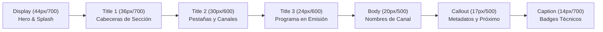

# SISTEMA TIPOGRÁFICO DE SALÓN (TYPOGRAPHY SYSTEM)
## Misión M3.0 — iCast Design System & Premium TV UX Blueprint
**Resolución Canvas:** 1920 × 1080 px (1080p Nativo)  
**Distancia Visual:** 2,5 a 4,5 metros (Ergonomía de Salón / 10-Foot UI)  
**Fuente Base del Sistema:** `LG Smart UI` / `-apple-system`  

---

## 1. Pila Tipográfica y Selección de Fuentes

En una aplicación de televisión embebida, la tipografía debe cumplir dos requisitos estrictos: **legibilidad instantánea a gran distancia** y **cero latencia de red**:

```css
/* Pila Tipográfica Oficial iCast: */
font-family: -apple-system, 'LG Smart UI', 'SF Pro Display', 'Helvetica Neue', Arial, sans-serif;
-webkit-font-smoothing: antialiased;
```

### Justificación Técnica de la Pila:
1. **Prioridad a la Fuente Nativa de LG (`LG Smart UI`):** Los televisores LG webOS incorporan en su ROM la familia tipográfica `LG Smart UI`. Esta tipografía ha sido diseñada específicamente por los laboratorios de LG para su motor de renderizado con sub-pixel rendering optimizado para matrices RGB y WRGB de paneles OLED y LCD.
2. **Eliminación de Web Fonts Remotas:** Descargar fuentes web externas (como Google Fonts) en webOS provocaría retardos en el primer renderizado (*Flash of Unstyled Text / FOUT*), consumo innecesario de memoria RAM y fallos si el televisor pierde conexión a Internet.
3. **Soporte Completo del Español y Caracteres Internacionales:** La fuente del sistema garantiza la correcta representación sin fallos de glifos de todos los caracteres especiales en castellano (`á`, `é`, `í`, `ó`, `ú`, `ñ`, `ü`, `¡`, `¿`), así como alfabetos extendidos de Europa del Este, cirílico y griego.
4. **Regla de Plataforma webOS:** Los símbolos y glifos exóticos no tipográficos (flechas complejas, iconos de bucle) no están presentes en la fuente del sistema; por directriz de arquitectura, todos los iconos deben ser **SVGs vectoriales puros**.

---

## 2. Escala Tipográfica de Televisión (10-Foot UI Scale)

La escala tipográfica ha sido calibrada proporcionalmente para que cada jerarquía sea legible sin esfuerzo desde el sofá:



### Tabla de Especificación de Jerarquías Tipográficas:

| Rol Semántico | Tamaño (px) | Peso (Weight) | Altura de Línea | Espaciado (Tracking) | Uso Específico en iCast |
| :--- | :---: | :---: | :---: | :---: | :--- |
| **`--icast-font-display`** | **44 px** | Bold (700) | 52 px (1.18) | -0.5 px | Pantalla de bienvenida, títulos de películas en ficha hero. |
| **`--icast-font-title-1`** | **36 px** | Bold (700) | 44 px (1.22) | -0.2 px | Cabeceras de categorías, títulos de modales críticos. |
| **`--icast-font-title-2`** | **30 px** | Semi-Bold (600) | 38 px (1.26) | 0.0 px | Pestañas de la TabBar, número de canal grande en OSD. |
| **`--icast-font-title-3`** | **24 px** | Semi-Bold (600) | 32 px (1.33) | 0.0 px | Programa actual en OSD, títulos de tiles en carrusel. |
| **`--icast-font-body`** | **20 px** | Medium (500) | 28 px (1.40) | 0.0 px | Nombre del canal en lista, opciones de configuración. |
| **`--icast-font-callout`** | **17 px** | Regular (400) | 24 px (1.41) | +0.2 px | Próximo programa en EPG, duración transcurrida, timestamps. |
| **`--icast-font-caption`** | **14 px** | Bold (700) | 20 px (1.42) | +0.8 px (Caps) | Badges de resolución (1080p, 4K), audio (AAC, AC3), subtítulos. |

---

## 3. Accesibilidad y Escalado de Fuentes

El sistema se acopla de forma transparente con el motor de escalado de texto existente en la aplicación (`data-text-size` en `html`):

```css
/* Factor de escala dinámico gobernado por la preferencia del usuario: */
[data-text-size="80"]  { --icast-font-scale: 0.8; }
[data-text-size="90"]  { --icast-font-scale: 0.9; }
[data-text-size="100"] { --icast-font-scale: 1.0; } /* Por omisión */
[data-text-size="110"] { --icast-font-scale: 1.1; }
[data-text-size="120"] { --icast-font-scale: 1.2; }
[data-text-size="130"] { --icast-font-scale: 1.3; }
[data-text-size="140"] { --icast-font-scale: 1.4; }
[data-text-size="150"] { --icast-font-scale: 1.5; }
```

### Reglas de Supervivencia de Layout (`typography.md`):
* Al aplicar la escala máxima (150%), los tiles de canales y bloques de la guía EPG aumentan de tamaño mediante paddings relativos, garantizando que el texto no desborde ni se corte de forma ilegible.
* El texto en modo de alta escala preserva el peso Semi-Bold (`600`) para maximizar la nitidez en usuarios con agudeza visual reducida.

